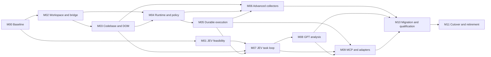

# Web Codebase Agent migration delivery plan

Status: **Planned — all implementation slices are pending.** Date: 2026-10-18.
Architecture and source baseline: [migration architecture](web-codebase-agent-migration.md).

This plan covers the complete internal migration while preserving the current UI structure. It does not authorize implementation, change current support claims, or mark existing issues resolved. M00's source inspection has begun as part of this design; its runtime baselines and all later work remain unexecuted.

## Detailed implementation Sprint mapping

The [detailed refactoring design](web-codebase-agent-refactoring.md),
[construction rules and limits](web-codebase-construction.md) and
[runtime contracts](web-codebase-runtime-contracts.md) expand these migration
slices into 12 **Planned** Sprints, 63 implementation cards and 72 verification
scenarios. The baseline for that refinement is clean HEAD
`8eb08e116cb90c8182d0ac449e6cabace68488cb`; the original inspection below remains
historical. No implementation or runtime qualification is completed by this
mapping.

| Sprint                                                  | Slice | Hard prerequisites | Scope                                                    |
| ------------------------------------------------------- | ----- | ------------------ | -------------------------------------------------------- |
| [S26](../sprints/s26-migration-baseline.md)             | M00   | None               | Migration baseline and preservation inventory            |
| [S27](../sprints/s27-jev-controller-contract.md)        | M01   | S26                | JEV controller protocol and feasibility                  |
| [S28](../sprints/s28-workspace-backend-bridge.md)       | M02   | S26                | Workspace, preserved UI seam and local backend bridge    |
| [S29](../sprints/s29-semantic-codebase-construction.md) | M03   | S28                | Semantic Codebase construction and repository            |
| [S30](../sprints/s30-shared-tool-policy-runtime.md)     | M04   | S28, S29           | Shared Tool Registry, policy and browser execution       |
| [S31](../sprints/s31-durable-task-recovery.md)          | M05   | S30                | Durable tasks, dispatch receipts and recovery            |
| [S32](../sprints/s32-advanced-browser-collectors.md)    | M06   | S29, S30, S31      | Advanced collectors and data coverage                    |
| [S33](../sprints/s33-jev-task-orchestration.md)         | M07   | S27, S29, S31      | JEV-owned Ask/Act and workflow orchestration             |
| [S34](../sprints/s34-gpt-evidence-analysis.md)          | M08   | S33                | GPT evidence analysis and provider-role migration        |
| [S35](../sprints/s35-mcp-external-adapters.md)          | M09   | S31, S33, S34      | MCP gateway and external integration adapters            |
| [S36](../sprints/s36-migration-qualification.md)        | M10   | S32, S34, S35      | Data conversion, UI continuity and release qualification |
| [S37](../sprints/s37-cutover-legacy-retirement.md)      | M11   | S36                | Production cutover and legacy runtime retirement         |

S29 can build deterministic graph structure before S27 live qualification;
JEV semantic annotations and S33 controller activation require S27. The
dependencies above govern complete Sprint exit, including the full high-level
MCP/analysis path in S35. Partial preparatory work does not satisfy those gates.

## 1. Delivery rules

- Keep one accountable owner per responsibility: browser facts in the extension repository, durable tasks in the backend, execution policy in the shared runtime with browser enforcement, and presentation in the existing UI.
- Each slice has a reviewable code/contract/test change, migration impact, positive and negative acceptance cases, and dated evidence. Keep changes bounded enough to review; do not combine directory relocation, behavior replacement and deletion without independent checks.
- Use the pinned `pnpm@9.15.4` until a separately recorded dependency upgrade is needed. Pin backend, MCP, Vite, Zod, database and provider dependencies during implementation; this plan does not assert current external API compatibility.
- Preserve existing worktree changes. Capture a new source baseline after the current diagnostics/provider work is committed or otherwise explicitly isolated.
- Do not replay production writes in shadow testing. Legacy and target runtimes may compare read-only observations, but every task has exactly one dispatch owner.
- Do not end the migration after DOM-only operation, a backend prototype, HTTP success, or a directory move. M11 requires all scoped collectors, roles, persistence, MCP, UI continuity, and supported-platform delivery gates.

## 2. Dependencies and phase mapping



Reference Phase 1 corresponds to M00–M02 and basic M03–M05 capability; Phase 2 to the complete M03 graph; Phase 3 to M07–M08; Phase 4 to M06/M09; Phase 5 to M10–M11. Security, binding and durability begin before autonomous execution rather than waiting until Phase 5.

These are dependency relationships, not calendar estimates or an instruction to run parallel agents. Estimate implementation duration only after M00/M01 establish baseline size and controller feasibility.

## 3. Implementation slices

### M00 — Freeze behavior, presentation and migration inventory

**Owner:** migration maintainer. **Depends on:** none. **Status:** Planned; static source inspection only is recorded in the architecture.

Deliverables:

- A committed baseline and manifest listing every source/config/script/test/assets directory, its target owner, and move/replace/import/retire disposition. Include all new working-tree files present at implementation start.
- Captured Side Panel, Options, profile manager, approval/value/consent dialogs, workflow preview and diagnostics screenshots/DOM/keyboard behavior in controlled Chrome at fixed viewport/font settings. Current screenshots were not captured for this design-only task.
- Baseline deterministic regressions and existing issue scope: target stale/no-op, navigation/goal distinction, capability parity, approval continuation, collection coverage/timeouts, provider decision handling, window ownership and trace correlation.
- Migration inventory of stored keys/schema versions, supported operating systems, release artifacts and external integration consumers. Run an import/dependency scan before retiring native/Studio/Business MCP paths.

Exit: every non-UI responsibility has a target owner; UI structure and allowable role/status wording changes are explicit; baseline failures are recorded separately from migration regressions. Preserve [issue history](../issues/README.md) and [Platform backlog C01–C09](../platform-alignment.md).

### M01 — Qualify JEV controller protocol and parameter binding

**Owner:** Task Engine / provider adapter maintainer. **Depends on:** M00.

Deliverables: versioned controller decision schemas, bounded candidate generation, parameter-source binding, decision budgets, processor routing and protocol qualification records. Begin with recorded/synthetic fixtures; perform a live JEV test before autonomous rollout.

Acceptance:

- JEV chooses intent, evidence sufficiency, next tool/plan fragment, recovery and result acceptance for all three reference scenarios. Candidates are freshly scoped, and selected arguments resolve from request/approved input/evidence references.
- Native `choice/score/noul` responses are validated against the exact question/candidate revision. Foreign choices, invented values, insufficient confidence, empty candidates and malformed output cannot dispatch.
- Search EQP001 completes its controller decisions without a GPT call. Complex analysis uses GPT only through an analysis request. Requests outside candidate/binding support produce clarification or unsupported coverage, never a hidden primary-model plan.
- Disabled/missing/unavailable JEV stops new agent admission or safely suspends a task. The existing `PRIMARY_LLM` fallback is absent from the target path.
- Live evidence identifies the JEV service/model/protocol and validates semantic decisions, not merely HTTP status. If the required controller behavior is unavailable, record a blocking feasibility result; do not declare the architecture implemented.

Exit: a feasible, measured controller protocol and explicit supported request envelope. Other preparatory work can proceed, but M07 cannot pass without this gate.

### M02 — Create workspace boundaries and local process bridge

**Owner:** platform/runtime maintainer. **Depends on:** M00.

Deliverables: target apps/packages, separate browser/Node exports, shared versioned contracts, extension presentation adapter, local Node daemon/native entry, authenticated IPC, capability handshake and a minimal installer.

Acceptance:

- Existing UI structure renders under its new app location; no React rewrite or new navigation surface. UI test fixtures exercise an adapter without requiring real model credentials.
- Native Messaging establishes an extension/profile-bound channel; two Chrome profiles cannot access each other's tasks, data or approvals. Unauthorized extension/client IDs, incompatible majors and oversized/replayed frames are rejected.
- Worker/Panel disconnect and reconnect preserve backend identity and return an ordered event cursor. The backend does not rely on a persistent UI document or an always-alive Worker.
- No external network listener is enabled by default. Missing backend/version mismatch has a truthful existing-UI status.
- Browser bundle contains no Node dependencies; backend bundle contains no direct Chrome calls. Boundary checks cover every package.

Exit: process separation works with mock task/read results and unchanged presentation structure. No claim of functional autonomous execution yet.

### M03 — Implement Semantic Codebase, DOM collection and storage

**Owner:** knowledge-plane maintainer. **Depends on:** M02.

Deliverables: all graph/evidence/dataset schemas, IndexedDB repository and migration metadata, builder, DOM discovery/deep inspection/deltas, typed repository port and backend projection format.

Acceptance:

- Site/route/page/frame/component/action/data/API/state/workflow records and edges validate; provenance and verification states survive round trips. Inferred facts never auto-promote to verified.
- SPA/structure changes invalidate affected dependents. Dynamic state refresh does not unnecessarily invalidate unrelated structure. Algorithm/schema version mismatches are explicit.
- Revisit reuses structural knowledge only after scope/fingerprint checks. Account/tenant changes cannot reuse personalized datasets or old grants. Reopened database state cannot revive live DOM refs.
- Transactions handle concurrent updates, interruption, quota/eviction, schema upgrade and corruption without silently losing the original store. Active evidence is pinned or the task gets a resource-limit result.
- Dataset versions retain counts, coverage, filters, units/timezone, row provenance, redaction and digest. `web.query` aggregation is deterministic and read-only.

Exit: inspectable versioned graph and correct DOM/read tool data, not merely serialized snapshots.

### M04 — Establish one Tool Runtime and policy boundary

**Owner:** execution/policy maintainer. **Depends on:** M02; complete graph-bound checks after M03.

Deliverables: registry contracts, availability/schema generation, shared validation/policy pipeline, browser binding/dispatch/verifier ports, approval UI projection, and basic web/control tools.

Acceptance:

- Every advertised tool has a registered executor and verifier appropriate to its effect. Negative capability checks remove it or return a typed unavailable result before dispatch.
- Ask rejects navigation/fill/click/business writes; Act evaluates actual effect, including autosave/submit-on-change. Sensitive input and arbitrary JS/API calls remain disabled.
- Exact proposal/argument/target/plan/policy binding is enforced before dispatch. User/policy approval sources remain distinct; model/MCP approval forgery and stale confirmation fail.
- No-op does not dispatch. Known destructive/bulk/external-transfer operations cannot skip task-specific explicit approval through Full mode.
- `web.invoke_action` works only for registered, effect-declared/verifiable actions; old dynamic-method grants cannot authorize it.
- Existing approval cards, value entry, source consent, Stop and error details work through the presentation adapter.

Exit: one approved dispatch path, with no parallel direct Worker/MCP/provider executor in the target runtime.

### M05 — Add durable task, dispatch and restart semantics

**Owner:** Task Engine / runtime maintainer. **Depends on:** M04.

Deliverables: SQLite task/event journal, browser dispatch ledger, leases, per-tab locks, cancellation generations, receipt reconciliation, status replay and bounded recovery.

Acceptance fault matrix:

| Interruption boundary                          | Required result                                                                                                          |
| ---------------------------------------------- | ------------------------------------------------------------------------------------------------------------------------ |
| Before dispatch reservation                    | Freshly revalidate before any resumed action.                                                                            |
| Backend intent recorded, browser not contacted | Reconcile binding and policy; dispatch only if the ledger proves no attempt and authority remains valid.                 |
| Browser reservation written, outcome unknown   | `UNKNOWN`; read-only reconciliation, no automatic redispatch.                                                            |
| Action observed, receipt acknowledgement lost  | Return/reconcile the same receipt and suppress duplicate dispatch.                                                       |
| Worker terminates during approval              | Recover pending view only; expire/revalidate bound authority before execution.                                           |
| Backend restarts during analysis               | Resume/retry bounded analysis with pinned datasets; no repeated browser mutation.                                        |
| Cancellation races dispatch                    | Browser cancellation generation wins before dispatch; if already dispatched, retain truthful effect/verification status. |
| Two clients write to one tab                   | One lease/lock owner; stale claimant rejected.                                                                           |

Exit: neither Service Worker lifetime nor MCP/UI connection lifetime is the task database. The design's at-most-once attempt guarantee is demonstrated, including ambiguous cases.

### M06 — Complete advanced browser observations

**Owner:** browser adapter maintainer. **Depends on:** M03, with M04 runtime enforcement.

Deliverables: bounded native AX/network observation, MAIN readers, visual chart assistance, navigation/state deltas, iframe/open-shadow adapters, and complete virtual-grid/table/chart tools.

Acceptance:

- DOM and native AX provenance remain distinguishable. CDP attach conflicts, denied permissions and cleanup failure produce scoped unavailable/quarantine outcomes.
- Captured Fetch/XHR observations are scrubbed before storage; observed endpoints cannot be replayed by the tool catalog. Hidden/unobserved APIs are never invented.
- Frame/document/route boundaries survive navigations. Cross-origin access requires relevant permissions; inaccessible frames and closed shadow roots report explicit coverage gaps.
- Virtualized/paginated datasets deduplicate, preserve totals/filters, expose per-unit deadline/progress, and restore scroll where possible. Partial results cannot satisfy full-coverage goals.
- Charts prefer source data; screenshot/OCR-derived observations are labeled inferred and obey disclosure consent. Page getters/scripts cannot escalate a bounded MAIN read into arbitrary execution.

Exit: every collector in reference section 04 has a qualified capability or a precisely defined browser-access limitation tested in its adapter. This slice is mandatory for full migration.

### M07 — Replace Ask/Act orchestration with the JEV task loop

**Owner:** Task Engine maintainer. **Depends on:** M01, M03, M05.

Deliverables: complete reference phases plus suspend/input/cancel states, plan revisions, scoped schema selection, repeat detection, budgets, evidence-based recovery, and final goal acceptance.

Acceptance:

- Both existing Ask and Act UI controls admit tasks to the backend; old Worker runners are no longer used for target-runtime requests.
- Search and multi-step/multi-page tasks are selected by JEV and dispatched only by the Tool Runtime. Multi-tab operations retain owner/window/profile binding.
- Invalid or low-confidence decisions cannot become approval or success. Completion requires explicit independent verifier/evidence checks; already-verified actions do not repeat when a later goal observation changes.
- Route changes, changed tool availability, provider failure, budget exhaustion and settings changes yield bounded replan/suspension/termination with first-failure evidence.
- UI status/event ordering survives reconnect; no duplicate final answer, approval card, or mutation. The current single/optional-JEV semantics are not retained as a second controller mode.

Exit: autonomous JEV control is demonstrated over controlled fixtures and qualified live JEV requests.

### M08 — Add evidence-based GPT analysis

**Owner:** analysis-plane maintainer. **Depends on:** M07.

Deliverables: backend GPT Responses adapter, `analysis.run`, versioned request/result/additional-data schemas, dataset egress filtering, evidence resolver and result acceptance.

Acceptance:

- Inputs resolve only authorized immutable datasets. GPT receives no browser tool schemas, approval tokens or live locators.
- Counts/aggregations come from deterministic query results. Findings have valid supporting evidence; unsupported claims and cross-partition references fail acceptance.
- Extra-data requests return to JEV. Analyst failure never becomes controller fallback or browser replay. Expired/deleted evidence is not silently replaced with another dataset.
- Basic search has zero GPT calls. Complex comparison/reporting calls GPT only after necessary data verification and explicit disclosure authorization.
- Streaming/progress and accepted final results use the existing UI. Live Responses tests record actual model/config versions and semantic output validity.

Exit: the control/analysis split is enforced by contracts, dependencies and runtime tests.

### M09 — Add MCP gateway and migrate external adapters

**Owner:** integration maintainer. **Depends on:** M05; high-level acceptance additionally requires M07/M08.

Deliverables: stdio MCP entrypoint, `agent.execute_request` plus status/cancel, scoped low-level exposure, client/profile pairing, and migrated signed-profile/workflow/Business MCP/PDP/audit/Studio adapters.

Acceptance:

- Real Codex CLI and Claude Code sessions can discover and call the gateway, continue after tool results, observe task status and cancel. A JSON response from a mock server alone does not pass.
- High-level tasks identify JEV as controller; configured low-level tasks identify the external agent. Both use identical runtime/approval/binding checks.
- UI approval remains required when policy demands it. No connected Panel means pending approval or timeout, never implied consent.
- Unauthorized clients cannot list unrelated tabs/data, replay receipts or mint approval. Long jobs remain durable across MCP disconnect.
- Old outbound Business MCP transport is identified accurately and does not masquerade as standards-compatible inbound MCP. Imported profiles retain original signature/replay semantics; incompatible contracts are explicit failures.
- Consumer inventory accounts for every old native/Studio/external route. Cross-repository contracts remain versioned adapters/backlog until their owners provide actual integration evidence.

Exit: external agents use the new shared system; integration consumers have a migration disposition, with external qualifications reported separately.

### M10 — Migrate data, qualify UI, metrics and release artifacts

**Owner:** migration/release maintainer. **Depends on:** M06, M08, M09.

Deliverables: idempotent data converters, staging/commit journal, rollback tooling, version compatibility manifest, backend/extension/MCP installers, test/eval corpus, release evidence and updated installation/test/source guides.

Acceptance:

- Exercise clean install, legacy v1/v2 upgrade, corrupt/unsupported records, interrupted migration, quota failure, re-run, disabled providers and blank-secret preservation. Counts/digests match or quarantined records are explicitly reported.
- No old pending approval/ref/MAIN handle becomes executable. Legacy in-flight requests retain real dispatch uncertainty rather than becoming resumable target tasks.
- Freeze visual structure and interaction regressions against M00: Side Panel/Options/profile manager/dialogs, focus/keyboard, tab/window ownership, workflow preview, and diagnostic export. Expected wording changes match the architecture's UI table.
- Exercise Linux, Windows and macOS native registration, IPC, permission/credential storage, restart, upgrade, repair and uninstall separately. If an OS is not in the selected supported release set, mark it explicitly unqualified; do not claim full cross-platform delivery for it.
- Backend unavailability, incompatible versions and permission denial render truthful errors in the existing UI. Host registration and extension identity survive supported updates.
- All metric gates and privacy/approval negatives below pass. Final source/contract/test revision and artifact digests are recorded together.

Exit: a concrete release candidate passes defined coverage. Cutover is still pending; preparation alone is not publication or deployment.

### M11 — Cut over and remove legacy internal architecture

**Owner:** product/release maintainer. **Depends on:** M10.

Deliverables: new-task admission switch, drained legacy runtime, committed migration markers, removal of legacy executors/stores/provider loops/temporary flags, updated source navigation and verified installed release.

Completion checklist:

- Production code has one Task Engine, one Tool Registry/Runtime and one policy path. No `PRIMARY_LLM` controller fallback, direct old `CHAT_SEND` bypass, legacy `START_ACT` executor, learned-command executor or separate workflow execution loop survives.
- Worker contains browser admission/transport/lifecycle/enforcement only. Offscreen provider-fetch orchestration and .NET placeholder host are retired; temporary move/re-export shims and runtime selectors are removed.
- Old mutable storage writers are disabled after verified conversion. Original backups remain bounded recovery data, not a second source of execution authority.
- A complete rollback drill restores the compatible prior release set and original namespace without repeating a side effect or promoting new data into old grants.
- All target app/package imports, schemas, tests, source-size/module-boundary checks, artifact validation, installers and source links pass at the final revision.
- The existing UI structure remains, all non-UI areas in the architecture mapping have a completed disposition, and M01–M10 evidence is current for the released set.
- Installation/upgrade and actual registry/release/artifact delivery are verified separately from build/tag creation. Cross-repository/OS/live-site exclusions remain explicit.

Exit: migration complete for the declared supported release scope. Until then report individual slice status and remaining work, not complete migration.

## 4. Quality metrics and evaluation definitions

These are the reference's initial targets, **not measured results**. Freeze a versioned holdout corpus before tuning; record fixture/live partitions, page types, modes, model versions, budgets, sample counts, confidence intervals, all first attempts and failures. Repeated attempts must not inflate the denominator or hide initial failure. Controller feasibility and release quality are separate gates.

| Metric                            | Required target | Measurement                                                                                                                                                                                                                           |
| --------------------------------- | --------------- | ------------------------------------------------------------------------------------------------------------------------------------------------------------------------------------------------------------------------------------- |
| DOM/AX action detection           | ≥95%            | Precision and recall each ≥95% against labeled observable/actionable controls; include hidden/disabled/ambiguous/sensitive negatives. Report DOM and native AX separately.                                                            |
| Verified locator execution        | ≥98%            | Correct postcondition on first attempted dispatch / eligible verified-locator tasks; ambiguous, stale and incorrect-target attempts count as failures. Never equate dispatched with successful.                                       |
| General Ask success               | ≥95%            | Correct grounded answer with honest coverage / all eligible holdout Ask tasks. No-data, partial data and forbidden-mutation cases have explicit expected outcomes.                                                                    |
| Complex Action success            | ≥90%            | All required goal predicates satisfied with valid approvals/evidence / eligible multi-step holdout tasks. HTTP success or final model prose does not count.                                                                           |
| Unnecessary rediscovery reduction | ≥70%            | `1 - target unnecessary full discoveries / baseline unnecessary full discoveries` on identical unchanged-page revisits. Required rediscovery after real changes is excluded; a zero baseline is reported as not applicable, not PASS. |
| Risk approval bypass              | 0               | Zero unauthorized side effects across policy/role/IPC/stale-binding/crash/adversarial tests. A single bypass blocks release regardless of aggregate success.                                                                          |
| GPT evidence reference rate       | 100%            | Every factual finding requiring support resolves to authorized evidence that supports it. Report reference resolution and factual support separately; a syntactically valid citation is insufficient.                                 |

The M00 corpus must include normal and virtual tables, charts, SPA routes, iframe/open-shadow boundaries, changed DOM, duplicate controls, backend restarts and model failures. As a minimum release evaluation, use 100 independent Ask tasks and 100 independent multi-step Action tasks, with an explicitly labeled live subset; report small per-adapter samples rather than implying statistical certainty. No test count substitutes for missing capability coverage.

Additional controller evaluations: `evidence_sufficient`, `processor`, `next_tool`, and `result_acceptance`. Record confusion matrices, abstention rates, unnecessary analysis calls, false completion, decision latency and token/call cost. Include safe clarification/unsupported outcomes with predefined expected labels; do not relabel failed supported tasks as unsupported after execution.

## 5. Regression and evidence matrix

| Layer                | Required checks                                                                                                           | Existing source to preserve/rebind                                                                                                                                     |
| -------------------- | ------------------------------------------------------------------------------------------------------------------------- | ---------------------------------------------------------------------------------------------------------------------------------------------------------------------- |
| Package contracts    | Strict TS, JSON Schema/Zod parity, closed envelopes, versions, no cycles/forbidden imports, source-size rules             | [Current boundary checker](../../scripts/check-module-boundaries.mjs), [contracts](../../extension/src/contracts)                                                      |
| Controller/roles     | No GPT controller path, no invalid JEV choice, config revision cancellation, first-failure preservation                   | [Provider unit tests](../../extension/tests/unit/providers), especially S25 contracts/routing/gates                                                                    |
| Policy/execution     | Ask/Act distinction, stale/denied approval, no-op, unique target, value provenance, unknown dispatch, goal verification   | [Action tests](../../extension/tests/unit/actions), [policy tests](../../extension/tests/unit/policy), [Worker regressions](../../extension/tests/unit/service-worker) |
| Knowledge/data       | Partitioning, delta invalidation, migration/idempotency, completeness, deterministic query and evidence digest            | [Learned-profile tests](../../extension/tests/unit/learned-profile), collection/analysis/page-API regressions                                                          |
| Browser runtime      | Actual Side Panel → controller → approval → DOM/MAIN/CDP → verifier → final UI, plus restart/route/frame tests            | [Chrome test guide](../test.md), existing S16–S25 and issue-specific drivers                                                                                           |
| Integration          | Native host/IPC authentication, profile boundaries, real MCP client schema/call/result continuation                       | [Native host test](../../scripts/native-host-smoke.mjs), Business MCP tests as legacy adapter regressions                                                              |
| Presentation         | Fixed-viewport visual structure, focus order, provider forms, profile manager, Stop, reconnect, window ownership          | [UI unit tests](../../extension/tests/unit/sidepanel), [Options smoke](../../scripts/chrome-options-ux-smoke.mjs)                                                      |
| Privacy/diagnostics  | No secret leakage in graph/LLM/MCP/export; task/decision/tool/dispatch correlation; release policy                        | Existing development-diagnostics and provider-call-correlation issue/test records                                                                                      |
| Installation/release | Clean install/upgrade/repair/uninstall, protocol skew, missing backend, bundle contents, no version drift in verification | [Package scripts](../../package.json), [compatibility record](../../deployment/compatibility.example.json)                                                             |

During implementation, run relevant package and regression tests for each slice; add Chrome/IPC/live verification when a slice crosses those boundaries. At release, run the combined target checks and the required supported-platform/client matrix. No current tests were run for this design-only delivery.

For baseline verification without a version bump, the current repository command is:

```sh
pnpm exec tsc -p tsconfig.build.json
node scripts/build-extension.mjs
node scripts/validate-package.mjs
```

This still writes generated artifacts and is **not run during design-only work**. `pnpm build` and `pnpm test` also change the current extension version. M02/M10 will define corresponding version-preserving commands for all target apps without silently changing release versions.

Evidence records must contain source revision plus any dirty-tree caveat, fixture/real-site scope, OS/Chrome/backend/provider/MCP client versions, commands, first failure and recovery, tool sequence, approval facts, dispatch count, verifier receipts, coverage and final UI result. Historical tests, controlled fixtures, live providers, actual sites and deployed installations are separate qualification scopes.

## 6. Decision and risk register

| Risk / unresolved external fact                                                  | Selected design or resolution gate                                                                                                                 |
| -------------------------------------------------------------------------------- | -------------------------------------------------------------------------------------------------------------------------------------------------- |
| Existing JEV is a finite-decision service                                        | Use repeated candidate decisions and source-bound arguments; M01 must qualify the supported envelope. Do not assume arbitrary JEV tool generation. |
| Existing UI calls JEV optional and primary a general model                       | Preserve layout; update roles/help and disable legacy fallback semantics through existing controls. Explicitly test migrated disabled settings.    |
| Backend introduces an installation dependency                                    | Native Messaging/IPC installer is required, with missing-host status and repair instructions; no silent browser-only legacy fallback.              |
| IndexedDB and SQLite could become competing state stores                         | Browser facts remain authoritative in IndexedDB; SQLite owns tasks and digest-bound projections. Test reconciliation and deletion propagation.     |
| Crash windows cannot prove exactly-once business effects                         | Persist reservations/receipts and use at-most-once dispatch attempts; ambiguous cases remain UNKNOWN with read-only recovery.                      |
| Legacy Full mode and dynamic methods conflict with the reference's risk defaults | Apply hard risk floor and default-disable arbitrary invocation; migrate supported registered actions through one runtime.                          |
| Vite migration can break MAIN serialization/CSP/tracing                          | Keep UI implementation, qualify new bundle behavior and existing instrumentation regressions before cutover.                                       |
| External consumers or Platform versions are unknown                              | Inventory consumers and retain versioned import adapters; preserve dated C01–C09 backlog. Actual external compatibility needs separate evidence.   |
| Provider/API/dependency versions may change                                      | Pin and verify official contracts during implementation; no live compatibility claim is made by this local-source design.                          |
| Original HTML is outside the repository                                          | Preserve its title/date/hash and full section-to-work coverage in the architecture. Recheck the hash if the reference is replaced.                 |

No user answer is required to complete this design. The feasibility and integration gates are future implementation acceptance work; they must not be converted into unverified assumptions or hidden fallback paths.
