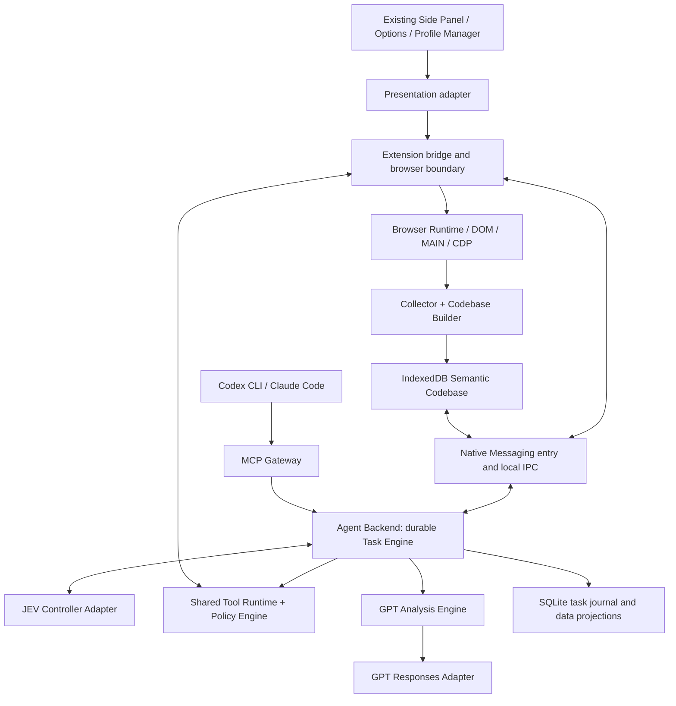

# Web Codebase Agent migration architecture

Status: **Proposed — design only; implementation is not authorized by this document.**
Date: 2026-10-18. Delivery sequence: [migration plan](web-codebase-agent-migration-plan.md).

Detailed implementation planning: [refactoring seams](web-codebase-agent-refactoring.md),
[Codebase generation and resource limits](web-codebase-construction.md),
[runtime contracts](web-codebase-runtime-contracts.md), and
[Planned S26–S37](../sprints/README.md#web-codebase-agent-migration-s26-s37).
These detail the pending architecture; they do not change current behavior.

## 1. Scope and baseline

Replace the current internal architecture with the Web Codebase Agent architecture. Preserve the current UI structure. This is a complete migration of ownership, contracts, persistence, execution, providers, integration, tests, and delivery; relocating the existing Worker orchestration into packages is insufficient.

The requested reference is `/home/heungtae/Downloads/web_codebase_agent_architecture.html`, titled **Web Codebase Agent — Chrome Extension Architecture**, proposal v1.0, dated 2026-10-18. Its SHA-256 is `2e049dd5fee625934691ec7f3a4bcc5acedd31f7ab8da342a976a68c4684d4cf`. Section numbers below refer to that file. The requirements matrix makes this plan readable without access to the local Downloads directory.

The implementation baseline was inspected on branch `master`, HEAD `9d30fa88989b427acd6382b8e518d5f417f44ea2`, with package/manifest version `0.1.117`. **The working tree contains pre-existing uncommitted changes**, including diagnostics and provider-call correlation. Source findings describe that inspected working tree, not HEAD alone. Implementation must capture its eventual committed baseline again before migration.

Only this design, its delivery plan, and a documentation navigation link are changed for this task. Source, tests, schemas, manifest, dependencies, build configuration, generated output, and the reference HTML remain unchanged. No build, runtime test, provider request, installation, or deployment is part of this design exercise.

Current behavior remains defined by [source and contracts](../source-guide.md). This document defines pending changes and acceptance conditions. After implementation, retain decisions and migration history, and replace duplicated behavioral descriptions with source links.

## 2. Architectural decisions

| ID  | Decision                                                                                                                                                                                                                                          |
| --- | ------------------------------------------------------------------------------------------------------------------------------------------------------------------------------------------------------------------------------------------------- |
| D01 | JEV owns intent, discovery decisions, planning, next-tool selection, recovery, analysis delegation, result acceptance, and completion proposals. GPT cannot inherit controller authority.                                                         |
| D02 | GPT is an analysis service behind `analysis.run`: evidence-based explanation, comparison, interpretation, and reporting. It receives no browser tools, approval tokens, or executable page references.                                            |
| D03 | The extension is the browser execution and observation boundary. A local Node.js/TypeScript Agent Backend owns durable tasks and model calls. A separate MCP process exposes the same runtime through authenticated local IPC.                    |
| D04 | A versioned Semantic Codebase, not a request-local snapshot or a learned recipe catalog, is the central knowledge model. IndexedDB is its canonical browser repository; SQLite stores backend task history and explicitly identified projections. |
| D05 | A model-independent Tool Runtime validates schemas, binds targets, applies policy, dispatches, and verifies. JEV and MCP proposals cannot bypass it. Browser-side enforcement remains mandatory.                                                  |
| D06 | Preserve Side Panel, Options, dialogs, profile management window, CSS/layout, navigation, and interaction structure. Replace their runtime clients and view models behind a presentation adapter. Do not introduce React or redesign the UI.      |
| D07 | Move non-UI responsibilities into the target apps/packages. Reuse tested algorithms only after adapting them to the new contracts and ownership. Remove old orchestration and compatibility execution routes at final cutover.                    |
| D08 | Start with local Native Messaging transport and a per-user backend. The backend is required for the migrated runtime. No hidden cloud backend or extension-only primary-LLM fallback is allowed.                                                  |
| D09 | Implement every reference capability, including advanced collectors and external MCP, before declaring the full migration complete. A phase milestone is not completion of the whole migration.                                                   |
| D10 | Preserve explicit denial, Ask/Act separation, fresh binding, consent, and ambiguous-dispatch handling. Cached knowledge and model confidence never create execution authority.                                                                    |

The reference recommends React/Vite, while the explicit user exception preserves the current UI. Keep the existing TypeScript/HTML presentation implementation; adopt Vite for the future extension build without changing that presentation architecture. Its extension entrypoints, MAIN-world helper handling, CSP, and method instrumentation require independent qualification. The backend and MCP remain Node.js/TypeScript. JSON Schema and Zod validate shared contracts; Vitest, Playwright, E2E, and Agent Eval cover the target system.

## 3. Reference coverage

| Reference section       | Required migration                                                                   | Design owner      | Delivery slice     |
| ----------------------- | ------------------------------------------------------------------------------------ | ----------------- | ------------------ |
| 01 Vision               | JEV controller, GPT analyst, independently enforced runtime, observe after execution | Sections 6–9      | M01, M04, M07, M08 |
| 02 Web Codebase         | Site/route/component/action/data/API/state/workflow graph, observed facts only       | Section 7         | M03                |
| 03 Components/processes | Collector, builder, repository, backend, runtime, analysis, gateway; keep UI         | Sections 5–6      | M02–M09            |
| 04 Collector            | DOM, AX, MAIN, network, visual, navigation, state; three collection levels           | Section 7         | M03, M06           |
| 05 Semantic model       | Versioned entities/edges, provenance, confidence, verification, fingerprints         | Section 7         | M03                |
| 06 Tool catalog         | All 20 catalog tools, narrow schemas, shared execution pipeline                      | Section 8         | M04, M06, M08      |
| 07 JEV                  | Full phase loop with separate proposed/approved/executed facts                       | Section 9         | M01, M07           |
| 08 GPT                  | `dataRefs`, criteria, output schema, findings and evidence validation                | Section 10        | M08                |
| 09 Scenarios            | Ask aggregation, search action, complex alarm analysis                               | Section 14        | M07–M10            |
| 10 MCP                  | Codex/Claude entrypoints, high-level JEV route and scoped low-level tools            | Section 11        | M09                |
| 11 Security             | Risk policy, disclosure filtering, postconditions, bounded repair                    | Sections 6, 8, 12 | M04–M10            |
| 12 Stack/repository     | Three apps, shared packages, tests, operational documentation                        | Section 5         | M02, M10           |
| 13 Roadmap              | Core → Codebase → autonomous controller → advanced/MCP → hardening                   | Delivery plan     | M00–M11            |
| 14 Metrics              | Defined datasets and denominators for all seven targets plus decision evals          | Delivery plan     | M10                |
| 15 Planes               | Control, analysis, execution, knowledge, integration have separate ownership         | Sections 5–11     | All                |

## 4. Current implementation and disposition

### 4.1 Material gaps verified in source

- [Worker composition](../../extension/src/service-worker/runtime-chat.ts) assembles Ask, Act, proposals, page-method execution, and model binding. [Runtime lifecycle](../../extension/src/service-worker/runtime-lifecycle.ts) creates the provider runtime and request lifecycle in the extension. There is no target Agent Backend in the inspected workspace.
- [JEV questions](../../extension/src/providers/decision-questions.ts) explicitly delegate new wording, plans, arguments, investigation, and extended reasoning to `PRIMARY_LLM`. [The coordinator](../../extension/src/providers/decision-coordinator.ts) returns control to the primary path on insufficiency or configured failure. This does not implement the reference's JEV controller.
- [JEV response contracts](../../extension/src/providers/jev-types.ts) support `choice`, `score`, and `noul`, not an arbitrary tool-call/plan payload. A new controller adapter must be qualified; changing a role label cannot supply this capability.
- [Request restore](../../extension/src/service-worker/request-store.ts) converts unfinished work to terminal `WORKER_RESTARTED`, using `UNKNOWN` when dispatch started. [Persistence](../../extension/src/service-worker/request-persistence.ts) stores bounded request summaries, not a durable resumable task journal.
- [Semantic collection](../../extension/src/content/semantic-collector.ts) produces a DOM/ARIA projection and document-bound refs. [Learned profiles](../../extension/src/learned-profile/types.ts) store advisory successful recipes. Neither is the required graph/repository with observed API and state-transition history.
- [Bounded CDP](../../extension/src/cdp/bounded-adapter.ts) validates an input-command allowlist and currently requires frame 0. It is not a general AX/network/frame collector. The inspected [manifest](../../extension/manifest.json) lacks Native Messaging and webNavigation declarations.
- [Business MCP](../../extension/src/profile/business-mcp-client.ts) is an outbound, profile-bound HTTPS JSON client. It is not an inbound MCP server for Codex/Claude. The existing [.NET host](../../native-host/Program.cs) returns `AI_HUB_NOT_CONFIGURED`; it is not the proposed backend.
- [Build configuration](../../package.json) uses TypeScript and esbuild; [workspace configuration](../../pnpm-workspace.yaml) only lists `extension`. The target app/package topology and backend installation do not exist yet.

### 4.2 Exhaustive responsibility mapping

This table covers every current top-level `extension/src` area. The target paths are planned, not existing links. File-level move manifests are created in M00 so subsequently added files cannot escape migration.

| Current area                                             | Final destination / disposition                                                                                                                                                                                                                        |
| -------------------------------------------------------- | ------------------------------------------------------------------------------------------------------------------------------------------------------------------------------------------------------------------------------------------------------ |
| `sidepanel/` presentation                                | Preserve under `apps/chrome-extension/src/sidepanel/`; replace runtime/event adaptation behind the existing views.                                                                                                                                     |
| `settings/` presentation and profile manager             | Preserve HTML/CSS, layout and forms under the extension app; move provider storage, validation, routing, and policy services out of the UI directory.                                                                                                  |
| `service-worker/`                                        | Retain a small browser composition root, trusted UI message adapter, native bridge, Chrome events and browser enforcement. Replace Ask/Act loops, model decisions, plan stores and execution orchestration with backend task-engine/runtime ownership. |
| `content/`                                               | Extension entrypoint plus `collector` and `browser-runtime` browser-safe modules. Fresh DOM mappings remain in the document process.                                                                                                                   |
| `contracts/`                                             | Split into `codebase-schema`, `shared` task/bridge contracts, and `tool-registry` schemas. UI compatibility contracts are confined to the extension adapter.                                                                                           |
| `providers/`                                             | `provider-adapters` hosted by the backend; JEV controller and GPT Responses adapters with separate input/output authority. Remove Worker/offscreen model orchestration.                                                                                |
| `page-act-harness/`                                      | Move evidence, binding, budgets, acceptance and approval responsibilities to `task-engine`, `tool-runtime`, and `policy-engine`. Remove the old parallel harness loop.                                                                                 |
| `page-api/`                                              | Registered, effect-declared adapters in `browser-runtime`; discovered candidates enter `codebase-builder` as observations, never automatic callable endpoints.                                                                                         |
| `cdp/`                                                   | A bounded CDP broker in `browser-runtime`, shared by input, AX/network observation, and capture; explicit attach ownership and cleanup.                                                                                                                |
| `policy/`                                                | Pure evaluation/contracts in `policy-engine`; backend proposal evaluation and browser-side final enforcement use the same versioned rules.                                                                                                             |
| `security/`                                              | Boundary validation, canonicalization, redaction, origin checks, deadlines and audit primitives in `shared`, `policy-engine`, and `diagnostics`; no ambient privileged singleton.                                                                      |
| `state/`                                                 | Task and dispatch journals move to backend SQLite; UI session projections remain extension-local; fresh value/target bindings stay ephemeral in browser execution.                                                                                     |
| `learned-profile/`                                       | Import recipes as advisory `Workflow` knowledge in the Codebase; keep management window operations through an adapter. Retire the separate learned-command execution path.                                                                             |
| `profile/`                                               | Versioned external import/resolver adapters in `integration-adapters`; signed profile envelopes are verified before any projection into graph knowledge.                                                                                               |
| `studio/`                                                | Validation/semantic-impact import adapters; workflow recording and preview produce advisory draft graph/workflow records, never an alternate executor.                                                                                                 |
| `native/`                                                | Replace protocol/client with the new versioned bridge. Old AI Hub request kinds are retired after consumer inventory and migration.                                                                                                                    |
| `offscreen/`                                             | Retire provider-fetch code. Keep an offscreen document only for a demonstrated browser-only need; it owns no task loop or model session.                                                                                                               |
| `diagnostics/`                                           | Cross-process structured tracing in `diagnostics`, with the current UI export surface. Preserve call/result correlation through the bridge.                                                                                                            |
| `deployment/`                                            | Version/capability compatibility checks shared by extension, backend, MCP, package validation and installers.                                                                                                                                          |
| `native-host/`                                           | Replace the .NET placeholder with the Node backend's Native Messaging entry/launcher; update native host tests, packaging and uninstall.                                                                                                               |
| `extension/assets`, manifest, managed schema             | Move with the app; retain branding/UI assets. Update permission and package paths during implementation, with permission-diff tests.                                                                                                                   |
| Root build/test scripts, config, dependencies            | Migrate to pnpm workspace app/package commands and Vite extension packaging; retain command compatibility only until M11.                                                                                                                              |
| `extension/tests`, examples and Chrome scripts           | Move reusable regressions into package tests and shared fixtures; rebind Chrome drivers to new artifacts. Preserve original issue IDs/evidence.                                                                                                        |
| `deployment/`, installation/release scripts              | Ship and validate extension + backend + MCP + native-host registration as a compatible release set.                                                                                                                                                    |
| README, guides, evidence, sprints, website documentation | Update source/install/test navigation at cutover; keep dated evidence historical. Do not rewrite old PASS results as target evidence.                                                                                                                  |

Preserving a UI directory does **not** preserve business logic accidentally located there. No non-UI module is exempt from the new boundaries. Reused code is accepted by behavior and boundary tests, not by its old module name.

## 5. Target repository and dependency rules

Use this repository as the product workspace. Do not create a second implementation in `ewap-workspace` or silently edit Platform contracts.

```text
apps/
  chrome-extension/          # existing UI + browser entrypoints + UI/bridge adapter
  agent-server/              # local daemon, native entry/launcher, composition, SQLite
  mcp-server/                # MCP stdio entrypoint and client-scope enforcement
packages/
  browser-runtime/           # Chrome adapters, binding, dispatch, observation
  collector/                 # discovery, deep inspection, incremental collectors
  codebase-builder/          # normalization, entities/edges, invalidation
  codebase-schema/           # versioned graph, evidence, dataset contracts
  codebase-repository/       # IndexedDB authority and repository ports/projections
  tool-registry/             # JSON Schemas, effects, availability, schema selection
  tool-runtime/              # execution pipeline and dispatch receipt coordination
  task-engine/               # durable phases, JEV loop, budgets, recovery
  shared/                    # small platform-neutral contracts and primitives
  policy-engine/             # risk, consent, approval and scope evaluation
  provider-adapters/         # JEV native protocol and GPT Responses transport
  analysis-engine/           # dataset resolution, analysis, evidence acceptance
  integration-adapters/      # signed profiles, workflows, Business MCP, audit ports
  diagnostics/               # sanitized cross-process events and exports
tests/
  fixtures/
  integration/
  agent-evals/
  e2e/
docs/
  architecture/
  adr/
  tool-contracts/
  validation/
```

The first nine packages and three apps follow reference section 12. The additional packages isolate policy, providers, analysis, legacy external integrations, and observability rather than recreating a large shared module.

Dependency constraints:

1. UI imports presentation contracts and its client only. It cannot import provider transports, dispatch, policy grants, or backend database code.
2. Task Engine depends on repository/runtime/analysis/provider ports. It never imports Chrome APIs or UI modules. GPT Analysis Engine has no Browser Runtime dependency.
3. Tool Runtime depends on schemas, policy and execution ports. Browser Runtime implements those ports inside the extension. Chrome-only modules and Node-only modules have separate exports and builds.
4. Builder consumes normalized observations; Repository persists validated records. Neither invokes a model or dispatches browser actions.
5. MCP calls Agent Backend APIs; it cannot import a browser dispatcher or connect directly to arbitrary content scripts.
6. Composition roots connect implementations. Package boundaries prohibit reverse imports, cycles and bypass entrypoints. New source modules follow the 199-line rule.



## 6. Processes, transport and UI preservation

### 6.1 Runtime ownership

| Owner                 | Durable state                                                                                                                         | Ephemeral state                                                          | Forbidden responsibility                                |
| --------------------- | ------------------------------------------------------------------------------------------------------------------------------------- | ------------------------------------------------------------------------ | ------------------------------------------------------- |
| Content/frame process | None                                                                                                                                  | DOM refs, frame/document bindings, read cursors, MAIN invocation handles | Model calls, approvals, task ownership                  |
| Extension repository  | IndexedDB graph/evidence/datasets, migration manifest, browser dispatch ledger; small preferences in trusted Chrome storage           | UI connection, current tab/window, grants requiring a live binding       | Long-running controller loop                            |
| Agent Backend         | SQLite tasks, ordered events, step/attempt journal, approval records, accepted analysis, versioned redacted graph/dataset projections | Model streams, cancellation controllers, authenticated IPC sessions      | Direct website cookie access or arbitrary Chrome access |
| MCP Gateway           | Client configuration/registration only                                                                                                | MCP request/session correlation                                          | A second task database or private executor              |

The IndexedDB graph is the authority for observed browser facts. Backend copies carry source repository ID, partition, revision and digest and are read-only projections. Backend task journal is the authority for task progress. The browser dispatch ledger is the authority for whether a particular bound dispatch was accepted locally. Reconciliation compares these authorities; it does not overwrite one with an optimistic copy.

### 6.2 Local bridge

The extension connects to a registered Native Messaging host included with `agent-server`. A small Node entrypoint handles Chrome's framed stdio and talks to a per-user, per-browser-profile backend daemon over a Unix socket or Windows named pipe. MCP uses the same authenticated local IPC. The daemon survives a UI or Worker connection loss; tasks requiring the browser wait for a new validated connection. A disconnected backend does not dispatch through cached page handles.

The installer registers allowed extension origins, an absolute host executable, per-user IPC access, backend startup and a profile pairing identity. The extension package gains `nativeMessaging`. An unpacked development ID and a release ID require separately tested host registrations. Local installation/repair commands provide backend setup; the existing Settings status/output and connection-test surfaces display readiness. No new product dashboard is introduced.

Bridge envelopes carry protocol version, sender role, paired installation/profile identity, browser connection epoch, task ID, message ID, monotonically ordered event sequence, deadline and cancellation generation. Mutation messages additionally carry a dispatch ID, task/plan revision, target binding digest, argument digest, policy revision, approval reference and expiry. Reject unknown fields, incompatible protocol major versions, replayed sequence numbers, oversized frames, and mismatched identities.

Native host registration and OS permissions establish the initial local boundary; a connection handshake binds per-session credentials to that identity. Do not accept credentials or a browser profile ID supplied by a web page. Chunk large dataset transfers with size/digest checks, ACK/backpressure and cancellation. A capability handshake advertises supported tools/adapters and schemas; a compatible version number alone is insufficient.

Provider configurations are managed through the existing forms, stored by a backend settings service, and referenced by immutable revision during a task. Secrets use an OS credential store where available; an installation without a durable secret store can use explicitly session-only credentials. Never silently write plaintext secrets into SQLite or send them back in public settings/export responses. Blank secret writes retain the prior secret only within the same validated provider identity/boundary.

### 6.3 Preserved UI contract

Preserve [Side Panel structure](../../extension/src/sidepanel/index.html), [Options entry](../../extension/src/settings/index.html), provider management/editor forms, approval dialogs, workflow recording/preview, the separate [profile manager](../../extension/src/settings/learned-profiles.html), and diagnostic download interaction. Keep DOM structure, spacing, styles, keyboard behavior, focus order, window/tab ownership and existing user workflows. UI rendering is not migrated to React.

The preservation boundary is **presentation structure**, not old orchestration semantics. Transport clients, event reducers, data bindings, status text, provider role labels and help text must accurately describe the target architecture. These are the required semantic adjustments within existing controls:

| Existing surface                          | Target meaning without structural redesign                                                                                                                                     |
| ----------------------------------------- | ------------------------------------------------------------------------------------------------------------------------------------------------------------------------------ |
| Ask / Act controls                        | Same modes. Ask admits read/analysis operations only; Act additionally admits policy-controlled page changes.                                                                  |
| Primary provider editor/select            | GPT Analyst configuration; validate Responses capability before analysis. Preserve incompatible provider records for export/repair, not automatic activation.                  |
| Decision provider editor/select           | JEV Controller configuration. Remove claims that JEV is optional for migrated autonomous tasks.                                                                                |
| JEV enable checkbox                       | Enables the JEV task controller. Off means new agent tasks are unavailable, not that GPT becomes controller. Existing history/settings remain usable.                          |
| JEV failure select                        | Stop or bounded controller retry. Retire the `primary` continuation choice; imported `primary` maps to safe stop and shows a migration notice in the existing status output.   |
| Full/custom approval controls             | Convenience choices remain subject to non-overridable task-specific approval for destructive/bulk/external-transfer operations. Existing labels/help must disclose that floor. |
| Approval/value/source-consent dialogs     | Render new bound proposals and disclosure requests using the same card/modal structure. Only trusted UI response handlers mint approval facts.                                 |
| Profile manager                           | Lists advisory imported/learned workflows and their history from the Codebase; existing enable/edit/delete/rediscover actions remain meaningful.                               |
| Execution details and diagnostic download | Show backend/bridge/tool/analysis events correlated to the same request; existing export surface assembles a sanitized bundle.                                                 |
| Connection and error output               | Report missing backend, missing controller, reconnect, or analyst unavailability using existing status regions. Never show idle/success for an unfinished backend task.        |

Compatibility mapping at the presentation boundary:

- `CHAT_REQUEST_START/STATUS/CANCEL/RESUME` map to backend admission, status/event projection, cancellation, and bound selection response. Retain the Panel's request ID as an alias of the durable task ID.
- `ACCEPTED/RUNNING/WAITING_USER/TERMINAL` remain view states. Internal phases and suspension reasons map into them without losing error/goal detail.
- Existing `primary/decision` event fields can be temporarily projected from analyst/controller roles; new internal contracts use those explicit names. Never map controller failure to the old `FALLBACK` success path.
- Snapshot revision and event sequence prevent duplicate cards/results on reconnect. Rehydration restores accepted history, not live old approvals.
- A task is owned by its originating browser profile/window/thread. `web.switch_tab` changes an explicitly scoped task target; it does not silently reassign ownership to whichever panel is active. Existing tab-context UI reflects the new target.

## 7. Semantic Codebase and collection

### 7.1 Entities and evidence

`codebase-schema` defines a versioned envelope and entities for `Site`, `Route`, `Page`, `Frame`, `Component`, `Action`, `Parameter`, `DataEntity`, `Dataset`, `ObservedApi`, `State`, `StateTransition`, `Workflow`, and `Evidence`. Edges include `contains`, `exposes`, `displays`, `navigatesTo`, `observes`, `defines`, `maintains`, `derivedFrom`, and `invalidates`.

Every entity carries a stable semantic ID, entity revision, source, confidence, verification status, last-observed time, versioned fingerprint, required permissions and provenance/evidence references. Required permissions describe prerequisites; they are not stored grants. Separate:

- `schemaVersion`: interpretation of record fields.
- `graphRevision`: a committed repository transaction.
- `structureFingerprint`: stable structure/capabilities with its algorithm version.
- `stateRevision`: filter, selection, loading, pagination and data freshness.
- `documentEpoch/frameEpoch/routeEpoch`: live browser binding context.

Use evidence states `observed`, `inferred`, `verified`, and `invalidated`. `verified` records the specific predicate, verifier, scope, version and time; it does not mean an action is currently executable. Model inference can add an inferred candidate but cannot promote its own claim to verified. Conflicting observations invalidate dependent records and trigger bounded rediscovery.

Partition records by local browser-profile identity, origin and privacy-preserving account/tenant context guard. Do not infer a shared identity from the URL alone. Unknown account context disables cross-session personalized-data reuse. Keep original signed profile envelopes separate from graph projections; a signature over an old envelope never authenticates a new graph record.

Persist semantic locator recipes (role/name, bounded structural relations, stable attributes where safe), not live refs, CDP node IDs, MAIN function handles, input values or approval tokens. Execution resolves a current unique target and proves preconditions against a fresh observation. Locator recovery follows role/name → local structural comparison → new candidates → independent verification → graph update. Ambiguity requests selection or stops; it never tries multiple potentially mutating targets.

### 7.2 Collector levels and adapters

| Collector           | Planned capability and limits                                                                                                                                                                           |
| ------------------- | ------------------------------------------------------------------------------------------------------------------------------------------------------------------------------------------------------- |
| DOM                 | Reuse semantic projection/collection readers behind normalized observation contracts; forms, fields, lists, tables and visible state.                                                                   |
| Accessibility       | DOM-derived role/name/state plus optional native AX via bounded CDP; provenance distinguishes those sources. AX availability is not assumed from DOM collection.                                        |
| MAIN world          | Bounded, registered readers of explicitly exposed objects/state; property access must avoid arbitrary getter/function execution. Source text and discovered functions remain untrusted.                 |
| Network             | Optional bounded CDP Fetch/XHR observations, sanitized before persistence. Captured API shape is evidence, not permission to replay a request.                                                          |
| Visual              | Transient screenshot/crop support and bounded chart interpretation; permission/disclosure checked first. Prefer accessible source data or verified API results. No screenshot-to-click authority.       |
| Navigation          | webNavigation and route/state events, including SPA transitions; update route/document bindings and invalidate affected knowledge.                                                                      |
| State               | Coalesced MutationObserver events and loading/selection/filter observation; avoid whole-page rebuilding on unrelated mutations.                                                                         |
| Frames / Shadow DOM | Frame-scoped identity and permissions; same-origin and permitted cross-origin frame adapters; explicit open-shadow traversal. Closed shadow or inaccessible frames report partial/unsupported coverage. |

Level 1 discovers a bounded initial catalog. Level 2 inspects only JEV-selected components/resources. Level 3 applies revisioned deltas to affected entities and dependent actions/datasets. Events include changed entity IDs and scope, not raw mutation payloads. Add `webNavigation` and any optional observation permissions only with their intended capability and negative-permission tests.

Virtual-grid extraction distinguishes viewport rows, deduplicated collected rows, declared totals and verified completeness. Bound scrolling, pagination, time and bytes; restore scroll position when possible. Each collection unit has a visible deadline/progress event, carrying forward the current per-unit timeout requirement. Timeout yields explicit partial coverage and missing ranges, not a whole-page success claim.

### 7.3 Repository, datasets and retention

IndexedDB object stores hold entities, edges, evidence metadata, dataset chunks, version history, indexes, invalidation markers, browser dispatch receipts, and migration metadata. The extension repository service is the only writer; use transactions and expected-revision checks, not a process-local mutex alone. Backend repository operations cross the bridge.

Datasets use opaque `dataset://` references with a digest, provenance, partition, collection time, filters, timezone, schema/units, row counts, coverage, redaction information and expiry. Analysis resolves immutable versions, never an arbitrary URL supplied by a model. Transfer an approved sanitized snapshot to the backend and pin its digest; changes create a new version.

Separate reusable structural knowledge, short-lived task datasets, transient screenshots and durable audit metadata. Proposed initial limits are 100 MiB of local Codebase cache, 24-hour task-dataset retention and 30-day structural-knowledge retention, configurable within installation policy. These are engineering defaults to qualify in M03/M10, not measured capacity claims. Pin active-task evidence; eviction or quota exhaustion returns an explicit resource-limit/partial result. Credentials and browser authentication material are excluded regardless of retention setting. Deletion, expiry and account change invalidate backend projections and cached evidence references as well.

## 8. Shared tools, execution and policy

### 8.1 Registry and catalog

Each registry entry has a tool/version identifier, JSON input/output schemas, deterministic validator, effect/risk classification, required capabilities, preconditions, executor, verifier, deadlines, output limits and availability predicate. Zod validation and JSON Schema exports derive from one contract source. Provider/MCP schema naming adapters must be reversible and collision-free if a wire format cannot represent dotted names.

Expose only the task's available subset. Schema visibility, registered executor, current target capability and verifier support must agree. Keep the subset/revision pinned for a turn; capability shrinkage causes a structured replan or stop, never optimistic execution. There is no generic `eval`, arbitrary JS, arbitrary SQL or arbitrary HTTP tool.

| Canonical tool          | Target behavior / migration source                                                                                                                    |
| ----------------------- | ----------------------------------------------------------------------------------------------------------------------------------------------------- |
| `web.discover`          | Level 1 catalog and graph revision from current page observation.                                                                                     |
| `web.search_codebase`   | Bounded graph/text/capability search in the authorized partition; replaces scattered inventory searches.                                              |
| `web.inspect`           | Level 2 component/resource/state inspection; encompasses read-page, text, script slices and optional visual inspection with explicit subcapabilities. |
| `web.get_capabilities`  | Current usable actions, schemas, limitations and required permissions; includes managed task-tab inventory.                                           |
| `web.navigate`          | Allowed route/URL or discovered link binding, followed by document/route verification.                                                                |
| `web.switch_tab`        | Switch only among task-authorized tabs; verify tab/window/profile binding and update target context.                                                  |
| `web.click`             | Fresh semantic action target and supported activation; approved effect and postcondition, not arbitrary coordinates.                                  |
| `web.fill`              | Explicitly bound text/value and editable target; no secrets, invented values or implicit submission.                                                  |
| `web.select`            | Typed select/listbox/radio/checkbox state change with option/state verification.                                                                      |
| `web.scroll`            | Bounded scoped scroll with observed position/result and restoration metadata; no unbounded extraction loop.                                           |
| `web.wait_for`          | Bounded observable predicate; no fixed sleep as proof of completion.                                                                                  |
| `web.extract`           | Normalized text/field/entity dataset with provenance and coverage.                                                                                    |
| `web.query`             | Deterministic typed filter/sort/group/count/aggregate over authorized datasets; no executable model-authored code.                                    |
| `web.get_chart_data`    | Accessible source/registered reader/verified data first; visual interpretation explicitly marked as inferred.                                         |
| `web.get_table_data`    | Table/grid/list extraction with cursor binding, row identity and completeness checks.                                                                 |
| `web.get_observed_api`  | Sanitized observed API catalog/response evidence only. It never reissues the API call.                                                                |
| `analysis.run`          | Bounded GPT analysis of approved immutable dataset references.                                                                                        |
| `task.verify`           | Run registered postcondition/goal predicates against fresh evidence and return a verification receipt.                                                |
| `task.request_approval` | Create a bound pending proposal for the trusted UI or policy authority; it cannot approve itself.                                                     |
| `task.complete`         | Propose completion; engine validates evidence, required steps, unresolved effects and accepted analysis before terminal commit.                       |

Existing registered Page API business actions that cannot be represented honestly by those tools use one explicit catalog extension, `web.invoke_action`, with a registered `Action` ID, declared effect, parameter schema, preconditions and verifier. This keeps existing supported business operations within the shared runtime. It is not a generic method/function-path escape hatch. Dynamic page-method discovery may contribute candidates, but arbitrary invocation is disabled by default and cannot be retained as a legacy executor. Workflow execution expands into the same catalog steps; old `propose_*`, `submit_plan`, learned-command and direct workflow routes disappear at M11.

### 8.2 Execution protocol

For every tool call: validate schema → bind task/target/data revision → classify effect → enforce policy and disclosure → obtain any required approval → recheck current context → reserve dispatch → execute → independently observe → record verification → update Codebase → append task result. Read-only calls follow the same scoped validation without mutation approval.

The target binding includes profile/window/tab/frame/document identity, document/route epoch, semantic entity revision, task cancellation generation, tool version, parameter digest and expected predicate. A backend approval is insufficient when the extension's permission/policy revision or page binding changed. The browser performs the final check immediately before side effects.

Persist a backend step intent and browser dispatch reservation before execution. Duplicate messages return the recorded receipt. A crash between dispatch and receipt is **ambiguous**: mark `UNKNOWN`, observe safely and never automatically redispatch. This provides at-most-once dispatch attempts for a bound step, not a promise of exactly-once business effects. A new deliberate retry requires a fresh task/proposal and policy review. Multi-command input can also partially execute; the receipt must retain that uncertainty.

Maintain separate facts: `proposed`, `approved`, `dispatch_reserved`, `executed`, `postcondition_verified`, and `goal_verified`. Tool execution status and goal status are distinct. A successful click or a model's completion text cannot become verified task success. Already-satisfied postconditions produce a recorded no-op.

### 8.3 Risk and Ask/Act policy

| Effect                                       | Target default                                                                                                    |
| -------------------------------------------- | ----------------------------------------------------------------------------------------------------------------- |
| Read/search within a granted site/task scope | Automatic, subject to source/disclosure and sensitive-data rules.                                                 |
| Unsubmitted non-sensitive form input         | Automatic in Act if effect is known and permitted. Autosave, submit-on-change, or unknown effects do not qualify. |
| Save/submit/update                           | Explicit task approval or a valid bounded pre-approved policy.                                                    |
| Delete, bulk mutation, external transfer     | Task-specific explicit approval; Full mode cannot remove this requirement.                                        |
| Arbitrary JS or arbitrary API replay         | Disabled; no standard catalog tool grants it.                                                                     |

`read` business intent does not make a click/fill operation an Ask operation. Ask can query already accessible data and run authorized read collectors; navigation, form changes and business mutation require Act. Bounded collector scrolling remains a distinct read capability with its consent/restoration rules. Unknown effects are not downgraded based on a page label or an LLM guess. Managed deny and site restrictions take precedence over user convenience settings.

Approval binds caller, task/plan revision, origin/target, tool/effect, parameters, policy revision and expiry. A page script, MCP caller or model cannot mint it. Existing grants migrate only if representable with equal or narrower scope; pending approvals never migrate. Runtime return-data disclosure and model egress approval remain separate from permission to execute an action.

## 9. JEV controller and durable task engine

### 9.1 Resolve the current JEV capability gap first

The repository proves a finite-choice native JEV interface, not native arbitrary planning/tool generation. The selected design uses that interface as a **repeated controller decision protocol**:

1. Build bounded candidate sets from the Codebase, registered task primitives and current request. Candidates contain tool IDs, graph entities, parameter-source references, preconditions and expected effects.
2. Ask JEV to select intent, evidence sufficiency, processor (`RUNTIME` or `GPT_ANALYSIS`), next tool/plan fragment, recovery strategy and result acceptance from those candidates. Version and validate each response against the exact candidate set.
3. A deterministic argument binder resolves user-supplied values, approved input slots and observed values. It records source spans/refs, units and transformations. It never asks GPT to invent executable parameters.
4. JEV repeatedly selects graph-linked steps to form/revise a plan. Low confidence or insufficient coverage leads to more inspection, user clarification, or an unsupported result. A runtime candidate generator may enumerate possibilities; it does not become an undisclosed second semantic controller.
5. Persist decision inputs/digests and accepted choices. GPT may explain verified results or analyze data but cannot choose the next browser action.

The existing seven decision phases, question templates and `PRIMARY_LLM` route are therefore replaced, not reused unchanged. Candidate synthesis and argument binding must cover the three reference scenarios and held-out requests. If the selected JEV service cannot support the needed validated choices within bounded calls, **M01 fails**. Do not claim full migration by routing planning to GPT. A different qualified JEV adapter would require a recorded protocol decision and the same role-boundary tests. No live JEV capability claim is made here.

### 9.2 State and recovery

Reference phases are retained: `intent_classification`, `codebase_discovery`, `planning`, `approval_pending`, `tool_execution`, `result_verification`, `analysis`, `result_acceptance`, `completed`, and `failed`. Add explicit `waiting_input`, `suspended` and `cancelled` lifecycle states, plus terminal outcome/reason fields that distinguish verified, incomplete and unknown results. Suspension reasons include browser unavailable, backend restart reconciliation and provider unavailability.

The journal records task owner/mode, initial request and safe value bindings, plan revisions, active tool catalog, model configuration revisions, budgets, decisions, dispatch IDs/receipts, approval facts, evidence versions, events, final result and cancellation generation. SQLite transactions commit events and task projections atomically; one lease holder advances a task. Browser mutation locks are enforced per target tab across JEV and MCP tasks. Different-tab reads may run concurrently within budgets.

Recovery rules:

- Worker reconnect: reconcile browser/profile identity and event cursor, refresh page bindings, then resume only safe pending work. Do not terminate the whole task just because a transport restarted.
- Backend restart: reload task journal, expire leases, reconcile browser receipts and pending approvals, then continue read/analysis phases. Uncertain dispatched effects remain unknown.
- Navigation: preserve semantic plan intent, invalidate live targets and approvals bound to the old document, then rediscover. An expected navigation is a state transition; an unrelated user navigation can suspend the task.
- Cancellation: persist a new cancellation generation, abort model/collector work and reject late proposals. After dispatch, cancellation stops future effects but cannot undo an already executed action. Verification may continue read-only to report the result.
- Provider failure: retain the first failure; retry only a bounded model/read step with no new execution authority. JEV failure cannot promote GPT. GPT failure cannot cause recollection or mutation replay merely to regenerate prose.
- Settings/policy changes: revoke affected task bindings; do not switch models or loosen policy mid-step. Resume under a newly admitted revision or finish safely.

Configure explicit per-task wall-clock, tool-call, JEV-decision, analysis-call, byte, token/cost and recovery budgets. A lack-of-progress signature terminates repeated identical decisions. Initial target values and reservation rules are now specified in the [construction budget table](web-codebase-construction.md#7-initial-resource-budgets); S27/S29/S32/S33 qualify them before production activation. The current hard-coded JEV cap is not treated as measured target capacity.

## 10. GPT analysis contract

`AnalysisRequest` contains task ID, objective, immutable `dataRefs`, criteria, output-schema ID, required evidence policy, coverage summary and resource budget. The backend resolves and sanitizes the datasets before sending them through the GPT Responses adapter. The current Responses transport is a migration source, not proof of backend compatibility. Exact provider/model/wire versions are pinned and verified during implementation.

`AnalysisResult` contains `summary`, `findings`, `evidenceRefs`, `limitations`, and `recommendations`, plus schema/model/config versions. Findings reference actual rows, fields, aggregates or chart evidence. Missing evidence, invalid references, expired data, cross-partition references and contradictions reject acceptance. Deterministic counts and aggregations come from `web.query`; GPT does not silently recompute authoritative totals from truncated samples.

A request for more data returns a structured `AdditionalDataRequest` to JEV. It is not a browser tool call. JEV checks scope, cost, permissions and need, then decides whether to collect. Analysis recommendations remain advisory unless the user requests a separate Act task.

JEV's `result_acceptance` consumes the validated result and coverage. Engine checks enforce required evidence independently of JEV confidence. Stream progress through the existing status surface; only accepted answer content becomes a final assistant result. Persist rejected attempts as diagnostic metadata without presenting them as accepted findings.

## 11. MCP and external integrations

`apps/mcp-server` implements a local stdio MCP server connected to the backend through authenticated IPC. Client capability scopes include permitted browser profile, sites, tabs, read/write mode and tool subset. There is no default network listener. Remote MCP transport is a later transport option requiring its own authentication design; local Codex/Claude interoperability is required for this migration.

Default high-level tool: `agent.execute_request`. It admits a durable JEV-owned task and returns a task handle with bounded waiting/progress. Companion status/cancel operations support reconnect and long tasks. The gateway must not require an MCP connection to remain open for task durability.

Low-level mode exposes the same registry tools under an explicitly configured client scope. The external agent selects steps in this mode; label that task's controller as `external`, not JEV. The shared Tool Runtime, policy, browser checks, approval UI and journal still apply. A deployment requiring JEV as the sole controller enables only high-level mode. `task.complete` and `analysis.run` retain the same validation; MCP cannot inject trusted evidence or approve its own mutation.

Pending approval returns a structured pending status/task handle and appears in the existing Side Panel. An absent approval UI does not imply approval. Cancellation and connection loss use the same task semantics as UI requests. MCP tool/result correlation, malformed input, timeouts and duplicate requests are tested through real client sessions.

The existing outbound Business MCP client, signed profile resolver, enterprise PDP, audit sink and Studio/workflow inputs move behind `integration-adapters`. They do not become the new gateway by renaming. Keep [the 2026-09-06 Platform alignment backlog](../platform-alignment.md) with its original C01–C09 identifiers and scope. Preserve original signature verification, trust/replay and deny behavior at the adapter boundary. Unsupported external schema/version/transport is rejected explicitly; no new Platform compatibility is claimed by local migration tests.

## 12. Security, diagnostics and operational boundaries

Treat page text, scripts, network content, graph observations, tools and analysis results as untrusted data. Prompts/typed decisions carry provenance and instructions outside data fields. Model output never overrides tool/effect schemas, policy, observed facts or approval receipts.

Sanitize at capture, persistence, model egress, MCP output and export. Session cookies, authentication headers, credentials, private input values and personal data are excluded or masked before entering the Codebase or model payloads. Provider credentials remain a separate secret-management concern. Network capture does not proxy authentication to the backend. No model-authored endpoint can turn `web.query` or `web.get_observed_api` into SSRF or API replay.

Current working-tree diagnostics support development raw-value capture through [privacy-mode](../../extension/src/diagnostics/privacy-mode.ts). The target makes structured correlation and safe metadata the normal trace, with any development-only detailed capture isolated, explicit and synthetic-fixture oriented. Existing raw diagnostics are never bulk-imported into the Codebase, backend analytics or model context. Changing that subsystem is future migration work; this design does not alter the current diagnostic code.

Trace correlation includes UI request/task, plan/step, JEV decision, analyst call, tool invocation, dispatch, evidence/graph version, approval receipt and terminal result. Export includes elapsed times, coverage, redaction indicators and failure reasons. It must show controller failure separately from analysis failure, tool execution separately from goal verification, and first failure separately from recovery. Never emit hidden model reasoning as a debugging requirement.

The backend installer supports per-user install, version check, upgrade, repair, stop and uninstall. Uninstall stops tasks and removes host registration/services; data deletion is a separate explicit option. Keep browser-profile data isolated and report missing/incompatible backend through the existing UI. Linux, Windows and macOS packaging/IPC/credential-store behavior require separate verification; passing on one platform is insufficient.

## 13. Data conversion and cutover

Migrations are versioned, resumable and idempotent. Stop new task admission and drain/cancel existing legacy tasks before the owner switch. Back up legacy records locally, write target records in a staging namespace, validate counts/digests/references, then atomically commit the migration marker. Unsupported records are quarantined with a reason; never silently discard them or broaden authority.

| Existing data                                                            | Target conversion                                                                                                                                                                                                                              |
| ------------------------------------------------------------------------ | ---------------------------------------------------------------------------------------------------------------------------------------------------------------------------------------------------------------------------------------------- |
| `provider_settings` v1/v2                                                | Preserve IDs, endpoints and write-only secret semantics. Candidate JEV → controller, selected primary → analyst only after capability validation. Preserve disabled/invalid/non-GPT records for repair/export. Never auto-enable disabled JEV. |
| `agent_preferences`, `contextpilot_permissions`, legacy `wb_permissions` | Preserve explicit denies and equal-or-narrower grants. Apply target non-overridable risk floor. Existing Full/primary-fallback values do not authorize broader target behavior.                                                                |
| `learned_page_profiles_v1`                                               | Convert recipe metadata/history into advisory Workflow records with legacy source IDs. Retain names, notes, enable/auto-update controls; require fresh validation before execution.                                                            |
| `learned_page_profile_identity_key_v1`                                   | Keep browser-local during the legacy import lookup; never export it as model/backend knowledge. New identity partitions get versioned bindings; do not compare incompatible hashes directly.                                                   |
| `saved_workflows_v1`, profile resolver settings/cache                    | Import supported definitions through schema-specific adapters; retain original signed envelopes. Recompute current bindings, not trust/signatures. Unsupported steps remain non-executable.                                                    |
| `chat_session_v1` and tab/thread history                                 | Preserve display history and window ownership in the presentation store. Historical approvals/results remain history, not replayable task state.                                                                                               |
| `execution_requests_v1` and pending workflow selections                  | Archive terminal summaries. End legacy in-flight tasks with their actual dispatch uncertainty; do not manufacture a resumable backend task from a summary. Discard pending approval/selection authority.                                       |
| `execution_diagnostics_v1`, raw traces                                   | Keep bounded legacy evidence separately under existing retention; import only safe correlation metadata when useful.                                                                                                                           |
| Value slots, DOM refs, MAIN handles, permission sessions, CDP markers    | Do not migrate execution authority. Reconcile owned CDP attachment cleanup and require new observation/binding.                                                                                                                                |

Use a development-only runtime selector while the new stack is qualified. Each newly admitted task is pinned to exactly one runtime. Shadow comparison is read-only; only one runtime may dispatch. There is no automatic per-step fallback to the old engine. At final cutover, the selector and legacy executor are removed from production artifacts.

Rollback selects the prior compatible **release set** and legacy data namespace after draining the new runtime. It never resumes a target-runtime mutation in the old runtime. New-only graph/task data is retained for inspection and is not reverse-converted into grants or old execution requests. A migration journal records which stores/versions were committed; failed partial conversions can be resumed or abandoned without deleting the original data.

## 14. End-to-end acceptance scenarios

| Scenario                                          | Required sequence and assertions                                                                                                                                                                                                                                               |
| ------------------------------------------------- | ------------------------------------------------------------------------------------------------------------------------------------------------------------------------------------------------------------------------------------------------------------------------------ |
| Ask: which equipment has the most current alarms? | Existing Ask UI → JEV discovery/selection → table dataset → deterministic group/count → verified answer, optional GPT explanation. No fill/click/navigation, coverage/ties/time scope explicit.                                                                                |
| Action: search for EQP001                         | Existing Act UI → JEV plan → current route/field/action binding → permitted navigate/fill/click → grid/filter verification → JEV completion. GPT call count is zero. Literal equipment ID has a proven user input source.                                                      |
| Complex: analyze yesterday's alarms               | JEV resolves date/timezone/range → obtains Act authority for any date/filter changes → complete bounded collection → evidence checks → GPT analysis → JEV/engine acceptance. Missing rows or causal uncertainty appear as limitations; correlations are not fabricated causes. |
| Revisit and UI change                             | Reuse matching structural graph; refresh dynamic data. Changed component invalidates dependent actions and triggers local repair, with no stored live locator/grant reuse.                                                                                                     |
| Worker/backend interruption                       | Restart at pre-dispatch, reserved, dispatched, verifying, approval and analysis boundaries. Reconcile durable receipts; no automatic duplicate mutation; UI reconstructs the correct status.                                                                                   |
| MCP                                               | Codex and Claude high-level calls use JEV and the same runtime/approval UI. Scoped low-level calls use the external-controller identity and identical enforcement.                                                                                                             |
| Permission and privacy negatives                  | Denied site/frame/CDP/egress, stale approval, sensitive field, unknown effect, page injection, foreign dataset ref and forged MCP approval all fail at their intended boundary.                                                                                                |
| UI continuity                                     | Side Panel, Options, profile manager, approval/value dialogs, stop, tab/thread restoration, workflow preview and diagnostics preserve structure and keyboard interactions. Only documented role/status/help semantics change.                                                  |

Full completion requires these scenarios, the release gates and all metric targets in the [delivery plan](web-codebase-agent-migration-plan.md). Current implementation tests, older sprint PASS records and this architecture document do not establish that completion.
