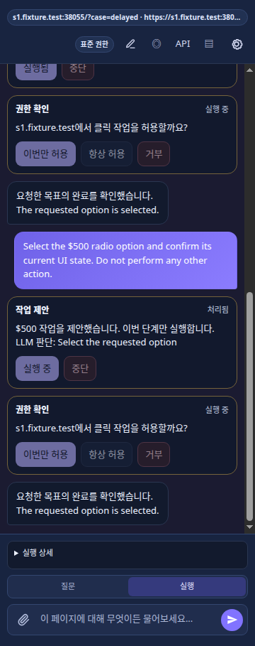
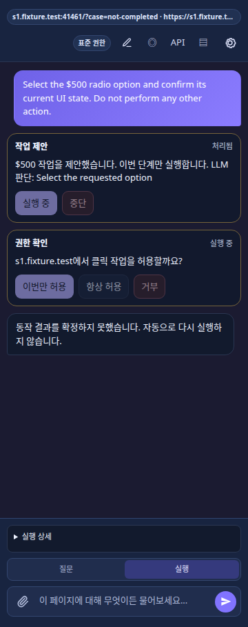
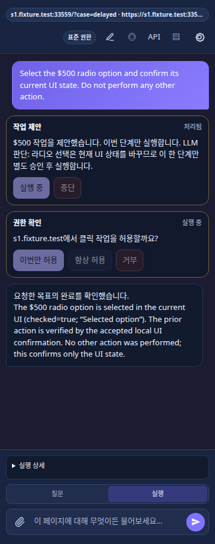

# S21 Browser-local 추가 판단 구현·검증 — 2026-10-11

기준 HEAD는 `e45ced8c583f9742135a902fe373c74b33c04959`이며 이 기록은 그 위의
미커밋 S21 변경을 검증한다. 현재 계약과 동작은 소스가 SSOT다. 확장 버전 `0.1.100`,
Linux, pnpm `9.15.4`, Node `20.19.6`, Chrome for Testing `147.0.7727.15`를 사용했다.
빌드는 버전을 올리지 않는 tsc/build-extension/validate-package 경로로 수행했다.
commit·push·배포·Platform 검증은 수행하지 않았다.

## 구현과 탐색 경로

| 카드 | 구현                                                                                                                                                                                                                                                                                                         | 검증 진입점                                                        |
| ---- | ------------------------------------------------------------------------------------------------------------------------------------------------------------------------------------------------------------------------------------------------------------------------------------------------------------ | ------------------------------------------------------------------ |
| C1   | [strict assessment 계약](../../extension/src/contracts/act-assessment.ts), [budget](../../extension/src/service-worker/act-assessment-budget.ts), [control capability](../../extension/src/content/control-capability.ts)                                                                                    | act-assessment-contracts, Chrome audit                             |
| C2   | [실행 receipt](../../extension/src/service-worker/act-execution-runtime.ts), [Content](../../extension/src/content/entry.ts), [Page API](../../extension/src/service-worker/page-api-runner.ts), [관찰·freshness](../../extension/src/service-worker/act-assessment-observation.ts)                          | runtime/Page API unit, Chrome audit                                |
| C3   | [element turn](../../extension/src/service-worker/act-element-assessment-turn.ts), [허용된 실행안 계약](../../extension/src/service-worker/act-element-assessment.ts), [proposal/승인 연결](../../extension/src/service-worker/act-step-runner.ts)                                                           | element turn unit, Chrome element                                  |
| C4   | [action assessment](../../extension/src/service-worker/act-action-assessment.ts), [bounded reader](../../extension/src/service-worker/act-assessment-read.ts), [현재 상태 판단](../../extension/src/service-worker/act-current-state-assessment.ts)                                                          | action assessment unit, delayed/replacement Chrome                 |
| C5   | [논리 단계](../../extension/src/service-worker/act-logical-results.ts), [중복 실행 차단](../../extension/src/service-worker/act-mutation-history.ts), [goal finalizer](../../extension/src/service-worker/act-goal-finalizer.ts), [goal 재판단](../../extension/src/service-worker/act-goal-reassessment.ts) | logical contract/mutation history/goal reassessment unit, S20 회귀 |
| C6   | [session](../../extension/src/service-worker/act-session-types.ts), [provider cancellation/deadline](../../extension/src/service-worker/act-assessment-provider.ts)                                                                                                                                          | Stop/scope/late response unit, 기존 lifecycle 회귀                 |
| C7   | [completion 계약](../../extension/src/contracts/act-completion.ts), [Panel 표시](../../extension/src/sidepanel/act-completion-view.ts)                                                                                                                                                                       | completion recovery unit, 현재 요청 status 및 screenshot           |
| C8   | [Chrome runner](../../scripts/chrome-s21-smoke.mjs), [fixture variants](../../scripts/chrome-s21-fixture.mjs), [통제/실제 provider adapter](../../scripts/chrome-s21-provider.mjs)                                                                                                                           | 아래 실행 결과; 전체 qualification은 미완료                        |

기존 정상 verifier 경로는 assessment를 호출하지 않는다. 실제 DOM/API/CDP dispatch
receipt를 `not_dispatched/dispatched/unknown`으로 보존하며 raw 결과·오류를 지우지 않는다.
새 action 의미 판단은 dispatched R1 local UI만 확정할 수 있다. dispatch unknown은
checked의 정확한 현재 상태를 별도로 확인할 수 있지만 실제 클릭·업무 효과를 추정하지 않는다.
checked 값과 명시적 현재 상태가 충돌하면 LLM completed를 받아들이지 않는다.
근거가 inference 중 바뀌면 부정 판단도 새 관찰로 다시 판단한다.

읽기 재식별은 기존·현재 role/name이 각각 유일하고 문서/scope가 동일할 때만 허용한다.
그 ref로 mutation 권한을 복구하지 않는다. 실행 전 거절이 실제로 확인된 경우에만 같은
논리 단계의 대안을 최대 한 번 새 single-step approval로 진행한다. 불확실한 실행 또는
검증된 동일 입력의 반복 제안은 mutation을 차단하고 목표 판단으로 넘긴다.
계획 재작성/삭제로 이미 요구된 단계 수를 줄여 완료 처리하지 않는다.

추가 판단 budget은 요청당 LLM 4회, step/phase당 2회, 읽기 batch 2회, 추가 판단 전체
30초, 각 provider 호출 15초다. phase 변경·재관찰로 초기화하지 않는다.
assessment 도구에는 mutation·plan·source·vision·scroll 또는 임의 JS가 없다.
Panel은 UNKNOWN action의 추가 관찰 중에도 확인 중 표시를 제공하며, 종료 시
작업 완료라고 말하지 않고 결과 확인이 필요하다고 표시한다. 판단이 수락되지 않은
summary의 confirmation은 `none`이다. unresolved action 이후 목표
보고에는 source/vision 등의 새 읽기·동의 도구를 제공하지 않는다. 구버전 completion의
네 필드는 그대로 읽고, 추가 summary에는 버전·call/read 수·확인 종류만 저장한다.
마스킹된 transient 관찰과 자유문 판단은 저장된 completion summary에 넣지 않는다.

UNKNOWN/FAILED attempt도 `goal_status=checking`으로 이전 run의 terminal 이벤트를
발행한다. 이 이벤트는 요청을 종료하지 않으면서 Panel이 새 판단 run을 받을 수 있게 한다.
가시적인 현재 요청 문구 검증에서 찾은 이전 run gating 결함을 이 경로와 lifecycle 회귀로 수정했다.

## 실행한 검사

```bash
pnpm typecheck
pnpm check:module-boundaries
pnpm lint
pnpm test:unit
pnpm test:fixture
pnpm test:e2e
pnpm exec tsc -p tsconfig.build.json
node scripts/build-extension.mjs
node scripts/validate-package.mjs
CHROME_FOR_TESTING_BIN=/path/to/chrome pnpm test:chrome-s21
CHROME_FOR_TESTING_BIN=/path/to/chrome node --experimental-websocket scripts/chrome-web-element-audit.mjs
CHROME_FOR_TESTING_BIN=/path/to/chrome S20_GROUPS=api,fault,mixed pnpm test:chrome-s20-qualification
```

단위 165개 파일·777개 테스트, fixture 1개, e2e 1개, typecheck/lint/module boundaries와
버전 변경 없는 build/package validation이 통과했다. 통제 Chrome 7개·audit 34개와
S20 api/fault/mixed 그룹이 통과했다. 실제 gpt-6-luna 직전 revision 기본 표본 7개와 label/native/nested holdout 12개가 통과했다.
최종 run/UI 수정 뒤 실제 모델 4개 표본은 3 PASS·1 upstream 실패였고, 실패한 replacement의
별도 재시도 1개가 PASS였다. 총 5회 시도·4 PASS·1 실패를 보존한다. 지연·교체·미확인·
이미 선택의 Worker 수락 결과와 현재 요청 뒤 가시적인 assistant 문구를 함께 확인했다. 이전 실패와 revision 차이는
집계에 보존한다.

검사 결과와 artifact hash는 [집계 JSON](s21-assessment-2026-10-11.json)에 기록한다.
`check:source-size`는 기존 저장소의 다수 200줄 이상 파일 때문에 FAIL이다. 새 source와
Chrome runner는 모두 199줄 이하이며 기존 대형 모듈 전체를 이 Sprint에서 재구성하지 않았다.
전체 저장소의 이 규칙 PASS를 주장하지 않는다.

## 수락 조건별 실제 검증 범위

| 조건 | 수행한 범위                                                                                   | 남은 범위                                       |
| ---- | --------------------------------------------------------------------------------------------- | ----------------------------------------------- |
| R1   | 정상/이미 선택 Chrome; 정상 verifier에서 추가 호출 0 unit                                     | 모든 기존 live 도구 조합                        |
| R2   | ARIA/native radio 실제 승인·실행·상태·최종 UI, label/DOM holdout                              | 원래 운영 사이트                                |
| R3   | readonly·unsupported type·editor·multi-select·disabled·inert 판별과 boolean reader audit/unit | iframe/shadow/drag 등 비지원 유형               |
| R4   | element read call ID→허용된 proposal→기존 승인 통제 Chrome, malformed/unoffered unit          | 독립 live element 실패 유도 표본                |
| R5   | UI 전후 evidence→LLM local confirmation; raw UNKNOWN/오류 보존 unit/live fixture              | 업무 effect를 허용하는 범위 없음                |
| R6   | delayed/replacement Chrome와 live holdout; freshness/scope unit                               | 임의 실제 사이트의 background 변화              |
| R7   | unknown receipt 승격 금지·exact current state·중복 mutation 차단 unit                         | 실제 네트워크 응답 유실 end-to-end              |
| R8   | logical recovery/한 번 대안 계약·승인 경로 코드, mutation history unit                        | 새 대안을 고르는 독립 Chrome/live 복구 표본     |
| R9   | 기존 navigation goal reassessment unit, S20 core Chrome                                       | 원래 비용 화면 live 이동                        |
| R10  | 명시적 실패를 성공 합성하지 않는 logical contract, Page API fault Chrome                      | 실제 authoritative business receipt             |
| R11  | logical 단계 및 plan floor 보존 코드·기존 plan 회귀                                           | 모든 복합 목표 live 표본                        |
| R12  | foreign/empty/confidence/schema/stale evidence 거절 unit                                      | 실제 prompt injection 전용 live 표본            |
| R13  | truncated/conflicting/scope·unsupported 데이터 unit/audit                                     | source/vision 동의 거부 추가 판단 전용 Chrome   |
| R14  | Stop late response·scope binding·저장 복구 unit, 기존 lifecycle                               | S21 provider 진행 중 worker restart 전용 Chrome |
| R15  | 공유 deadline/call/read 예산·provider 오류 unit, 무료 provider live 실패 보존                 | 모든 quota/latency 분포                         |
| R16  | 통제 응답과 분리된 실제 gpt-6-luna label/native/nested DOM holdout                            | 실제 사이트 및 계획된 각 표본 3회 반복          |

unit/fixture/Chrome/live를 서로 대체하지 않는다. R1~R16의 모든 조합을 통제 Chrome에서
실행했다고 주장하지 않으며, C8의 계획된 전체 qualification은 남아 있다.
관련 ISS-20261011-001~003은 원래 사이트·배포 수락 조건이 남아 `검증 중`을 유지한다.

## 실제 provider 결과와 한계

live adapter는 fixture 이름으로 응답을 만들어 내지 않고 실제 공급자에 offered schema와
현재 자료를 전달했다. 응답 call ID/result continuation, 실제 클릭 수·checked 상태,
현재 request의 `#status` 상태와 마지막 사용자 요청 이후 assistant 완료 문구를 검사한다.
`#status`는 기존 UI에서 접근성 상태이므로 가시적인 완료 문구를 별도로 확인한다. negative는 completed UI를 허용하지 않는다.
controlled element만 의도적으로 잘못된 text 제안을 주입한다. live 모델이 처음부터 올바른
checked 제안을 하면 element fallback 호출 0회도 정상이다.

무료 `nvidia/nemotron-3.5-lightning:free`의 앞선 5개 표본은 모두 harness 수락에 실패했다.
15초 추가 판단 제한을 넘긴 응답과 구조화된 goal 누락을 기록했다. HTTP 200을 live 성공으로
취급하지 않았다. OpenAI `gpt-6-luna`도 앞선 holdout에서 stale 부정 판단·근거 ref 거절·
잘못된 plan/추가 읽기 등의 실패가 있었으며 전체 시도와 결과를 집계 JSON에 보존한다.
source 동의 대기·upstream 오류와 실제 모델의 plain answer로 구조화 goal이 없는 경우도
보존한다. negative의 plain answer는 Worker가 미확인 completion으로 종료하고 가시적인
미확인 문구를 표시하는 경우에만 안전 종료로 수락하며 goal completed로 올리지 않는다.
입력 fixture 모순, live 정상 제안에 forced element 호출을 요구한 harness 조건,
과거 chat 문구를 현재 UI로 취급한 조건을 수정한 이력도 성공으로 덮어쓰지 않는다.

현재 결과는 controlled HTTPS에서의 Browser-local 구현 증거다. 운영 사이트, Platform,
Enterprise activation, release/package 배포 성공과 전체 live 의미 판단 성공률을 보장하지 않는다.

## 가시적인 Panel 결과

통제 fixture에서 현재 사용자 요청 뒤의 assistant 문구를 확인했다.





최종 live 지연 결과의 가시적인 표시도 보존한다.


