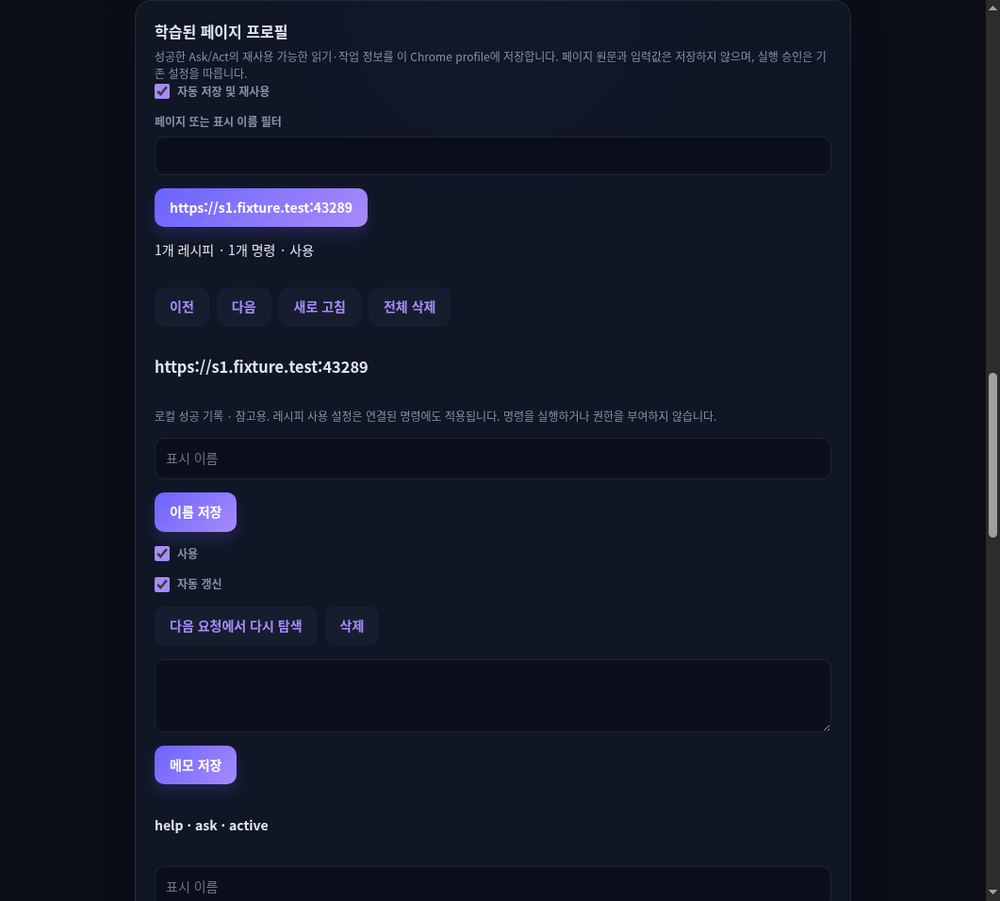

# S24 learned profiles and page commands — 2026-10-13

Browser-local implementation and bounded qualification. Base Git revision:
`a1f111fcb9b2f402e9ef6790728225120270ae3c`, with uncommitted implementation and
pre-existing S22/S23/provider changes. This evidence is not a clean-commit release claim.
Current support is defined by [source](../../extension/src/learned-profile) and
[tests](../../extension/tests/unit/learned-profile).

## Environment and checks

Linux, Node 20.19.6, pnpm 9.15.4, extension 0.1.108,
Chrome for Testing 147.0.7727.15. The version was preserved.
Built Worker SHA-256:
`019961911ed64c788088f078d1948f65d4d298dfc71f43a82fe65adabd5411af`.

Executed successfully:

- `pnpm typecheck`, `pnpm lint`, `pnpm check:module-boundaries` (374 files).
- `pnpm exec vitest run`: 194 files, 918 tests, including 37 S24 tests.
- `pnpm exec tsc -p tsconfig.build.json && node scripts/build-extension.mjs && node scripts/validate-package.mjs`.
- `pnpm test:chrome-s24`, `pnpm test:chrome-s24-act`, with `CHROME_FOR_TESTING_BIN` set.
- Live Ask: `S24_LIVE_MODEL=nvidia/nemotron-3.5-lightning:free pnpm test:chrome-s24`,
  with OpenRouter credentials supplied through the environment.

## Runtime evidence

[Controlled Ask/Options receipts](s24-controlled-2026-10-13.json) verify eligible save,
independent next-request generated command execution, same-call-ID continuation,
privacy exclusions, trusted Settings mutation, 14px spacing, feature-off retaining
records and withdrawing tools, stale management rejection and deletion.

[Controlled Act receipts](s24-act-2026-10-13.json) verify two distinct current inputs,
UI command returning a draft, fresh submit_plan/proposal, normal approval policy,
actual VERIFIED dispatch, atomic command revision and exclusion of persisted input values.
The isolated fixture enables Full Permission through the real Options path.
This does not qualify interactive approval prompts or production-site Act.

[Live OpenRouter receipts](s24-live-openrouter-2026-10-13.json) verify actual model task
classification, save, recipe selection, generated command invocation with dry_run false,
AVAILABLE read result, same-call-ID continuation and feature-off behavior. HTTP 200 alone
was not the acceptance criterion. This live run preceded the final metadata-description
and conservative unsupported-read eligibility changes; final controlled checks cover the
rebuilt artifact. No live Act/method or efficiency claim follows from these receipts.

## Failures and corrections

- Chrome storage reordered object keys, causing duplicate task recipes. Task equality now
  uses a fixed-field key; unit storage fixtures reproduce reordered keys.
- Act's static read ordering rejected new metadata calls. Registered read tools now control
  ordering and budget checks; unit and controlled Act checks exercise the real harness.
- An early live call returned INVALID_PAGE_COMMAND despite HTTP 200. Exact arguments were
  not retained, so its cause is unconfirmed. Cold schemas omit recipe_id; warm schemas
  constrain it to current candidate IDs. The later normal-read live run qualified.
- Earlier live attempts exercised metadata or dry-run rather than normal command execution.
  The accepted report explicitly requires AVAILABLE, dry_run false and linked command identity.
- A detail selector initially chose history JSON instead of profile JSON. The check now uses
  the dedicated profile JSON element. Checkbox alignment uses the existing checkbox-row style.
- A final local Chrome invocation omitted CHROME_FOR_TESTING_BIN and failed before launch;
  it was rerun with the required executable configured.

## Scope limits

The visible-text context guard deliberately misses after changed page data. Changed-data
reuse (R01), tenant/account holdouts, live S24 method discovery/invocation and live repair
remain pending. Repair, quarantine, corrupt storage recovery, revision races and command
contracts have unit evidence; exhaustive R01–R44 Chrome qualification is not claimed.
Commands currently generalize none/text inputs and directly execute snapshot read operations.
Resource/component operations return NEEDS_CONTEXT; visual/batch/business reads prevent learning.
UI/method commands require fresh normal execution and never reuse stored refs, values or grants.
No token/latency savings, Windows, public Store, Platform integration or release is qualified.
