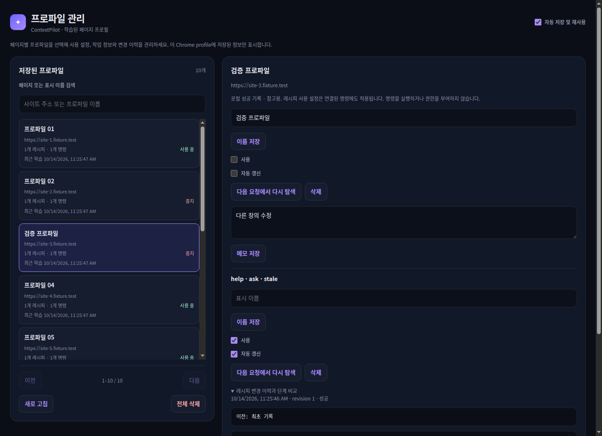

# S24 separate profile management window — 2026-10-14

Browser-local UI delivery on Linux. Source base:
`a1f111fcb9b2f402e9ef6790728225120270ae3c`, with pre-existing uncommitted changes
and this management-window change. No commit, deployment or release was performed.
Node 20.19.6, pinned pnpm 9.15.4, Chrome for Testing 147.0.7727.15,
extension 0.1.109. The extension version was preserved.

## Entry points and operation

In Options, select **프로파일 관리** in **학습된 페이지 프로필**. The button opens
a separate popup window and focuses an existing manager when available.
Options keeps the automatic save/reuse setting and saved-profile count.
The manager displays a searchable, paginated list alongside the selected profile's
settings, recipes, commands and history. Editing uses the existing Worker-owned
management messages. Detail writes retain the catalog revision shown to the editor.

Source: [Options launcher](../../extension/src/settings/learned-profile-options.ts),
[manager document](../../extension/src/settings/learned-profiles.html),
[list controller](../../extension/src/settings/learned-profile-management.ts),
[detail editor](../../extension/src/settings/learned-profile-detail.ts).
The manager is authorized only for learned-profile management; it does not become
a general Settings or Panel sender.

## Executed verification

- `pnpm typecheck`, `pnpm lint`: PASS.
- `pnpm exec vitest run extension/tests/unit/learned-profile extension/tests/unit/settings extension/tests/unit/sidepanel extension/tests/unit/service-worker/page-sender-context.test.ts extension/tests/unit/service-worker/preferences-message-handler.test.ts extension/tests/unit/service-worker/approval-runtime.test.ts extension/tests/unit/service-worker/panel-transport.test.ts extension/tests/unit/service-worker/chat-message-handler.test.ts`: 27 files, 98 tests PASS.
- `pnpm exec tsc -p tsconfig.build.json && node scripts/build-extension.mjs`: PASS,
  without the version-changing `pnpm build` step.
- `node scripts/release-smoke.mjs`: package policy and required manager assets PASS.
- `pnpm check:module-boundaries` and final direct script check: PASS, 377 modules.
- `CHROME_FOR_TESTING_BIN=/home/heungtae/.cache/ms-playwright/chromium-1217/chrome-linux64/chrome pnpm test:chrome-s24`: PASS.
- Same Chrome binary with `pnpm test:chrome-s24-act`: PASS.
- `pnpm check:source-size`: FAIL on existing oversized modules, including the
  existing Settings and Panel entry documents. All new manager source and check
  files stay within 199 lines. No broad source-size refactor was included.

[Ask and management receipts](s24-profile-manager-2026-10-14.json) cover an actual
learned profile, separate-window reuse, management-only sender authority, selection,
14px spacing, and existing save/reuse/tool-continuation/privacy/off checks.
The expanded UI checks seed 12 synthetic profiles in the isolated test profile to
verify origin/name filtering, pagination, filtered rename, deletion confirmation,
recovery after deleting a final page, notes, enabled/automatic-update settings,
feature synchronization, stale editor rejection, rediscovery, recipe deletion,
clear confirmation, empty states, responsive layout and visible list-footer controls.
Synthetic records establish management UI behavior, not production-site learning.

[Act receipts](s24-profile-manager-act-2026-10-14.json) preserve the existing
fresh-input, draft-only UI command, plan, approval and revision/privacy checks.
No live Provider call was made for this change.

## Failure and correction

Initial S24 Ask runs failed at `ASK_COMPLETION` after opening the popup. Moving
focus alone did not fix the missing displayed response. The request and stored
assistant/terminal events belonged to the original browser window, while direct
`CHAT_RECOVER` selected the popup's last-focused tab and returned an empty history.
Recovery now uses the existing authenticated `PANEL_REQUEST` window envelope.
The final Ask check passes with the manager still open. See
[ISS-20261014-001](../issues/records/2026-10-14-profile-window-chat-recovery.md).

## Scope limits

Controlled Chrome fixtures and local unit/package checks only. Live providers,
production sites, Windows, user-installed upgrades, public distribution and Platform
integration were not verified. Earlier S24 learning and live qualification limits
remain recorded in the [2026-10-13 evidence](s24-learned-page-profiles-2026-10-13.md).
