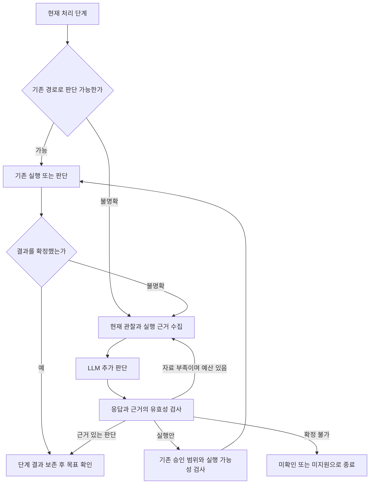

# Browser Act S21 — 현재 관찰과 실행 증거에 기반한 LLM 추가 판단

## 상태와 착수 근거

**Implemented — 2026-10-11, Browser-local; qualification 범위는 아래 증거 참조.**
C1~C7과 C8의 실행 가능한 검증 도구를 구현했다.
[구현·검증 기록](../evidence/s21-assessment-2026-10-11.md)이 현재 소스와 실제 실행 결과를 연결한다.
이 문서의 아래 설계·수락 조건은 착수 당시 계획의 이력이다. 실제 사이트·배포 및 계획된
전체 live 반복 표본은 완료하지 않았으므로 Browser 전체 qualification 완료로 해석하지 않는다.

| 항목           | 내용                                                                                                                                                                                                                                                                        |
| -------------- | --------------------------------------------------------------------------------------------------------------------------------------------------------------------------------------------------------------------------------------------------------------------------- |
| 요청           | 기존 처리 가능한 경로를 그대로 사용하고, 판단하기 어려운 상태에서는 현재 자료를 모아 LLM에 요소·action 완료·전체 목표 판단을 요청해 확정                                                                                                                                    |
| 분석 기준      | HEAD `549ebacc76b5608d80ca70ab71610da11bbc29f0` + 미커밋 작업 트리, 확장 `0.1.100`                                                                                                                                                                                          |
| 의존성         | [S17 실행 결과 피드백](s17-act-plan-execution-feedback.md), [S18 Workflow 검토](s18-workflow-resource-tools.md), [S19 Component 읽기](s19-component-data-tools.md), [S20 qualification](s20-act-tool-loop-live-qualification.md)                                            |
| 관련 이슈      | [ISS-20261011-001 이동 후 목표 확인](../issues/records/2026-10-11-act-completion-after-navigation.md), [002 ARIA radio](../issues/records/2026-10-11-aria-radio-button-execution.md), [003 지원 기준 불일치](../issues/records/2026-10-11-web-control-capability-parity.md) |
| 기준 증거      | [웹 요소 audit](../evidence/web-element-compatibility-audit-2026-10-11.md), [이동 후 completion 수정 검증](../evidence/act-completion-after-navigation-2026-10-11.md)                                                                                                       |
| 구현·검증 상태 | C1~C7 구현; C8 unit/Chrome/live 표본 수행, 운영 사이트·전체 live 표본 미검증. 버전 0.1.100 유지, 배포 없음                                                                                                                                                                  |

기준 소스에서 이미 LLM이 action을 제안하고 실행 후 목표를 보고한다. 최근 이동 이슈의
재확인은 관찰 변화에 대응하는 읽기 전용 경로다. 이번 Sprint는 이를 **판단이 막히는
각 단계의 공통 추가 판단 경로**로 확장한다. 기존 정상 처리에 LLM 호출을 일괄 추가하거나
현재 모든 요소가 지원된다고 가정하지 않는다.

## 목표와 범위

1. 기존 실행기·검증기·목표 판단으로 확정할 수 있으면 그 결과와 기존 호출 수를 유지한다.
2. 요소의 사용 방법, 실행 결과의 의미, 사용자 목표 달성 여부가 불명확할 때만 현재 관찰과
   실행 근거를 묶어 LLM에 전달한다. LLM은 추가 자료 요청, 실행안, 완료/미완료/미확인을 반환한다.
3. LLM이 UI의 의미를 해석해 완료를 확정하는 경로를 구현한다. 코드가 이미 같은 결론을
   낼 수 있는 경우에만 LLM 의견을 허용하는 구조로 제한하지 않는다. 대신 근거의 실제 존재·
   최신성·대상 연결·완료 판정 범위는 코드가 검사한다.
4. 기존 동작의 승인·권한·문서 바인딩과 실행 횟수를 유지하고, 실제로 실행됐을 수 있는
   action은 추가 관찰로 확인한다. 불확실성을 이유로 같은 mutation을 반복하지 않는다.
5. 요소·실행·검증 판별의 알려진 불일치를 먼저 연결해, LLM 제안이 실제 실행과 검증까지
   도달하도록 한다. radio 문제를 단순 모델 프롬프트 변경으로 종료하지 않는다.

초기 실행 지원은 기존 primitives와 등록된 Page API, 그리고 공통 판별·상태 읽기로 수용한
native/ARIA checked 및 boolean UI 상태에 한정한다. iframe/shadow/drag/file upload, 임의 JS,
미등록 API, authoritative 업무 완료 수단을 새로 일반 지원하는 것은 이 Sprint의 범위 밖이다.
그런 대상에도 읽기 가능한 자료로 설명·미지원 판단은 제공할 수 있다.

## 처리 흐름과 진입 조건



| 단계                | 기존 처리 유지                                          | 추가 판단 진입                                                                  | LLM의 역할                                                                |
| ------------------- | ------------------------------------------------------- | ------------------------------------------------------------------------------- | ------------------------------------------------------------------------- |
| 요소·실행 수단 해석 | 지원 target/action/capability가 명확                    | 역할과 DOM 구현 불일치, 여러 실행 방식, 적용할 완료 조건 불명확                 | 제공된 수단으로 실행안·기대 변화 제안 또는 자료 요청                      |
| action 완료         | 정확한 값·선택·expanded·navigation·typed receipt로 검증 | 실행은 확인됐지만 verifier가 의미를 해석하지 못함, 관련 UI 지연·교체·부분 관찰  | 최신 상태와 실행 전후 자료를 해석해 해당 action의 완료/미완료/미확인 판단 |
| 전체 목표           | 기존 local goal proof 또는 기존 LLM 목표 판단으로 확정  | action 완료와 사용자 목표의 관계 불명확, 후속 렌더링·복합 목표·남은 단계 불명확 | 원래 요청과 현재 결과를 대조해 전체 완료·남은 작업·자료 부족 판단         |

진입 여부는 코드가 reason으로 기록한다. 명시적 권한 거부·Stop·request 종료·예상 밖 scope
변경·실제 execution failure는 추가 LLM 판단으로 허용/성공 처리하지 않는다. 정상 pending
렌더링은 먼저 기존 bounded 관찰을 적용하고, 수단이나 의미가 계속 불명확할 때 추가 판단한다.
`TARGET_NOT_ACTIONABLE` 같은 code만으로 실행 전 거절인지 실행 후 검증 실패인지 분류하지 않는다.

추가 판단이 필요한 요청은 최종 terminal을 발행하기 전에 이 경로로 진입한다. 이미 끝난
request를 늦은 모델 응답으로 되살리지 않는다. 요소 판단의 실행안은 proposal일 뿐이며,
완료 판단용 turn에는 mutation·계획 승인 도구를 제공하지 않는다.

## 현재 자료와 구조화된 판단

### 전달할 근거

추가 판단 패킷은 request-local이며 필요한 영역만 bounded하게 구성한다. 페이지·도구 결과는
기존처럼 untrusted evidence로 표시하고, 페이지 안의 지시문을 사용자 요청이나 정책으로 취급하지 않는다.

| 자료        | 포함 내용·제한                                                                                                                             |
| ----------- | ------------------------------------------------------------------------------------------------------------------------------------------ |
| 요청과 목적 | 원래 요청, 사용자 정정, 승인된 논리 단계·기대 결과. 새로운 입력값을 추측하지 않음                                                          |
| scope       | opaque observation ID, request generation, document/page scope 연결, 관찰 시각·digest. 내부 origin/path 검사는 Worker가 수행               |
| 요소 정보   | 현재 ref, native control kind, role/name, 허용 DOM/ARIA 속성, 현재 상태와 관련 container 관계. 미지원 속성·불명 상태를 false로 만들지 않음 |
| 실행 전후   | dispatch 전 baseline과 최신 대상·결과 영역, 의미 있는 상태/텍스트 차이, coverage/truncation·관찰 누락 사유                                 |
| 실행 이력   | 논리 단계 ID와 attempt ID, 사용한 수단, DOM/CDP/API dispatch 근거, verifier 결과, typed code, already-satisfied 여부                       |
| 실행 수단   | 실제 executor와 상태 reader가 연결된 capability, 허용 target·argument·postcondition·권한·부작용·미지원 사유                                |
| 추가 데이터 | 기존 등록 reader의 현재 DOM/component 자료. source/vision/collection 채널은 각각 기존 동의·정책·복구 조건 적용                             |

새 control observation reader는 필요한 public DOM/ARIA fact만 읽고 callable schema·executor·
같은 tool call ID의 결과 반환을 함께 제공한다. raw 사용자 입력·credential·민감 DOM·전체
script/trace·selector/function 경로를 기본 패킷으로 보내지 않는다. 값 비교는 가능하면 로컬의
masked match fact로 전달한다. 기존 허용된 DOM 관찰 범위 안의 추가 읽기는 기존 권한을 사용한다.
새 disclosure가 필요할 때만 해당 채널의 동의 흐름을 따른다.

### LLM 응답의 예정 계약

아래는 새 계약의 요구사항이며 현재 존재하는 타입 선언이 아니다. C1에서 TypeScript와
Provider schema/parser/validator를 동시에 정의한다.

- 공통: 판단 단계, observation ID, logical step/attempt ID, 결정, 짧은 근거, evidence ID 목록.
- 요소 판단: `propose_action / need_more_data / unsupported / unknown`. 실행안에는 허용된
  action ref·argument와 실행 뒤 기대하는 관찰을 포함한다. 임의 selector·JS·URL을 반환하지 않는다.
- action/goal 판단: `confirmed / not_completed / need_more_data / unknown`. 관찰한 사실과
  그 사실이 해당 action 또는 원래 목표를 충족하는 이유를 구분한다.
- 자료 요청: 현재 등록된 read tool과 허용 ref/channel만 요청하며, 같은 자료 반복 요청·
  부작용 있는 scroll/vision/source의 무단 사용을 거절한다.

코드는 schema, evidence ID 존재, 관찰 시각·scope·coverage, 해당 실행/목표와의 연결을
검증한다. `confirmed`는 최소 한 개의 유효한 관련 근거가 있어야 한다. 근거 없는 텍스트,
모델 confidence 점수, 변경되지 않은 이전 toast, 잘린/오래된 자료만으로 확정하지 않는다.
모델 응답 후 근거 영역을 다시 읽어 달라졌으면 응답을 폐기하고 남은 예산 안에서 재판단한다.
관련 없는 배경 변화는 기존 region freshness 검사로 구분한다.

## action 완료와 목표 완료 확정

### 실행 사실과 판단 근거를 분리

현재 Worker의 `dispatch_started`는 메시지 전송 단계이고,
[execution feedback](../../extension/src/service-worker/act-execution-feedback.ts)은 dispatch를
실제 DOM receipt 없이 추론한다. C2에서 실제 실행기에 `not_dispatched / dispatched / unknown`
근거를 추가한다. DOM `.click()` 및 CDP/API 호출 전후와 예외 위치를 구분하며, legacy receipt가
없으면 `unknown`으로 취급한다. 이 작업은 fallback 실행을 허용하기 위한 선행 조건이다.

| 상황                                       | 허용하는 후속 처리                          | 완료 판단                                                                                                                       |
| ------------------------------------------ | ------------------------------------------- | ------------------------------------------------------------------------------------------------------------------------------- |
| 기존 verifier가 확정                       | 기존 결과 그대로 보존                       | 새 fallback 호출 없이 확정                                                                                                      |
| dispatch 전에 지원 해석이 막힘             | LLM 제안·capability 검사 후 승인된 대안 1회 | 대안의 실제 실행·관찰로 해당 논리 단계를 판단                                                                                   |
| 실제 dispatch 확인, local UI 결과가 불명확 | 현재 자료 추가 수집과 읽기 전용 LLM 판단    | 유효한 관련 UI 근거로 `llm_evidence` 확인 가능; mutation 반복 없음                                                              |
| dispatch 여부 unknown                      | 읽기·관찰·LLM 의미 판단                     | 실행 발생은 unknown 유지. local 상태 설정 요청은 현재 기대 상태를 별도 확정할 수 있으며, 실행 효과 확인이 필요한 요청은 unknown |
| 이미 기대 상태                             | fresh 상태와 사용자 목적 확인               | already-satisfied로 기록하고 불필요한 mutation 없이 단계 판단                                                                   |
| 업무 실패·권한 거부·취소 등 확정된 실패    | 실패 보존                                   | LLM의 완료 주장으로 성공으로 변경하지 않음                                                                                      |
| 자료 부족·모순·Provider 실패·budget 종료   | 사유와 남은 작업 기록                       | unknown/not-completed, 성공 강제 없음                                                                                           |

`llm_evidence`는 실제로 관찰된 **local UI 상태와 요청 의미의 연결**을 확인하는 새 판단
근거다. 코드가 등록된 증거의 유효성을 확인하고 LLM이 그 의미를 판정한다. 해당 action의
실행이 확인되고 근거가 충족되면 UI action을 VERIFIED로 확정할 수 있어야 한다. 기존 결과를
삭제하지 않고 raw executor/verifier 결과와 새 assessment를 별도 보존한다.

확정 범위도 구분한다. “500을 선택한 상태로 설정”처럼 현재 UI 상태 자체가 목적이면,
dispatch 응답이 유실됐더라도 fresh 상태가 충족된 근거로 `state_satisfied`를 판단할 수 있다.
이는 click이 발생했다는 증명이 아니며 추가 클릭은 하지 않는다. event 발생·서버 효과가
목적인 경우는 `execution_effect`의 증거가 필요하다. C5/C7에서 이 차이를 논리 단계 결과와
completion 계약에 연결해, 확인한 상태와 실제 실행 여부를 혼동하지 않도록 한다.

저장·제출·구매 같은 업무 commit의 authoritative 결과는 등록된 receipt/authoritative reader가
있어야 한다. LLM은 receipt 의미를 해석할 수 있으나 단순 toast·화면 변화만으로 commit을
확정하지 않는다. “저장됨 표시를 확인”하는 요청과 “실제 저장을 완료”하는 요청의 범위를 구분한다.
현재 `render_result` verifier 미지원 차단을 LLM 설명만으로 해제하지 않는다.

### 논리 단계와 여러 attempt의 결과 합성

현재 [goal finalizer](../../extension/src/service-worker/act-goal-finalizer.ts)는 이력 중 FAILED가
하나라도 있으면 전체 action을 FAILED로 분류하고,
[goal feedback](../../extension/src/service-worker/act-goal-feedback.ts)은 action이 VERIFIED일 때만
재판단을 계속한다. 예외 복구를 연결하려면 이 합성 방식과 terminal 발행 시점의 변경이 필요하다.

- 원래 논리 단계와 각각의 attempt·판단 ID를 연결한다. 모델이 이전 실패 단계나 미완료
  요구사항을 계획에서 삭제해 완료로 보이게 하지 않는다.
- **실행 전 거절임이 확인된 attempt** 뒤의 검증된 대안은 같은 논리 단계를 완료할 수 있다.
  이전 거절과 복구 사실은 진단에 남고, 사용자는 복구된 최종 결과를 받는다.
- dispatch 후 verifier가 지원하지 못한 상태는 실제 execution failure와 구분한다. 새로운
  유효한 assessment로 불확실성을 해소할 수 있으나 실제 실패나 contradicted 증거를 덮어쓰지 않는다.
- dispatch 여부를 알 수 없는 attempt나 실제 실패는 자동 대안 mutation 대상이 아니다.
- action 완료와 전체 목표 완료는 별도다. 확인된 단계·현재 화면·원래 요청의 남은 조건을
  합성한 뒤, 기존 goal 경로로 확정할 수 없을 때 LLM goal assessment를 사용한다.

`action_outcome=VERIFIED`, `goal_status=completed`는 적용한 확인 근거와 함께 일관되게
발행한다. uncertainty 해소에 성공한 요청은 정상 완료하고, 미완료/미확인/실패는 구분한다.
원래 raw 실패 code를 버리는 방식으로 오류 표시만 숨기지 않는다.

## 바인딩·예산·사용자 표시

- 기존 승인 범위가 target/action/value/effect를 포함하면 그대로 이어간다. 달라진 실행안이
  기존 범위를 벗어나면 기존 proposal approval 경로를 사용한다. LLM 판단 자체는 승인이나 권한이 아니다.
- dispatch 전과 모델 응답 수락 전에 request generation·취소·tab·origin·document/page scope·
  대상 최신성을 검사한다. 예상된 검증 완료 navigation의 재연결만 기존 경로로 허용한다.
- DOM replacement의 유일한 읽기용 재식별은 이전 ref/승인을 새 실행 대상으로 이전하지 않는다.
  새 실행에는 fresh proposal과 현재 승인 범위 검사가 필요하다.
- Stop·새 요청·예상 밖 이동·worker restart 후 pending fallback을 실행하지 않는다. 복구된
  이력에는 결과만 복원하고 실행 권한·pending proposal·원문 패킷은 복원하지 않는다.

예산은 C1에서 코드/설정으로 고정하고 실행 전에 측정값에 기록한다. 초기 예정 기본값은
**요청당 추가 LLM 4회, 동일 논리 단계·판단 phase당 2회, 추가 read batch 2회, 추가 판단 전체
30초와 각 Provider 호출 15초 이내**다. 기존 goal reassessment도 동일한 전체 추가 호출
예산에 합산한다. 기존 부모 요청 deadline의 남은 시간이 우선하며 호출·관찰마다 예산을
초기화하지 않는다. 실행 전 거절 뒤 자동으로 이어갈 대안 attempt는 논리 단계당 최대 1회다.
최종 수치 변경은 구현 설정과 evidence에 같이 기록한다.

현재 [ActCompletion](../../extension/src/contracts/act-completion.ts)은 정확히 4개 필드와
`reassessments<=2`를 검증한다. 전체 fallback 횟수를 이 필드에 넣거나 임의 필드를 추가하면
기존 validator가 거절한다. C7에서 새 근거·budget·버전 계약과 구버전 projection/migration을
정의하고, 현재 goal 재판단 횟수와 전체 fallback 횟수를 구분한다.

Side Panel은 진행 중에 “현재 상태를 추가로 확인하고 있습니다.”를 표시한다. 정상 완료 시
판단한 대상 상태와 목표를 자연어로 설명하고, 미완료에는 남은 작업, 미확인에는 부족한
근거를 표시한다. Provider가 판단했다는 이유로 오류 카드로 종료하지 않는다. 상세 진단에는
reason·추가 호출 수·확인 방식·receipt 연결을 남기되 제품 흐름에 내부 schema 설명을 노출하지 않는다.

## 구현 카드와 진행 순서

`C1 → C2 → C3 → C4 → C5 → C6 → C7 → C8` 순서이며 C7의 계약·마스킹 기준은 C1부터
함께 검토한다. 각 카드는 코드/테스트/실제 호출 연결을 확인한 작은 변경으로 진행한다.

| 카드   | 상태                  | 작업·주요 연결 위치                                                                                                                                                                                                                                                                                                                                                  | 수락 조건                                                                                                                                       |
| ------ | --------------------- | -------------------------------------------------------------------------------------------------------------------------------------------------------------------------------------------------------------------------------------------------------------------------------------------------------------------------------------------------------------------- | ----------------------------------------------------------------------------------------------------------------------------------------------- |
| S21-C1 | Implemented           | 판단 진입 reason·phase·응답 계약·공유 budget·정상/추가 판단 분기; [action discovery](../../extension/src/service-worker/page-derived-actions.ts), [schema](../../extension/src/service-worker/act-tools.ts), [inventory](../../extension/src/service-worker/act-execution-inventory.ts)                                                                              | 기존 정상 경로에 불필요한 fallback 0회. capability와 실제 executor/reader 지원 일치, 미지원·차단·불명확 이유 구분                               |
| S21-C2 | Implemented           | 실제 dispatch receipt·logical step/attempt·현재 observation 패킷과 bounded reader; [Content](../../extension/src/content/entry.ts), [CDP](../../extension/src/cdp/bounded-adapter.ts), [runtime](../../extension/src/service-worker/act-execution-runtime.ts), [read registry](../../extension/src/service-worker/act-read-tool-registry.ts)                         | 전송과 DOM mutation 구분. evidence ID·전후 상태·coverage·마스킹, 실제 read schema/executor/call 결과 연결                                       |
| S21-C3 | Implemented           | 요소 예외 판단과 실행안 수락, native/ARIA checked·허용 boolean state reader, 기존 승인·실행 연결; [proposal](../../extension/src/service-worker/act-proposal-parser.ts), [readiness](../../extension/src/service-worker/act-proposal-readiness.ts)                                                                                                                   | `$500` ARIA radio의 판단→승인 범위 검사→한 번 클릭→실제 상태 확인. 잘못된 text/disabled/readonly 후보 정정. 지원하지 않는 수단은 제안·실행 없음 |
| S21-C4 | Implemented           | action 완료 추가 판단, 읽기 전용 도구와 structured assessment, terminal 전 dispatch/검증 분류; [verifier](../../extension/src/service-worker/act-postcondition-verifier.ts), [feedback](../../extension/src/service-worker/act-execution-feedback.ts), [completion](../../extension/src/service-worker/act-proposal-completion.ts)                                   | 지연·검증 의미 불명확을 현재 데이터 기반으로 확정, raw 결과 보존. 미확인 mutation 재실행 0회, unsupported business confirmation 유지            |
| S21-C5 | Implemented           | 논리 단계의 복구 결과 합성·전체 목표 평가·freshness 및 예산 공유; [goal feedback](../../extension/src/service-worker/act-goal-feedback.ts), [reassessment](../../extension/src/service-worker/act-goal-reassessment.ts), [finalizer](../../extension/src/service-worker/act-goal-finalizer.ts), [step runner](../../extension/src/service-worker/act-step-runner.ts) | 실행 전 거절+검증 대안의 복구 가능, 미완료 단계 누락 없음. action 완료와 goal 완료 분리, 근거에 따른 최종 확정과 코드 전달                      |
| S21-C6 | Implemented           | 추가 확인 중·완료·미완료·미확인 UI, 이벤트와 request 종료·재개·Stop; [Panel](../../extension/src/sidepanel/entry.ts), [completion view](../../extension/src/sidepanel/act-completion-view.ts), [request lifecycle](../../extension/src/service-worker/chat-request-lifecycle.ts), [chat lifecycle](../../extension/src/service-worker/chat-run-lifecycle.ts)         | 추가 판단 중 조기 terminal/idle 없음. 복구된 완료는 정상 표시, 실패·unknown 구분, 늦은 응답 영향 없음                                           |
| S21-C7 | Implemented           | completion/assessment/receipt 계약·validator·storage·diagnostic·compatibility migration                                                                                                                                                                                                                                                                              | 구버전 저장 결과 읽기, strict schema 유지, 마스킹·ZIP·재시작 검증. 원문/승인 능력 재생 없음. 공유 wire 변경의 producer/consumer 범위 기록       |
| S21-C8 | Partial qualification | 계약·unit·Chrome·holdout·live reasoning·성능·회귀와 이슈 종료 근거                                                                                                                                                                                                                                                                                                   | 아래 R1~R16 충족 범위 기록. 기존 정상 경로, 원래 이슈, 명시 실패와 재실행 방지 증거를 함께 보존                                                 |

각 카드의 상태·revision·실행 명령·증거·미검증 범위를 [진행 기록](../sprint-progress.md)에
추가한다. 관련 이슈의 상태·완료 조건·날짜별 이력과 [이슈 목록](../issues/README.md)을 같은
변경에서 갱신한다. 알려진 사례는 해석 fallback을 거쳤는지와 기본 지원으로 확정했는지를
구분해 기록한다. 원래 이슈의 필수 회귀·실제 사이트 검증이 남으면 해결로 닫지 않는다.

## 필수 검증 행렬

| ID      | 시나리오                                                                      | 반드시 확인할 결과                                                                                                |
| ------- | ----------------------------------------------------------------------------- | ----------------------------------------------------------------------------------------------------------------- |
| S21-R1  | 기존 text/native checked/select/summary/tab/link/등록 Page API                | 기존 실행·판단 결과와 승인 횟수 보존, 필요 없는 추가 판단 0회                                                     |
| S21-R2  | button ARIA radio `$500`, checkbox, tabindex -1, 이미 선택                    | 필요 시 요소 LLM 판단, 실제 한 번 클릭과 aria 상태·group 관찰, already-satisfied는 mutation 0                     |
| S21-R3  | input button/file/range, readonly·ARIA disabled·fieldset·optgroup·inert       | 실제 실행 가능한 action만 제공, 차단 대상 mutation 0; 불가능한 수단을 LLM 말로 허용하지 않음                      |
| S21-R4  | `contenteditable`, custom selector, 여러 select의 지원/미지원                 | executor+reader 있는 방식만 proposal, 미지원 사유·추가 자료가 같은 conversation에 반환                            |
| S21-R5  | 실행 receipt=true, 기존 verifier가 해석 못한 local UI 결과                    | 최신 데이터와 LLM의 관련 근거로 action 확정, 확인 방식 보존, 추가 mutation 0                                      |
| S21-R6  | 클릭 뒤 늦게 선택·렌더링 완료, DOM replacement, 배경 변화                     | bounded 재관찰·의미 판단, 관련 근거 최신성 검사, 읽기 재식별이 실행 권한을 만들지 않음                            |
| S21-R7  | 실행 후 응답 유실·dispatch unknown                                            | 읽기만 수행. 상태 설정 목적은 fresh state로 확정 가능, 실제 실행/업무 효과는 증거 없으면 unknown; 반복 mutation 0 |
| S21-R8  | 실행 전 거절 이후 승인 범위 안/밖 대안                                        | receipt=false 확인 후 대안 최대 1회, 범위 밖이면 기존 approval, 이전 거절과 복구 결과 함께 보존                   |
| S21-R9  | 비용 화면 이동 성공 뒤 추가 UI 렌더링·복합 목표                               | ISS-20261011-001 회귀, action/goal 분리, 현재 화면 근거로 완료 또는 남은 작업 판정                                |
| S21-R10 | 명시적 business 실패, 오래된 toast, 다른 작업의 receipt                       | 실패 보존. 현재 실행과 연결된 authoritative 근거 없이 업무 완료 없음                                              |
| S21-R11 | 일부 단계 누락·단계 성공만 있는 요청                                          | 사용자 전체 목표와 비교, 계획 삭제/단계 수 축소로 완료 위장 없음                                                  |
| S21-R12 | evidence 없는 completed, confidence-only, 잘못된 ID/schema, 지시문 혼입       | 응답 거절 또는 bounded 보완, 거짓 완료·임의 실행 없음                                                             |
| S21-R13 | 관찰 unavailable/truncated/masked/conflicting, source/vision/scroll 동의 거부 | 필요한 자료 부족을 보고, 권한 없는 읽기·값 추측·무한 반복 없음                                                    |
| S21-R14 | Stop·새 request·scope/tab 변화·approval 만료·worker restart                   | 늦은 판단/승인 재사용/새 mutation 0, 안전한 저장 복구                                                             |
| S21-R15 | Provider 오류·quota·deadline·공유 예산 소진                                   | 요청 deadline 안에 확인 불가 종료, action 성공 근거 보존, 재호출로 예산 초기화 없음                               |
| S21-R16 | 같은 의미의 label/DOM/role·렌더링 방식 holdout와 실제 사이트                  | fixture 이름·정해진 응답으로 판단 대체 없음. offered tools/call/result·실행 receipt·전후 상태·최종 UI 연결        |

통제 검증에서는 최소 R1~R15를 수행하고, LLM 의미 판단이 필요한 성공(R2/R5/R9)과
미완료·미확인·실패(R7/R10~R15)를 모두 보존한다. 초기 live 측정은 R2/R5/R9/R10/R12의
독립 표본과 R16 holdout을 각 3회씩 계획하고 총 시도·실패·재시도를 보고한다. 실제 모델의
선택과 근거로 판단해야 하며 mock Provider의 정해진 confirmed 응답으로 live를 대체하지 않는다.
원래 운영 사이트의 접근이 불가능하면 별도의 미검증 범위로 남기고 통제 페이지 결과만 기록한다.

## 완료 조건·검증 명령·증거

- [x] C1~C8 구현과 R1~R16의 실행/미검증 상태를 날짜별 증거에 연결했다.
- [ ] **요소 해석, action 완료, 전체 목표**의 세 판단 경로가 실제 Provider schema/executor/
      같은 conversation continuation으로 도달한다. 요소 판별만 구현해서 Sprint를 종료하지 않는다.
- [ ] 기존 정상 경로의 동작·호출·승인 보존, 불확실한 UI action과 목표의 실제 확정 사례,
      실제 실패 보존·unknown·중복 실행 방지의 음성 사례를 각각 증명한다.
- [ ] `$500` 및 관련 과거 navigation/menuitem/request recovery 회귀를 실행하고 기존 이슈
      기록을 갱신한다. issue 해결 범위와 Sprint Browser-local 종료 범위는 별도로 판단한다.
- [ ] 추가 호출률·읽기 수·latency·budget 종료·fallback 확정률·unknown률·잘못된 완료 판정·
      중복 mutation 수를 기록한다. 통제 negative의 거짓 완료 및 미승인/중복 mutation은 0이어야 한다.
- [ ] UI·request/chat event·storage·diagnostic/export·구버전 계약 및 Ask/Provider 회귀를 확인한다.
- [ ] code/build/schema/prompt/provider/model/Chrome revision, masking 후 dispatch receipt와
      assessment 근거 연결, 실패와 재실행 이력을 dated evidence로 보존한다.
- [ ] 통제 Chrome·live reasoning·원래 사이트·Platform·release/배포의 상태를 분리해 기록한다.

구현 변경에 맞는 계약·unit·fixture/E2E와 Chrome 회귀를 먼저 수행한다. 공통 경로 변경은
`pnpm typecheck`, `pnpm lint`, `pnpm check:module-boundaries`, 전체 unit과 package 검증을
포함한다. 버전 보존 검증은 다음 명령을 사용한다.

```bash
pnpm exec tsc -p tsconfig.build.json
node scripts/build-extension.mjs
node scripts/validate-package.mjs
```

새 fallback Chrome runner는 C8에서 추가하고 [test.md](../test.md)에 재현 명령을 연결한다.
현재 [웹 요소 audit script](../../scripts/chrome-web-element-audit.mjs)는 기존 결함을
assert하는 재현 도구이므로 정상 기대값의 회귀와 새 전체 Act 검증으로 전환한다.
live 설정은 [테스트 가이드](../test.md#live-provider-기본-설정)를 따른다. 지원하지 않는 모델이나
도구 미제안·quota 실패는 그대로 기록하며 성공 표본만 골라 종료하지 않는다.

카드 구현과 필요한 증거가 연결되기 전 상태는 Planned/In Progress/검증 중으로 유지한다.
`pnpm build`의 버전 변경, commit, 배포는 별도 실제 실행 이력으로 기록한다. 이 Sprint 작성
자체로 기존 이슈 해결·모든 웹 요소 지원·운영 배포를 완료 처리하지 않는다.
