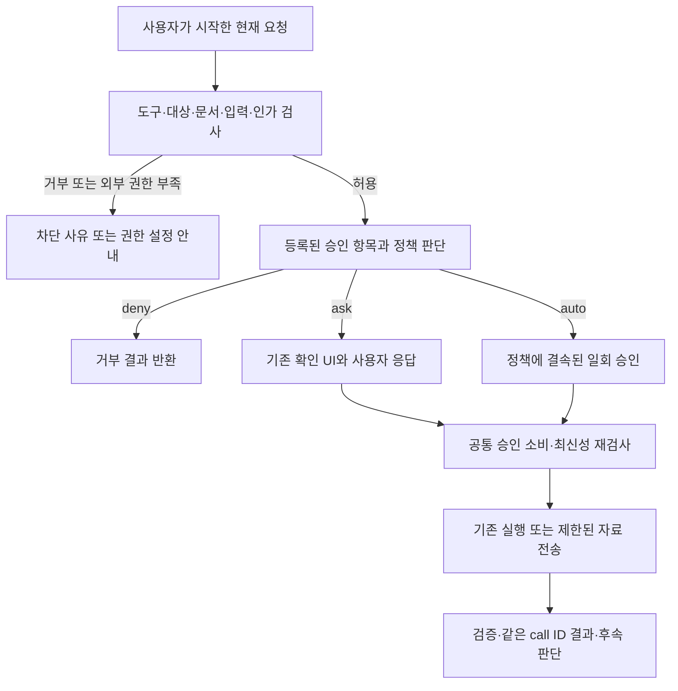

# Browser Agent S22 — 통합 승인 정책과 Full Permission 자동 실행

## 상태와 착수 근거

**구현·검증 진행 중 — 2026-10-11. 아래 계획은 착수 당시 기록이며 현재 구현은 코드가 SSOT다.**

Options와 공통 승인 정책, 자동 승인·거절, 설정 변경 시 취소, 승인 이력의 구현을 추가했다.
[커밋 전 검증 기록](../evidence/s21-s22-precommit-2026-10-11.md)을 참조한다.
전체 C1~C8/R1~R18 qualification과 운영 사이트·배포 검증은 완료하지 않았다.

[2026-10-12 무료 OpenRouter live 검증](../evidence/s22-live-free-2026-10-12.md):
통제 9/9, 기본 live 3/3 및 일부 추가 표본 PASS. driver 조기 판정을 수정했으나
추가 live 재검증과 혼합 흐름은 HTTP 429/프록시 오류로 미완료다. 진행 중 상태를 유지한다.

[동일 날짜 OpenAI 재검증](../evidence/s22-live-openai-2026-10-12.md)에서 기본 최초 8/9와
검사 수정 후 재실행 1/1, holdout 15/15, 혼합 2/2를 통과했다. OpenRouter 실패와
OpenAI 최초 검사 실패·HTTP 500은 보존하며 전체 R1~R18 qualification은 여전히 진행 중이다.

| 항목        | 내용                                                                                                                                                                                                                                                                                |
| ----------- | ----------------------------------------------------------------------------------------------------------------------------------------------------------------------------------------------------------------------------------------------------------------------------------- |
| 요청        | Options에서 작업 제안·권한 질문 등 모든 실행 승인 항목의 확인 여부를 설정하고, Full Permission에서는 사용자 승인 대기 없이 자동 진행                                                                                                                                                |
| 분석 기준   | HEAD `f4e962f205caf9f0c8b6ad012c0de55a7624c236` + 분석 시점의 미커밋 작업 트리, 확장 `0.1.101`                                                                                                                                                                                      |
| 기존 기반   | [S8 권한 모드](s8-permission-modes-hardening.md), [S15 입력·질문](s15-pah-9-llm-input-value-binding.md), [S17 계획·실행 피드백](s17-act-plan-execution-feedback.md), [S19 자료·vision 읽기](s19-component-data-tools.md), [S21 추가 판단](s21-act-evidence-based-llm-assessment.md) |
| 범위        | Browser-local Options, Ask/Act·Workflow·collection의 승인 경로, 설정 저장·이전·진단·검증                                                                                                                                                                                            |
| 외부 의존성 | Chrome 자체 권한 부여와 기존 Enterprise 정책은 각각 별도 권한 경계. Platform 기능·새 실행 수단·배포는 이 Sprint의 완료 주장에 포함하지 않음                                                                                                                                         |

현재 [permission mode](../../extension/src/policy/permission-mode.ts)는 host/tool 질문을
제어한다. 작업 제안은 [step runner](../../extension/src/service-worker/act-step-runner.ts),
계획은 [plan turns](../../extension/src/service-worker/act-plan-turns.ts), 자료 전송은
[source consent](../../extension/src/service-worker/source-consent.ts), 중요 작업 확인은
[proposal readiness](../../extension/src/service-worker/act-proposal-readiness.ts)에서 별도로
대기한다. collection 읽기의 일부 경로는 permission manager를 직접 호출한다.
따라서 현재 설정 하나로 모든 승인 대기를 자동화할 수 없다.

아래 내용은 **앞으로 구현할 변경과 수락 조건**이다. 구현 후 현재 동작은 코드·계약·설정을
따르고 이 문서는 전달 이력으로 보존한다. 기존 미커밋 수정의 완료·배포를 전제하지 않는다.

## 사용자 설정과 동작

Options의 Browser Agent 영역에 **승인 설정**을 제공한다.

| 모드            | 사용자에게 보이는 설명                                               | 처리                                                                                                      |
| --------------- | -------------------------------------------------------------------- | --------------------------------------------------------------------------------------------------------- |
| 승인 확인       | 필요한 승인을 사용자에게 물어봅니다.                                 | 신규 승인에는 확인 UI를 표시. 이미 사용자가 허용한 동일 범위의 권한·session 승인은 기존 수명 안에서 사용  |
| Full Permission | 요청한 작업에 필요한 실행·권한·자료 전송 승인을 자동으로 처리합니다. | 등록된 승인 항목을 모두 자동 승인. 사용자 입력·대상 선택이 필요하거나 Chrome 권한이 없으면 그 사유를 표시 |
| 항목별 설정     | 승인 종류별로 확인·자동 승인·거부를 선택합니다.                      | 아래 모든 항목을 개별 설정. 항목을 직접 수정하면 이 모드로 전환                                           |

- 기본값은 `승인 확인`이다. Full Permission은 사용자가 Options에서 직접 선택하고
  저장해야 활성화된다. 선택 화면에서 페이지 변경, 중요 작업, 코드·화면의 선택 Provider
  전송까지 포함됨을 설명한다. 선택 후 저장을 명시적 설정 동의로 사용하며 별도 팝업이나
  동일 문구 재입력 절차는 추가하지 않는다.
- 모든 모드에서 항목별 유효 설정을 볼 수 있다. `확인 / 자동 승인 / 거부`를 제공하며,
  Full Permission의 유효 항목은 모두 `자동 승인`이다. 신규 승인 항목이 추가될 때는
  명시적 registry 등록과 검증을 거쳐 이 목록에 함께 노출한다.
- Side Panel은 적용 중인 모드를 표시한다. 자동 승인 항목은 클릭할 카드 대신
  `설정에 따라 자동 승인됨`이라는 안전한 timeline 기록을 남기고 계속 진행한다.
  전체 입력값·코드·이미지·nonce를 이 기록에 넣지 않는다. Stop은 계속 제공한다.
- 설정은 Chrome profile의 로컬 설정이다. 대화·페이지·LLM·Workflow/Profile에서 변경할 수 없다.
  이미 시작한 요청에 더 넓은 권한을 소급 적용하지 않는다.

### 승인 항목 전체 목록

| 예정 category       | 사용자 항목               | 현재 연결 위치·추가 적용 범위                                                                                                        |
| ------------------- | ------------------------- | ------------------------------------------------------------------------------------------------------------------------------------ |
| `action_execution`  | 작업 제안 실행            | `action_review_required`: DOM, navigation, 등록 Page API, Workflow 각 단계, S21 실행 전 대안. `single_step`도 정책에 따라 자동 승인  |
| `plan_approval`     | 계획 승인                 | `submit_plan`, 선택된 Workflow의 `WORKFLOW_PLAN` 후 시작 확인. 계획 승인과 각 동작 승인에는 각각 정책 적용                           |
| `tool_permission`   | 사이트·도구 사용 권한     | `permission_required`, Ask/Act 분석 collection·Page API read, 독립 collection 읽기, 승인된 계획의 도메인 허용                        |
| `risk_confirmation` | 중요 작업 추가 확인       | `confirmation_required` 중 현재 코드가 허용하는 R2 동작. 확인 token의 발급·결속·단일 소비를 유지하며 사용자 확인 대신 정책 승인 사용 |
| `source_disclosure` | 페이지 코드 전송·분석     | script search/read의 source 동의, `WORKFLOW_ANALYSIS_CONSENT`와 코드 전송. 전송할 출처·범위와 현재 Provider에 결속                   |
| `vision_disclosure` | 화면 캡처·이미지 전송     | component vision·Act screenshot/zoom 동의와 Ask screenshot/zoom의 공통 정책 적용. Chrome 캡처 권한·민감 화면 검사는 별도 적용        |
| `component_scroll`  | 스크롤을 동반한 자료 읽기 | `source_consent_required`의 component-scroll. bounded 읽기·위치 복구·취소를 유지하며 동의만 정책으로 결정                            |

`확인`은 유효한 동일 scope의 사용자 승인을 재사용할 수 있고, `자동 승인`은 현재 작업에
필요한 승인만 정책으로 부여하며, `거부`는 해당 작업을 실행·전송하지 않고 거부 결과를 반환한다.
자동 승인을 영구적인 `항상 허용` permission으로 저장하지 않는다.

### 질문·시작 행위·차단의 구분

| 항목                                                                                          | Full Permission에서의 동작                                                                                                                                                      |
| --------------------------------------------------------------------------------------------- | ------------------------------------------------------------------------------------------------------------------------------------------------------------------------------- |
| 입력값·option·추가 질문 (`value_required`, clarification)                                     | 원래 요청과 현재 revision에 결속된 값이 있으면 기존 입력 경로 사용. 없으면 사용자 응답 대기; 값을 추측하거나 빈 답변으로 승인하지 않음                                          |
| 여러 collection·Workflow 중 대상 선택                                                         | 기존 코드 또는 모델의 검증된 선택으로 대상이 확정된 경우에만 진행. 후보가 모호하면 선택 요청 유지                                                                               |
| 사용자 요청 제출·수동 작업 시작                                                               | 설정 저장만으로 작업을 시작하지 않음. 사용자가 제출한 요청 또는 명시적으로 시작한 작업이 필요                                                                                   |
| Workflow 저장 이름·설정 변경·삭제·권한 철회                                                   | 실행 승인 정책으로 새로운 관리 작업을 만들지 않음. 사용자가 선택한 관리 동작과 필요한 입력은 유지                                                                               |
| Chrome 사이트 접근·캡처·debugger·Provider host 권한                                           | 확장이 이미 보유한 권한 안에서 진행. 권한이 없으면 Options의 사용자 동작으로 권한을 요청할 경로와 부족한 권한을 표시; 앱의 자동 승인으로 Chrome 권한을 부여했다고 처리하지 않음 |
| 저장된 DENY, Enterprise 거부·인가 불가, R3 차단, credential·민감 화면·제한 페이지·미지원 수단 | 기존 차단을 적용하고 이유 표시. 모델이나 로컬 자동 승인으로 인가 결과를 완화하지 않음                                                                                           |
| Ask에서 mutation 제안                                                                         | 계속 차단. 자료 전송 자동 동의가 Act 실행 권한을 만들지 않음                                                                                                                    |

Full Permission은 **제품이 허용하는 승인 항목 전체의 자동 승인**이다. 기존 R2의 추가 확인도
자동화 대상에 포함하며, R3처럼 현재 승인으로도 실행할 수 없는 동작의 지원을 새로 추가하지 않는다.
외부 권한·입력 부족·인가 차단은 자동 승인과 구별해 화면에 표시한다.

기존 [Enterprise 인가 계약](../../extension/src/policy/enterprise-policy.ts)의
`ALLOW / DENY`와 `managed_auto: false` 검증은 유지한다. 이 Sprint의 자동 승인은 사용자가
Options에 저장한 로컬 정책에 의한 승인이다. PDP의 `managed_auto: true`나 외부
`approval_token`을 수락하는 Platform 자동 실행 기능을 추가하거나 완료로 기록하지 않는다.

## 예정 설정 계약과 이전

`AgentPreferences.permission_mode`를 통합 `approval_policy`로 대체한다. page read 범위,
screenshot policy, timeline 설정은 유지한다. 아래 필드는 예정 계약이며 현재 존재하는 API가 아니다.

| 필드                                     | 예정 값·책임                                                                                                                |
| ---------------------------------------- | --------------------------------------------------------------------------------------------------------------------------- |
| `approval_policy.schema_version`         | `1`; 알려진 버전만 허용                                                                                                     |
| `approval_policy.mode`                   | `ask`, `full_permission`, `custom`                                                                                          |
| `approval_policy.rules`                  | 위 category 전체와 `ask / auto / deny`의 완전한 매핑. ask/full은 preset과 일치해야 하며 누락·불일치 저장 거절               |
| `approval_policy.tool_permission_scope`  | `request` 또는 `approved_plan`; 기존 S8의 정확한 origin 계획 경계를 유지. 이 값이 실행 수단이나 도메인을 새로 지원하지 않음 |
| `policy_revision`                        | Worker가 발급·저장하는 revision. UI·모델이 임의로 권한을 부여하는 값으로 사용하지 않음                                      |
| 저장 메시지의 `expected_policy_revision` | Options가 읽은 revision. 충돌한 저장은 거절하고 최신 설정을 다시 표시                                                       |

기존 값은 storage bootstrap의 별도 migration에서만 읽는다. 일반 설정 저장의 strict
validator에 구·신 계약을 혼합하지 않는다. preset 해석과 migration 결과는 단위 테스트로 고정한다.

| 기존 permission mode         | 이전 결과                                                             | 보존할 동작                                                                         |
| ---------------------------- | --------------------------------------------------------------------- | ----------------------------------------------------------------------------------- |
| `standard`                   | `ask`, 모든 category `ask`, scope `request`                           | 기존 승인 질문과 저장된 permission                                                  |
| `skip_all_permission_checks` | `custom`, `tool_permission=auto`, 나머지 `ask`, scope `request`       | host/tool 질문 생략만 유지. 자동 업데이트만으로 작업·코드·화면 승인까지 넓히지 않음 |
| `follow_a_plan`              | `custom`, `tool_permission=auto`, 나머지 `ask`, scope `approved_plan` | 정확히 승인된 origin만 자동 허용; origin 추가는 정책에 따른 계획 승인으로 처리      |
| 설정 없음                    | 기본 `ask`                                                            | 사용자 선택 전 자동화 없음                                                          |
| 손상·알 수 없는 version/값   | 자동화 비활성화, 설정 복구 안내                                       | 저장된 거부는 삭제하지 않으며 잘못된 설정을 Full Permission으로 해석하지 않음       |

설정 저장은 Worker에서 직렬화한다. 진행 중인 요청·읽기·동의·승인 대기를 취소하고
능력을 폐기한 뒤 preferences와 revision을 함께 저장한다. 저장 완료 시 새 요청만 새 정책을
사용한다. storage 실패나 저장 경합 중에는 dispatch·자료 전송을 차단하며 성공 메시지를 내지 않는다.
Worker 재시작은 저장된 모드를 유지하지만 이전 자동 승인 token·대기 요청을 복원하지 않는다.

기존 screenshot `disabled / manual_only` 및 명시적 DENY는 상위 제약으로 유지한다.
Full Permission을 선택해도 상충하는 제약을 자동 수정하지 않고 유효 차단 사유를 보여준다.
다른 설정 화면이나 import를 통해 이 제약을 우회할 수 없어야 한다.

## 공통 승인 판단과 실행 연결

공통 registry·resolver는 `policy/`에, 현재 요청의 승인 grant·resume 연결은 Worker에 둔다.
UI는 확인 요청을 표시하거나 결과를 보여주고, 자동 승인 판단은 Worker가 수행한다.
LLM의 `approval_scope`·`approval_reason`은 제안 정보이며 사용자 설정을 바꾸거나 거부를 뒤집지 않는다.

1. 요청 활성 상태, 현재 문서·origin·대상·입력 binding과 기존 policy 검사를 적용한다.
   명시적 DENY·회사 정책·Ask mutation 차단이 로컬 자동 승인보다 우선한다. 기존 verifier,
   등록 adapter, 민감값 마스킹, 실행·전송 예산을 유지한다.
2. 기존 권한·승인이 이미 해당 category와 현재 scope를 정확히 허용하면 재사용한다.
   항목별 `deny`는 기존 ALLOW/session 승인보다 우선한다. 계획 origin 밖이면 기존 범위 오류를
   유지하거나 등록된 도메인 승인 요청으로 진행하며 범위를 자동 확장하지 않는다.
3. 새 승인은 category와 유효 정책으로 `ask / auto / deny`를 결정한다. 알 수 없는 category는
   자동 허용하지 않으며 등록 오류로 중단한다. 동일 resolver로 조회한 UI 설명과 실제 결정이 일치해야 한다.
4. `auto`에서는 대기 카드·`AWAITING_REVIEW` terminal을 발행하지 않고 Worker 내부에서
   일회 grant를 발급·소비한다. 기존 실행기를 호출하며 DOM 버튼 클릭, runtime 메시지 위조,
   `consent:true`의 무조건 신뢰로 자동화하지 않는다. 인간 승인도 같은 소비 경로로 연결한다.
5. grant는 category, policy revision, request generation, session/run, plan revision,
   document/page scope, intent digest에 결속한다. source/vision은 전송 범위·출처·Provider
   identity에도 결속한다. nonce·승인 ID는 모델에 제공하지 않고 재사용을 차단한다.
6. 모든 async 경계와 dispatch/전송 직전에 활성 요청·정책 revision·문서·인가를 다시 확인한다.
   R2는 기존 confirmation token 발급·결속·소비를 내부 정책 승인과 연결한다. `REQUIRE_CONFIRMATION`을
   무시하거나 R1로 바꾸지 않는다. 값 입력·확인 후 재개에도 같은 인가 검사를 적용한다.
7. 계획은 현재 revision을 승인한 뒤 같은 conversation으로 돌아간다. 각 action과 새 disclosure는
   다시 해당 category의 정책을 평가한다. 다른 origin·문서의 자료를 이전 grant로 읽거나 전송하지 않는다.
   지원되는 navigation continuation도 새 관찰·binding·승인을 만들며 기존 navigation 제한을 유지한다.
8. 실행·읽기 결과는 원래 tool call ID로 반환하고 현재의 verifier·목표 판단을 거친다.
   자동 승인을 실행 성공으로 기록하지 않는다. dispatch 이후 UNKNOWN은 읽기 재확인만 허용하며
   같은 mutation을 자동 재실행하지 않는다. 기존 step/round/time/byte budget을 유지한다.

자동 승인으로 동의할 때도 실제 source·vision safety 검사와 bounded 수집·스크롤 복구는 수행한다.
Ask vision처럼 현재 개별 동의 UI가 없는 경로도 공통 정책에 연결하고, 같은 요청·현재 Provider에
대해 이미 확보한 명시적 동의만 재사용한다. 전체 사이트 접근 권한을 전송 동의로 해석하지 않는다.

## 구현 카드와 완료 조건

| 카드   | 상태    | 구현 범위·주요 연결점                                                                                                                                                                                                                                                                                                                                                                                                                                                                                       | 완료 조건                                                                                                                                                                |
| ------ | ------- | ----------------------------------------------------------------------------------------------------------------------------------------------------------------------------------------------------------------------------------------------------------------------------------------------------------------------------------------------------------------------------------------------------------------------------------------------------------------------------------------------------------- | ------------------------------------------------------------------------------------------------------------------------------------------------------------------------ |
| S22-C1 | Planned | 승인 category registry, preferences·grant·결정 계약과 strict validator. 기존 chat event 및 응답 state 전체 조사                                                                                                                                                                                                                                                                                                                                                                                             | 위 7종 및 응답형 Workflow/collection 승인 누락 없음. 승인·입력·외부 권한 구분을 실행 가능한 검증으로 고정                                                                |
| S22-C2 | Planned | [Options](../../extension/src/settings/index.html), [settings entry](../../extension/src/settings/entry.ts), [preferences handler](../../extension/src/service-worker/preferences-message-handler.ts), [storage bootstrap](../../extension/src/service-worker/storage-bootstrap.ts)                                                                                                                                                                                                                         | 모드·항목별 편집·유효 차단 사유 표시, explicit save, 안전한 이전·revision 충돌·storage 실패 검증. 기존 세 설정을 넓히지 않고 이전                                        |
| S22-C3 | Planned | 공통 resolver, [permission manager](../../extension/src/policy/permission-manager.ts), [plan scope](../../extension/src/policy/plan-scope.ts), Worker 전용 일회 grant                                                                                                                                                                                                                                                                                                                                       | DENY·외부 인가·scope 우선순위, policy revision과 fresh binding, 중복 소비·미등록 category 차단. UI와 자동 승인에 동일 결과                                               |
| S22-C4 | Planned | [step runner](../../extension/src/service-worker/act-step-runner.ts), [plan turns](../../extension/src/service-worker/act-plan-turns.ts), [proposal executor](../../extension/src/service-worker/act-proposal-executor.ts), [Workflow start](../../extension/src/service-worker/workflow-start-message-handler.ts)                                                                                                                                                                                          | single_step/session, 계획·Workflow 시작·Page API·navigation·S21 대안 모두 적용. Full Permission에서 action/plan 확인 0회, 정확히 한 번 dispatch와 tool 결과 continuation |
| S22-C5 | Planned | [readiness](../../extension/src/service-worker/act-proposal-readiness.ts), [followup](../../extension/src/service-worker/act-proposal-followup.ts), [mutation coordinator](../../extension/src/state/mutation-coordinator.ts), [confirmation](../../extension/src/state/confirmation.ts)                                                                                                                                                                                                                    | 지원 R2의 정책 승인·token 소비. ask/deny도 정확히 적용. 입력 부족 질문은 유지하며 stale value/confirmation·중복·취소 후 dispatch 0회                                     |
| S22-C6 | Planned | [source consent](../../extension/src/service-worker/source-consent.ts), [Workflow analysis](../../extension/src/service-worker/workflow-analysis-message-handler.ts), [analysis selection](../../extension/src/service-worker/analysis-source-selection.ts), [collection handler](../../extension/src/service-worker/collection-read-message-handler.ts), [Act vision](../../extension/src/service-worker/act-vision-read.ts), [Ask vision](../../extension/src/service-worker/ask-vision-tool-executor.ts) | tool·source·vision·scroll 모든 채널에 정책 적용. manual/disabled/DENY 우선, scope와 Provider 변경 검사, 거부 시 읽기·전송 0, 자동 scroll 복구·같은 요청 재개             |
| S22-C7 | Planned | request 취소·저장 race·Worker 재시작, [Panel](../../extension/src/sidepanel/entry.ts), [chat 계약](../../extension/src/contracts/chat-event-types.ts), [복구 저장](../../extension/src/state/tab-chat-session-store.ts), diagnostics/export                                                                                                                                                                                                                                                                 | 모드와 자동 승인 주체 표시, 입력 대기는 승인 대기와 구별. grant 복원·늦은 응답 재실행 없음. 마스킹된 결정 이력과 strict schema·구버전 history 호환                       |
| S22-C8 | Planned | unit/fixture·통제 Chrome·live Provider·관련 회귀, 신규 S22 검증 driver와 [test 가이드](../test.md)                                                                                                                                                                                                                                                                                                                                                                                                          | 아래 R1~R18의 수행 revision·환경·결과·한계를 기록. 미통과나 미검증 항목이 남으면 해당 카드/qualification을 완료로 표시하지 않음                                          |

착수 순서는 C1 → C3이며 C2는 C1 계약 이후 진행한다. C4~C6는 C2·C3의 설정과 공통
승인 소비 경로를 사용한다. C7은 각 연결 변경과 함께 적용하고 C8에서 전체 요청의 동작을 확인한다.
production 신규 모듈은 199줄 제한과 기존 module boundary를 지킨다.

`approval_source=user|policy`, category, 결정·reason code, 정책 revision, opaque request/plan
revision과 outcome을 안전한 결정 이력에 기록한다. 정책 자동 승인을 `사용자가 이번에 승인함`으로
표시하지 않는다. 과거 기록은 과거 user 승인으로 읽되 새 grant 능력으로 복원하지 않는다.
wire·storage 변경의 실제 producer/consumer 및 버전 범위는 C7 증거에 기록한다.

## 검증 행렬

| ID      | 시나리오                                                                       | 필수 결과·증거                                                                                                                            |
| ------- | ------------------------------------------------------------------------------ | ----------------------------------------------------------------------------------------------------------------------------------------- |
| S22-R1  | 신규 설치·ask, 초기 계획·작업 제안·허용 R2                                     | 필요한 기존 확인 UI 표시. 승인 전 mutation 0; 현재 scope의 인간 승인 후 정확히 한 번 실행                                                 |
| S22-R2  | Full Permission: 계획 → 값 있는 single_step → click → 목표 확인                | 승인 클릭 0, app 승인 대기 0, 정확한 요청값·각 dispatch 1회·같은 call ID 결과·실제 최종 UI·목표 판단                                      |
| S22-R3  | category마다 ask/auto/deny와 preset 조합                                       | 7종 × 3결정 검증. ask는 확인 전 부작용 0, auto는 대기 없이 한 번, deny는 실행·해당 데이터 획득·전송 0                                     |
| S22-R4  | 기존 standard/skip/follow 설정으로 update·다시 로드                            | migration 매핑 일치, 기존 DENY 보존. skip에서 새 action/source/vision 자동 승인 0, follow의 정확한 origin 범위 유지                       |
| S22-R5  | 저장된 DENY, Enterprise 거부/인가 불가, R3·credential·제한 페이지·Ask mutation | Full Permission으로 우회 0; reason과 실제 부작용 부재 확인. 테스트 응답과 통제 runtime 범위를 구분                                        |
| S22-R6  | Full Permission·custom auto의 R2와 confirmation 중복·만료·scope 변경           | 정책 grant와 기존 token을 한 번만 소비. 권한/문서 바인딩 유지; 거절·취소·중복 실행 0                                                      |
| S22-R7  | 값 없음·여러 대상·clarification 답변과 정정 revision                           | 질문·선택 대기 유지, 임의 값/후보 선택 0. 답변 후 같은 conversation, 새 proposal에 다시 정책 적용                                         |
| S22-R8  | Ask/Act 분석 및 독립 collection·Page API read                                  | 공통 tool 권한 적용; Full Permission에서 app 권한 카드 0. DENY·descriptor 변경·미지원 채널 우회 0                                         |
| S22-R9  | script 목록·검색·부분 읽기와 Workflow 코드 분석                                | auto 동의 후 bounded 자료·같은 tool 결과·후속 판단. deny 시 원문 전송 0. 타 출처·Provider로 grant 재사용 0                                |
| S22-R10 | Ask/Act screenshot·zoom·component vision                                       | 정책 동의와 실제 image 전송 확인. disabled/manual_only/민감 화면/Chrome 권한 부재 시 전송 0; 이미지는 ZIP/history에 남지 않음             |
| S22-R11 | component-scroll auto·deny·중간 Stop                                           | 허용한 bounded 읽기만 수행·위치 복구 증거. deny/Stop 이후 추가 스크롤·전송 0, 복구 실패는 사실대로 반환                                   |
| S22-R12 | Workflow 후보 선택·계획 승인·다단계 실행과 request-local 수정                  | 대상 확정 후만 auto 시작, 원본 저장 변경 0. 각 category 적용, plan revision·목표 보존·각 단계 한 번 실행                                  |
| S22-R13 | 승인·LLM·capture 대기 중 설정 변경, 다중 Options 저장, storage 실패            | 기존 요청 취소·grant 폐기, revision 충돌 거절. 저장 경계 이후 구 정책 dispatch/전송 0, 실패를 저장 성공으로 표시하지 않음                 |
| S22-R14 | Worker/Panel 재시작·새 요청·Stop·늦은 결과·중복 응답                           | 저장된 모드는 유지, 이전 grant·승인 UI의 능력 재생 0. 자동 mutation/자료 전송 재개 0; live/recovered event 순서 회귀                      |
| S22-R15 | navigation·DOM 교체·plan/value 변경·S21 대안과 UNKNOWN                         | fresh scope로 재평가. 기존 grant 재사용 0, 실행 전 대안 예산 유지, 실제 dispatch 이후 UNKNOWN 재실행 0                                    |
| S22-R16 | 자동 승인 이력·mode badge·진단 ZIP·구버전 history                              | user/policy 구분, reason·outcome 표시. 원문·이미지·입력값·credential·nonce 부재, ZIP 무결성·strict schema 확인                            |
| S22-R17 | 실제 model의 mixed tool loop와 라벨/DOM 변경 holdout                           | Options 저장 → 승인 클릭 없는 계획/action/읽기/중요 확인 → 실제 결과와 후속 판단·최종 UI까지 증명. HTTP 성공이나 unit만으로 대체하지 않음 |
| S22-R18 | 정상 경로·기존 승인 모드·source/vision 거부·실행 오류 회귀                     | S8, S10, S13, S15, S17~S21의 영향받는 검증 통과. 기존 오류/UNKNOWN 유지, budget·복구·마스킹 회귀 없음                                     |

구현 시 pinned `pnpm@9.15.4`로 typecheck, lint, 영향받는 unit/fixture/E2E,
module-boundaries, method-trace와 필요한 Chrome 회귀를 실행한다. build는 버전을 바꾸므로
검증 build는 `pnpm exec tsc -p tsconfig.build.json && node scripts/build-extension.mjs && node scripts/validate-package.mjs`를 사용한다.
신규 S22 driver는 모드·category·case 선택, 승인 표시/클릭 횟수, 실제 dispatch와 자료 전송,
동일 call ID continuation, 최종 UI, Stop·재시작과 masked report를 측정해야 한다.
live Provider/model·Chrome revision, 실행 실패와 재실행은 별도 증거로 기록한다.

## 종료와 운영 범위

Browser-local 종료는 C1~C8의 구현과 R1~R18의 해당 수락 범위 검증으로 판단한다.
사용자가 Options에 저장한 정책과 실제 승인·실행·전송 동작이 일치해야 한다. 실제 운영 사이트,
임의 Provider, Platform 강제 정책의 live 통합, 설치·배포는 개별 증거 없이 완료로 확대하지 않는다.
남은 범위는 날짜·원래 범위를 유지해 backlog로 기록한다.

현재 완료된 것은 이 Sprint 계획 생성뿐이다. 제품 코드·설정 계약·기본 승인 동작과 배포는
이 문서 생성으로 변경되지 않았다.
