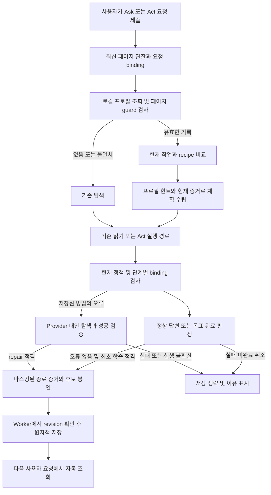
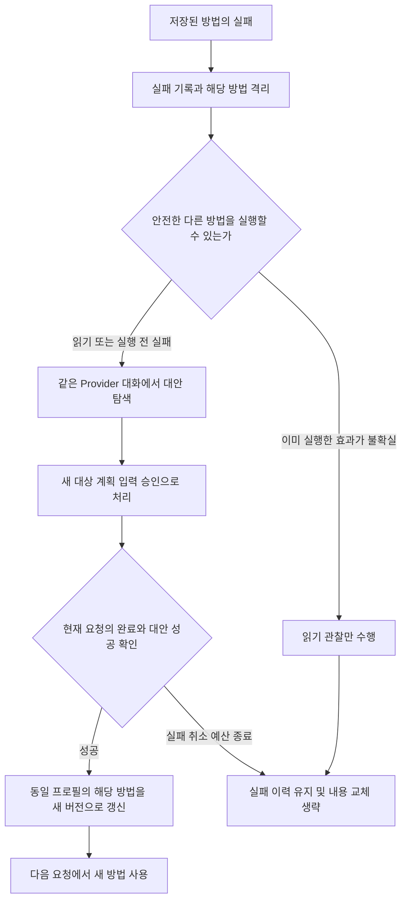

# Browser Agent S24 — 성공한 Ask/Act 요청의 페이지 프로필 자동 저장·재사용

## 상태와 범위

**Planned — 2026-10-13. 설계만 작성했으며 제품 코드는 구현하지 않았다.**

2026-10-13 후속 요구를 반영해 **저장된 방법의 실패 → Provider 대안 탐색 → 성공한
대안으로 해당 프로필 갱신**과 **Options 항목별 관리·내용 보기**를 보강했다.

사용자는 오류가 발생하지 않은 요청에서 페이지 프로필을 자동 저장하고,
다음 동일한 페이지의 요청에서 활용하기를 요청했다. 대상은 **Ask와 Act 모두**다.
이 문서는 구현 전 결정과 acceptance를 기록한다. 구현 후 현재 계약의 SSOT는
코드·런타임 계약·설정으로 이전하고, 이 문서는 delivery 기록으로 남긴다.

초기 범위는 같은 Chrome profile의 Browser-local 저장·재사용이다. 페이지를
방문하는 것만으로 작업을 시작하지 않으며, 사용자가 제출한 다음 요청에서 자동 조회한다.
외부 Resolver/Platform 등록, 조직 서명, 클라우드 동기화는 후속 범위다.

## 기대 동작

1. Ask에서 표를 읽어 분석한 요청이 정상 완료되면, 표를 찾고 읽는 방법과
   coverage 확인 방법을 자동 저장한다. 다음 요청은 현재 표를 새로 읽어 분석한다.
2. Act에서 검색어를 입력하고 검색한 요청이 정상 완료되면, 입력 대상·검색 버튼·
   결과 확인 순서를 저장한다. 다음 요청의 검색어를 사용하며 과거 입력값은 저장하지 않는다.
3. 같은 페이지에서 다른 작업을 요청하면 공통 페이지 힌트만 활용한다.
   검색 프로필이 있다는 이유로 새 읽기 요청을 검색 실행으로 바꾸지 않는다.
4. 프로필이 없거나 현재 화면에 맞지 않으면 기존 Ask/Act 탐색 경로로 진행한다.
   프로필 저장 실패는 이미 완료한 요청의 성공 결과를 바꾸지 않는다.
5. 저장한 읽기 방법이나 작업 순서에서 오류가 발생하면 같은 요청의 Provider가 현재
   화면과 실패 근거로 다른 방법을 찾는다. 대안으로 요청이 완료되면 같은 프로필의
   해당 recipe를 새 revision으로 갱신한다. 다음 요청부터 성공한 대안을 사용한다.
6. Options에서 프로필과 recipe를 각각 선택해 내용을 보고, 이름·활성 여부·자동 갱신·
   삭제·다음 요청의 재탐색을 관리한다. 최초 실패와 변경 전후 내용도 확인할 수 있다.

## 확인한 현재 연결점

2026-10-13 작업 트리에서 확인했다. 기준 HEAD는 `c0ae91f72`이고 미커밋 변경을
포함하므로 아래 분석을 clean commit 전체의 검증 결과로 해석하지 않는다.

| 영역                | 코드와 설계에 미치는 영향                                                                                                                                                                                                                                                                                                                                              |
| ------------------- | ---------------------------------------------------------------------------------------------------------------------------------------------------------------------------------------------------------------------------------------------------------------------------------------------------------------------------------------------------------------------- |
| 외부 Profile        | [Resolver](../../extension/src/profile/resolver.ts), [Profile 계약](../../extension/src/profile/profile-types.ts), [설정](../../extension/src/settings/profile-settings.ts): 현재 페이지에 결속된 서명 응답을 조회한다. 로컬 학습 기록을 이 타입으로 위장하지 않는다.                                                                                                  |
| 페이지 읽기·binding | [page context runtime](../../extension/src/service-worker/page-context-runtime.ts), [fingerprint](../../extension/src/profile/fingerprint.ts): 최신 snapshot을 확보한다. 기존 fingerprint는 이름을 category로 줄이므로 작업 대상의 의미 일치까지 보장하지 않는다.                                                                                                      |
| Ask                 | [runner](../../extension/src/service-worker/ask-chat-runner.ts), [executor](../../extension/src/service-worker/ask-tool-executor.ts): 답변 정상 종료와 adapter 검토 종료가 모두 VERIFIED가 될 수 있다. 화면의 tool_finished VERIFIED만으로 실제 읽기 성공을 판단하지 않는다.                                                                                           |
| Act 완료            | [goal finalizer](../../extension/src/service-worker/act-goal-finalizer.ts), [completion 계약](../../extension/src/contracts/act-completion.ts), [실행 feedback](../../extension/src/service-worker/act-execution-feedback.ts): 최종 goal 완료와 원래 action receipt를 함께 확인한다.                                                                                   |
| 대안 실행·중복 방지 | [논리 결과](../../extension/src/service-worker/act-logical-results.ts), [mutation history](../../extension/src/service-worker/act-mutation-history.ts): 현재 pre-dispatch TARGET_NOT_ACTIONABLE/TARGET_STALE의 대안 1회와 UNKNOWN/동일 mutation 반복 차단을 유지한다. 다른 method로 같은 효과를 중복 실행하지 않는다.                                                  |
| Options 관리 권한   | [preferences handler](../../extension/src/service-worker/preferences-message-handler.ts), [Options](../../extension/src/settings/index.html): Settings sender 확인·strict fields·revision·직렬 mutation을 사용한다. 프로필 관리도 같은 소유권 원칙으로 새 전용 경로를 연결한다.                                                                                        |
| 요청 종료·복구      | [request lifecycle](../../extension/src/service-worker/chat-request-lifecycle.ts), [run lifecycle](../../extension/src/service-worker/chat-run-lifecycle.ts), [request store](../../extension/src/service-worker/request-store.ts): finish에서 controller를 abort하며 복구 시 prompt·mode 전체를 보존하지 않는다. 종료 후 기존 active-context 검사로 저장하면 안 된다. |
| 기존 Workflow       | [catalog](../../extension/src/service-worker/workflow-catalog-runtime.ts), [declaration](../../extension/src/contracts/workflow.ts), [save handler](../../extension/src/service-worker/workflow-save-message-handler.ts): 사용자 저장 경로와 제한된 v1 도구 계약이 있다. 학습 프로필을 기존 catalog에 자동 삽입하지 않는다.                                            |
| 설정·storage        | [preferences](../../extension/src/policy/permission-mode.ts), [bootstrap](../../extension/src/service-worker/storage-bootstrap.ts): strict validator와 TRUSTED_CONTEXTS 저장 경계를 유지한다.                                                                                                                                                                          |
| 동적 메서드         | [Page Method 계약](../../extension/src/contracts/page-method-types.ts), [S23](s23-provider-page-method-execution.md): method_ref·함수/receiver identity·인자·승인은 현재 요청 소유다. 다음 요청에서 재발급한다.                                                                                                                                                        |

## 설계 결정

**저장 단위는 페이지별 공통 힌트와 작업별 처리 방법을 가진 별도
`LearnedPageProfile`이다.** 과거 답변이나 업무 데이터가 아니라 처리 절차를 저장한다.
한 페이지에 여러 작업 recipe를 둘 수 있으며 Ask와 Act의 recipe는 구분한다.

**프로필의 자동 사용은 탐색·계획 수립을 돕는다.** 실제 읽기·값 판단·계획·승인·
dispatch·검증은 기존 실행 경로를 이용한다. 사용자가 Full Permission을 선택했다면
현재 승인 정책에 따라 진행하며, 프로필 사용 때문에 승인 질문을 추가하지 않는다.
프로필 저장 성공이 새 실행 권한을 만들지는 않는다.

설정에는 `성공한 요청의 페이지 프로필 자동 저장·사용`을 하나의 기능으로 제공한다.
신규 설치와 업데이트 모두 기본 **켜짐**, Ask/Act 모두 활성으로 제안한다.
이 기본값은 사용자가 요청한 로컬 자동화를 구현하기 위한 결정이며 실행 승인 모드는
변경하지 않는다. 별도의 최초 저장 확인이나 요청별 저장 버튼은 요구하지 않는다.
Enterprise의 로컬 저장·자료 전송 제한은 적용한다.

## 자동 저장 기준

Worker는 디버그 설정과 무관하게 실행 중 최소한의 typed evidence와 오류 여부를
수집한다. 일반 trace 문자열·UI 메시지·HTTP 200·`ok: true` 하나를 성공 근거로 쓰지 않는다.

| 요청 결과                         | 자동 저장 판정                                                                                                                                                                                                            |
| --------------------------------- | ------------------------------------------------------------------------------------------------------------------------------------------------------------------------------------------------------------------------- |
| Ask 정상 답변                     | 전체 답변이 정상 종료했고 유효한 현재 페이지 증거와 재사용할 읽기 방법이 있으며 필요한 읽기 결과가 정상인 경우 저장한다. 답변 내용의 사실성을 별도로 인증한 것으로 표시하지 않는다.                                       |
| Act 모드의 정보·script 읽기       | read-only runner의 정상 답변 기준을 적용하되 mode=act와 read-only 성격을 기록한다.                                                                                                                                        |
| Act UI 작업                       | 최종 goal_status=completed이고 실제 사용한 단계의 raw receipt가 정상 검증되었으며 unresolved mutation이 없을 때 처리 순서를 저장한다. no-op은 실제 실행 단계로 만들지 않는다.                                             |
| 동적 메서드의 데이터 요청         | invocation=returned, 필요한 반환 projection이 정상이며 현재 데이터 목표 완료가 확인되면 **재탐색 힌트만** 저장할 수 있다. UNKNOWN 업무 효과를 성공한 mutation recipe로 저장하지 않는다.                                   |
| 대기·검토·미완료                  | WORKFLOW_CANDIDATES, ANALYSIS_ADAPTER_REVIEW_REQUIRED, WAITING_USER, checking/incomplete/unknown, 빈 답변, 도구 예산 종료는 저장하지 않는다.                                                                              |
| 실패·취소·불확실한 실행           | 실패한 방법을 성공 recipe로 저장하지 않는다. 사용자 거부, Stop, worker restart, 해결되지 않은 stale binding·mutation UNKNOWN은 신규 저장/대안 승격 대상에서 제외한다. 오류 기록과 안전한 repair 가능성은 별도로 판단한다. |
| 저장된 방법의 실패 후 성공한 대안 | 아래 repair 조건을 통과한 대안으로 최종 요청이 완료되면 기존 프로필/recipe를 갱신한다. 실패한 시도는 보존하고 성공한 처리 절차만 새 revision에 반영한다.                                                                  |
| 재사용 정보 없음                  | 정상 답변이어도 안전하게 일반화할 정보가 없으면 저장하지 않고 NO_REUSABLE_HINT를 기록한다.                                                                                                                                |

사용자의 “오류가 발생하지 않은 요청”은 실제 Provider·필수 도구·실행·검증 오류가
없다는 뜻으로 적용한다. **최초 자동 학습**에서는 실패 후 재시도로 완료한 요청도
신규 저장·성공 횟수 증가 대상에서 제외한다. **기존 프로필의 repair**는 별도의
성공 판정으로 갱신할 수 있으며 이는 이번 후속 요구에 따른 예외다. 실패한 방법의
성공 횟수는 증가시키지 않고 대안 성공·repair 횟수를 따로 기록한다.
Resolver 미설정·정상 cache miss·지원 채널 없음과
같은 **예상 가능한 가용성 결과**는 필수 작업 실패와 구분한다. 잘못된 JWS 같은
검증 실패를 정상 miss로 바꾸지 않는다. 오류 분류와 저장 제외 이유는 C1에서 고정한다.

현재 S21의 PROVIDER_COMPLETED 수용 자체는 유지한다. 프로필 학습 적격 기준이
더 좁다는 이유로 이미 완료된 요청을 실패로 다시 판정하지 않는다.

## 동일 페이지와 동일 작업 판정

초기 버전의 안정적인 page key는 **exact origin + 전체 URL의 로컬 keyed digest +
읽기 scope + context guard**로 구성한다. 구조 fingerprint는 해당 revision의
재사용 guard로 분리한다. 같은 페이지의 구조 변경으로 옛 방법이 실패했을 때에도
원래 profile_id를 찾고 성공한 대안으로 갱신할 수 있어야 하기 때문이다.
URL에는 path·query·SPA hash를 포함하고,
query나 hash를 일괄 제거하거나 path_prefix·wildcard로 범위를 넓히지 않는다.
digest의 로컬 키는 TRUSTED_CONTEXTS에 저장하며 Provider·진단으로 내보내지 않는다.
URL digest는 식별용이며 익명화를 보장한다고 설명하지 않는다.
초기 digest 알고리즘은 versioned HMAC-SHA-256이고 URL canonicalization은
`new URL(...).href`로 고정한다. query 순서나 trailing slash를 추가 정규화하지 않는다.

- protocol·host·port가 다르면 다른 페이지다. query·hash가 데이터/화면을 바꾸면 다른 페이지다.
- document_epoch·ref_id는 재방문마다 바뀌므로 영속 page key에 넣지 않는다.
  프로필 조회 후 현재 request/document/page scope에는 새로 결속한다.
- fingerprint 일치는 구조 비교일 뿐이다. 사용 단계마다 role, 안전한 label 증거,
  상위 영역 관계, visible/enabled, 현재 capability를 추가 확인한다.
- snapshot이 불완전·truncated이거나 fingerprint를 안전하게 계산하지 못하면 재사용하지 않는다.
  초기 버전은 기존 comparable snapshot 기준을 보수적으로 적용한다.
- 로그인·tenant·업무 대상이 달라지는 화면은 현재 허용된 관찰에서 context guard를
  확인할 수 있어야 한다. 불명확하면 작업 recipe 재사용·학습을 생략한다.
  cookie/token·숨겨진 사용자 식별자를 읽어 context guard를 만들지 않는다.
- 저장은 **요청 시작 화면**에 결속한다. 검색 결과·대화상자·이동 목적지를 시작 화면으로
  덮어쓰지 않는다. 단계별 화면 조건은 recipe의 별도 guard로 기록한다.

작업 key는 mode, 구조화된 작업 종류, 대상 의미, 필수 input slot 종류, 목표·coverage
조건으로 만든다. raw prompt나 prompt hash만으로 작업을 식별하지 않는다.
값이 바뀌어도 동일한 검색 절차는 재사용할 수 있지만 검색과 삭제는 다른 작업이다.
Worker가 유효 후보만 제공하고 Provider가 **현재 사용자 요청**과 비교하여 recipe를
선택한다. 후보가 모호하면 공통 힌트만 쓰고 기존 탐색·질문 경로로 진행한다.

URL template·동적 행 수를 무시하는 fingerprint·서로 다른 URL 간 recipe 공유는
오탐 검증과 별도 사용자 요구가 있을 때 후속 범위로 확장한다.

## 예정 저장 계약

아래 이름과 값은 **예정 계약**이며 현재 존재하는 타입·API가 아니다.

| 필드       | 예정 내용·제약                                                                                                                                                                                                                                                            |
| ---------- | ------------------------------------------------------------------------------------------------------------------------------------------------------------------------------------------------------------------------------------------------------------------------- |
| envelope   | schema_version=1, catalog_revision, records. 저장 key는 learned_page_profiles_v1.                                                                                                                                                                                         |
| identity   | opaque profile_id, profile_revision, source=local_success, authority=advisory. 서명된 Profile의 id/version과 별도다.                                                                                                                                                      |
| page_match | origin, keyed URL digest, scope, fingerprint 알고리즘/값, 안전한 context guard digest. raw URL/path/query/hash는 저장하지 않는다.                                                                                                                                         |
| page_hints | 읽기 채널·collection/source 탐색 순서·coverage 확인 종류. 안정적인 공개 UI label은 Worker의 허용·민감값 검사 후 제한적으로 저장하고 그 외는 digest만 저장한다.                                                                                                            |
| recipes    | 최대 5개. stable recipe_id/recipe_revision, mode, 작업 descriptor, input slot 종류, 단계별 guard·tool 종류·semantic target descriptor, 목표 확인 종류. 최대 12단계. recipe별 enabled/auto_update와 실패 격리 상태를 둔다.                                                 |
| provenance | 원래 request/run의 opaque digest, completion/confirmation 종류, receipt 요약 enum, 최초/최근 성공 시각·횟수. acquisition_kind=first_success/repaired_success, repair_id, 이전 revision·실패 단계/reason·대안 성공 근거와 repair 횟수를 둔다. raw trace·prompt는 제외한다. |
| lifecycle  | enabled, active/stale/quarantined/disabled, expires_at, last_used_at, revision별 mismatch·실패 이유와 횟수. 새 내용은 새 revision으로 저장한다. repairing은 현재 요청에서만 표시하는 진행 상태다.                                                                         |
| management | 표시 이름·메모, profile별 auto_update, force_discovery_next_request, 관리 revision. 메모는 Options 표시용이며 Provider instruction으로 전달하지 않는다.                                                                                                                   |
| history    | 현재 내용 외 최근 성공 revision 최대 3개와 실패/repair 요약 최대 20개. 이전/새 recipe·guard·input slot·목표 확인 방식의 마스킹된 차이를 볼 수 있다. 전체 크기 제한을 우선한다.                                                                                            |

허용하지 않는 영속 값은 raw prompt/답변/페이지 원문/표 데이터/이미지/소스 코드,
실제 입력값·option 값·method 인자·반환 데이터, credential, arbitrary endpoint,
JWS·nonce·승인 grant·ref_id/model_ref/method_ref·tool_call_id·문서 epoch다.
LLM 자유 서술 instruction을 영속 처리 명령으로 저장하지 않는다.

입력은 `query:string, source=current_request` 같은 slot으로 저장한다.
다음 요청에서 현행 value binding·clarification 경로가 값을 확보한다. 과거 값·
페이지 기본값으로 빈 slot을 채우지 않는다. 페이지·Provider가 임의로 준 risk·
permission·verifier 정의를 새 권한 규칙으로 저장하지 않는다.

추출은 typed tool/실행 증거에서 만들고 Worker의 closed schema·민감값 검사를 통과해야 한다.
작업 의미의 일반화가 필요하면 이미 동의된 같은 Provider 대화 안에서 bounded 구조화
후보를 만들 수 있다. 후보 생성 자체는 성공 판정·저장 권한이 아니며 추가 page 읽기·
mutation을 수행하지 않는다. 의미가 불명확하거나 예산이 없으면 해당 recipe를 생략한다.

## 저장과 재사용 흐름

### 저장

1. 요청 admission 시 시작 page identity·generation·설정 revision을 확보한다.
   실행 중 오류 flag와 안전하게 일반화할 trace 후보를 request-local 메모리에 수집한다.
2. UI에서 activity_finished/COMPLETED를 관찰해 저장하지 않는다. Worker의 정상 응답과
   최종 completion·실행 증거가 함께 확정되는 공통 종료 경로에서 적격 여부를 판단한다.
3. finish가 signal을 abort하고 Act session을 정리하기 **전에** 마스킹된 후보와
   최종 request/generation/revision을 immutable receipt로 봉인한다. 아직 checking이면
   봉인하지 않는다. 정상 종료의 abort와 사용자 취소를 혼동하지 않는다.
4. 실제 저장은 Worker의 직렬화된 queue에서 수행한다. receipt·기능 revision·삭제
   tombstone·catalog revision을 확인하고 record와 dedup ledger를 한 storage value로
   저장한다. 동일 request completion은 성공 횟수를 포함해 한 번만 반영한다.
   repair receipt는 원래 profile_id/recipe_id와 expected revision·repair_id를 추가 확인한다.
5. 종료 이후 새 요청·navigation 때문에 이미 봉인된 시작 페이지 기록을 새 화면 기록으로
   바꾸지 않는다. feature off·delete·clear가 선행하면 늦은 저장을 무효화한다.
6. 저장 실패·quota 초과는 프로필 상태만 실패로 표시한다. 원래 답변·완료 결과·실행을
   다시 시작하거나 변경하지 않는다. 증거 없는 과거 chat history에서 재학습하지 않는다.

### 재사용

1. 현재 snapshot 확보 직후, 작업별 분석 수집·Workflow discovery·Provider 메시지 구성
   **이전**에 공통 조회를 연결한다. 현재 Ask는 collectAnalysisData가 외부 Profile 조회보다
   먼저 있으므로 기존 위치에 붙이는 것만으로 collection 재사용이 된다고 볼 수 없다.
2. mode와 페이지 guard가 맞는 page hints를 제한된 UNTRUSTED_LEARNED_PAGE_PROFILE
   자료로 제공한다. 현재 관찰과 현재 사용자 요청이 우선이며 system instruction으로 넣지 않는다.
3. 첫 Provider 요청에는 최대 4 KiB의 metadata·공통 힌트만 넣는다. 상세 recipe는
   read-only list/read 도구로 필요할 때 읽는다. Ask/Act 각각 schema → executor → 현재
   request-local catalog → 같은 tool_call_id 결과 → continuation 연결을 검증한다.
4. recipe의 입력 slot을 현재 요청 값에 결속하고 각 단계의 target·capability를 재발견한다.
   자료 수집은 현재 coverage/continuation·전송 동의를 확인하고 과거 결과를 답변에 쓰지 않는다.
5. Act에서는 recipe를 계획 초안의 근거로만 사용한다. 신규 submit_plan·action proposal·
   S22 승인 소비·S15 입력 판단·현행 dispatch/verifier/goal 경로로 실행한다.
   저장된 Workflow 선택이나 계획 승인을 이미 받은 것으로 간주하지 않는다.
6. S23 힌트는 필요한 script/method의 재발견을 돕는다. 새 source evidence와 함수/receiver
   identity·method_ref·인자·승인을 확보한다. 초기 버전은 method 호출 자체를 영속 recipe
   실행 단계로 자동 변환하지 않는다. 이 제한은 서명 Workflow v1 계약도 유지한다.
7. 같은 페이지/문맥에서 guard가 불일치하거나 저장된 방법이 실패하면 해당 revision의
   사용을 중단하고 아래 Provider repair 경로로 연결한다. URL·계정·tenant가 바뀌면
   원래 프로필을 덮어쓰지 않고 다른 페이지의 기존 탐색으로 진행한다.
   이미 dispatch한 mutation 뒤 UNKNOWN이면 읽기 재확인만 허용하고 동일 실행을 반복하지 않는다.
8. 오류 없는 재사용은 원래 방법의 성공 횟수를 늘린다. 성공한 repair는 해당 recipe의
   새 revision으로 갱신하며 실패한 원래 시도와 대안 성공 통계를 구분한다.

## 프로필 실패 시 Provider 대안 탐색·자동 갱신

### 실패를 연결하는 기준

Worker는 선택·소비한 profile_id/recipe_id/revision, 실패한 논리 단계, 실제 tool 결과와
dispatch 여부를 연결한다. **cache hit만 있었던 요청의 모든 오류를 프로필 오류로
간주하지 않는다.** guard 실패도 같은 page key의 후보와 실패 근거가 있을 때 연결한다.
문제 범위가 recipe면 그 recipe만 quarantined로 격리하고 다른 정상 recipe는 유지한다.
공통 page hint가 원인이면 그 hint와 해당 hint를 사용하는 recipe를 격리한다.
구조 fingerprint가 바뀌면 영향받는 다른 recipe guard도 다시 평가한다.

| 실패 종류                         | Provider가 할 수 있는 대안 탐색·처리                                                                                                                                                                               |
| --------------------------------- | ------------------------------------------------------------------------------------------------------------------------------------------------------------------------------------------------------------------ |
| 읽기 경로·대상·coverage 실패      | 현재 관찰에서 다른 DOM/collection/component/source 채널을 찾는다. 새 채널의 동의·coverage·예산을 적용하고 새 데이터를 읽는다.                                                                                      |
| 실행 전 target/guard 실패         | dispatch=not_dispatched가 확인되면 새 대상·계획·입력 binding과 승인을 확보해 대안을 제안한다. 기존 S21의 논리 단계별 대안 1회 제한을 유지한다.                                                                     |
| 실행 이후 검증 실패·UNKNOWN       | 다른 버튼이나 API로 같은 업무 동작을 다시 수행하지 않는다. Provider는 읽기 관찰로 실제 효과와 남은 작업을 확인한다. 같은 논리 mutation의 결과가 불확실하면 실행 대안·recipe 승격을 중단한다.                       |
| Provider 장애·권한 거부·입력 부족 | 페이지 방법의 결함으로 단정하지 않는다. Provider 연결이 가능하면 허용된 별도 방법을 검토할 수 있으나 DENY를 우회하거나 누락 값을 추측하지 않는다. Provider가 불가하면 failure reason을 유지하고 repair를 종료한다. |

### 요청 안의 repair 절차

1. 실패한 방법의 자동 사용을 중단하고 마스킹된 failure record를 만든다. 실패 통계와
   격리 상태 기록은 성공 recipe 저장과 구분하며 최초 실패·raw receipt를 삭제하지 않는다.
2. 원래 request_id/generation·사용자 목표·이미 성공한 단계는 유지한다. failure를 원래
   tool_call_id 결과로 반환하고 같은 Provider conversation에 실패 단계, current observation,
   기존 방법 요약과 금지된 중복 효과를 전달한다. raw 자료의 추가 전송은 현재 동의 범위에서만 한다.
3. Provider가 다른 처리 방법을 찾는다. 저장된 방법을 필수로 따르게 하지 않으며 기존
   탐색 도구를 사용한다. 후보 생성이나 `다른 방법을 찾았다`는 텍스트만으로 갱신하지 않는다.
4. 새 후보는 Worker의 현재 page/context·capability·입력·계획·승인 검사를 거친다.
   대안 실행은 기존 실행기와 tool 결과 continuation에 연결한다. 이미 VERIFIED인 단계를
   반복하지 않고 실제 남은 작업만 처리한다. 계획이 바뀌면 기존 승인을 재사용하지 않는다.
5. Ask 대안의 필요한 읽기가 정상이고 최종 답변이 완료되거나, Act의 안전하게 실행한
   대안과 남은 단계가 검증되고 현재 목표가 완료되어야 repair 성공으로 판정한다.
   pre-dispatch 실패한 시도는 성공 절차에서 제외하되 원래 실패 이력에는 보존한다.
   raw 실패를 지우거나 PROVIDER_COMPLETED 하나로 unresolved mutation을 승격하지 않는다.
6. 다음 시작 화면에서 쓸 수 있는 전체 recipe를 구성한다. 원래 요청의 검증된 정상
   단계와 성공한 대안을 결합하며 실패한 단계·지금만 유효한 ref·과거 값은 포함하지 않는다.
   중간 상태의 성공한 suffix만 있고 시작 화면의 guard·절차를 재구성할 수 없으면
   요청 완료는 유지하되 recipe 갱신은 생략한다. S23는 기존 재탐색 힌트 범위를 유지한다.
7. eligible repaired_success receipt를 봉인하고, 같은 profile_id/recipe_id의 revision을
   증가시킨다. 성공한 대안의 procedure·guard·목표와 provenance/history를 원자적으로
   반영한다. 다른 정상 recipe와 프로필 이름·메모·enabled/auto_update 설정은 보존한다.
8. 갱신 commit 후 해당 recipe는 active가 되고 다음 독립 요청에서 새 revision을 선택한다.
   대안 실패·예산 종료·취소 시 옛 내용은 남겨 내용 보기에서 확인할 수 있지만,
   결함이 확인된 revision을 다시 자동 선택하지 않는다. 저장 실패도 요청을 재실행하지 않는다.

초기 repair 예산은 요청에서 선택한 recipe의 **대안 후보 1개/논리 단계**, 한 요청의
자동 repair cycle 최대 1회다. 기존 Provider round·읽기·step/time/byte budget과
교집합을 적용하고 새 Run을 생성해 제한을 초기화하지 않는다. repair 실패는 무한 루프로
이어지지 않으며 필요 시 사용자에게 현재 한계를 보여준다.

### 갱신과 관리 동작의 경합

recipe 성공 갱신은 expected_profile_revision/expected_recipe_revision과 관리 revision을
검사한다. 다른 탭이 먼저 갱신했거나 사용자가 비활성화·삭제·자동 갱신 끄기를 했다면
늦은 결과가 내용을 덮어쓰거나 기록을 부활시키지 않는다. 성공한 현재 요청의 결과는 유지한다.
repair 대상이 삭제된 후 같은 완료를 신규 프로필 학습으로 우회하지 않는다.
profile/recipe의 auto_update=false여도 현재 요청의 안전한 Provider 대안 탐색은 할 수
있지만 처리 방법은 자동 교체하지 않는다. 실패 상태·진단은 표시하고 성공 후보는
request-local로만 유지한다. 비활성화된 recipe를 성공했다는 이유로 다시 켜지 않는다.

Provider는 영속 프로필을 직접 쓰는 도구나 storage 접근을 갖지 않는다. 후보 제안과
실제 실행을 맡고, 최종 검증·revision 확인·commit은 Worker가 처리한다.

## 수명·경합·관리 UI

초기 상한은 최대 100개 페이지, profile당 32 KiB, 전체 serialized UTF-8 2 MiB,
성공 갱신 후 30일 TTL이다. 상세 도구와 모델 전송은 기존 request byte/time budget도
함께 적용한다. `last_used`만으로 TTL을 연장하지 않는다. history도 32 KiB/전체 예산에
포함하며 현재 내용보다 오래된 상세 revision·요약부터 제거한다.

- TTL 초과·명확한 구조/대상 불일치는 해당 revision을 stale로 만든다. 비활성·오래된
  기록부터 LRU 제거한다. corruption·미지원 schema는 재사용하지 않고 자동 실행을 만들지 않는다.
- 실패 횟수는 원래 요청 결과와 실패 원인별로 기록한다. Provider 429·사용자 취소를
  페이지 구조 결함으로 간주하지 않는다. 실행 이후 실제 guard 불일치는 해당 recipe를 격리한다.
- 별도 recipe 또는 시작 구조가 바뀐 프로필을 자동 합치지 않는다. 동일 key/recipe/내용은
  upsert하고, 충돌 내용은 새 revision으로 저장한다. 성공만으로 이전 실패 이력을 삭제하지 않는다.
- 모든 catalog mutation은 Worker가 처리한다. 두 탭의 완료를 직렬화하며 삭제·끄기·전체
  초기화와 pending 저장의 순서를 revision으로 검증한다. settings 직접 storage write를 금지한다.
- Worker 재시작 시 이미 commit된 기록만 복원한다. 봉인·commit 사이 종료는 저장 누락을
  허용하되 unfinished 요청을 성공으로 복원하지 않는다. v1은 미commit 저장의 완전 복구를 보장하지 않는다.
- schema가 없는 기존 설정은 기능 기본값을 적용한다. 손상된 학습 설정은 자동화를
  비활성화하고 복구 상태를 표시한다. 이전 chat history나 Workflow를 자동 학습 기록으로 이전하지 않는다.
- 기능 끄기는 신규 저장·조회·대기 queue를 중단하고 기록은 유지한다. 실행 중인 요청은
  기존 request 수명 규칙에 따라 취소·능력 폐기하며 새 요청만 새 설정을 사용한다.
- Options에는 아래 항목별 관리·상세 보기를 제공한다. profile/recipe별 auto_update는
  전역 기능, profile, recipe 설정의 교집합이며 하나라도 꺼져 있으면 자동 내용 갱신을 하지 않는다.
- Panel에는 `저장된 페이지 프로필 사용`, `처리 방법 자동 저장`, `페이지가 달라 기존 방식으로
처리`, `프로필 저장 실패`를 짧게 표시한다. 자동 저장에 확인 질문을 추가하지 않는다.
  `local_success`를 `조직 검증됨`으로 표시하지 않는다.
- repair 중에는 `저장된 방법 오류 · 다른 방법을 찾는 중`, 성공 commit 후에는
  `성공한 방법으로 프로필 갱신`, 실패·잠금·revision 충돌이면 해당 실제 결과를 표시한다.
  Provider가 후보만 찾은 상태를 프로필 갱신 성공으로 표시하지 않는다.

진단에는 opaque profile/revision, mode, hit/miss/stale, 저장/제외 reason과 범위만 기록한다.
프로필 조회·Provider 전송·실제 사용을 구별하여 cache hit만으로 재사용 성공이라고 주장하지 않는다.
동일 fixture에서 cold/warm/off 요청의 탐색 호출 수·Provider round·총 처리 시간을
비교해 효과와 추가 overhead를 기록한다. 최신 데이터 읽기나 검증을 생략해 성능을 높이지 않는다.

## Options의 자동 프로필 항목별 관리·내용 보기

**관리 진입점은 Options의 `자동 페이지 프로필` section이다.** 기존 Page Profile Resolver와
사용자 저장 Workflow section은 구분한다. Panel에는 현재 요청의 사용/repair/갱신 상태와
Options로 가는 링크만 표시하고 별도의 관리 화면을 만들지 않는다.

### 목록과 상세 화면

목록에는 표시 이름, 안전한 origin·페이지 signature, Ask/Act 작업 종류, 현재 revision,
active/stale/quarantined/disabled, 최근 성공·사용일, 성공/실패/repair 횟수,
자동 갱신 여부를 표시한다. 이름·origin·작업 종류로 검색하고 상태·mode·갱신 여부로
필터링하며 pagination을 제공한다. raw URL/path/query를 되살려 목록에 표시하지 않는다.

프로필을 선택하면 같은 Options 안의 상세 영역에서 항목별 내용을 볼 수 있다.

| 상세 항목      | 내용 보기                                                                                                            |
| -------------- | -------------------------------------------------------------------------------------------------------------------- |
| 기본 정보      | 이름·메모·ID/revision, 로컬 학습 출처, 사용/자동 갱신 상태                                                           |
| 적용 페이지    | origin, URL digest의 짧은 식별값, 읽기 scope, 구조 fingerprint 알고리즘/값, 문맥 guard·불일치 이유                   |
| 공통 탐색 힌트 | 채널 종류·collection/source 찾기 순서·coverage 확인 방법과 현재 사용 가능 상태                                       |
| 작업별 recipe  | recipe별 이름·ID/revision·mode·작업 descriptor·입력 slot·단계 번호/도구/semantic 대상/guard/목표 확인 방법           |
| 성공 근거      | 최초/최근 성공 시각, completion/confirmation 종류, 마스킹된 receipt 요약과 성공 횟수                                 |
| 실패·갱신 이력 | 실패한 revision/단계/reason·시각, 대안 발견/성공/commit 구분, old/new revision, repair 성공·중단 이유                |
| 변경 전후      | 보관된 revision의 단계·대상·guard·slot·목표 확인 방식 차이. 실패한 방법과 성공한 대안을 함께 확인                    |
| 구조 보기      | 현재 기록과 보관된 revision의 마스킹된 JSON을 읽기 전용으로 표시. 로컬 digest 키·전체 storage envelope/ledger는 제외 |

표·단계 설명을 기본으로 제공하고 JSON 구조 보기는 펼치기 영역에 둔다.
HTML/script 실행 없이 텍스트로 렌더링한다. 페이지 자료·실제 입력·승인 token을
복구해 보여주지 않는다. 비어 있는 목록, 삭제된 항목, 로딩·storage 오류와 보관 상한으로
제거된 revision은 각각 정확한 상태로 표시한다.

### 항목별 관리 동작

| 대상·동작                       | 처리 규칙                                                                                                                                      |
| ------------------------------- | ---------------------------------------------------------------------------------------------------------------------------------------------- |
| 전역 켜기/끄기·전체 초기화      | 기존 feature 수명과 삭제 경합 규칙을 적용. off는 기록 보존, 초기화는 catalog/tombstone 세대로 pending 저장을 무효화                            |
| profile 이름·메모 수정          | explicit save, 길이/민감값 검사. 사용자 메모는 Provider 자료/실행 instruction으로 사용하지 않음                                                |
| profile 사용 켜기/끄기          | 해당 프로필의 새 선택을 제어. 끄면 진행 중 해당 기록의 사용/repair를 중단하고 늦은 갱신을 막음                                                 |
| profile 자동 갱신 켜기/끄기     | 저장된 정상 방법의 재사용과 분리. off여도 현재 요청의 안전한 대안 처리 가능, 내용 자동 교체는 금지                                             |
| recipe 사용·자동 갱신 켜기/끄기 | 해당 작업만 제어하고 다른 recipe/프로필 설정은 보존. quarantined recipe는 토글만으로 검증 상태가 active가 되지 않음                            |
| profile/recipe 삭제             | 지정 ID만 삭제하고 pending receipt에 tombstone을 적용. recipe 삭제는 나머지 recipe·공통 힌트를 유지                                            |
| 다음 요청에서 다시 탐색         | 지정 profile/recipe를 기존 방법 자동 선택에서 제외하고 force_discovery_next_request 표시. 다음 실제 사용자 요청에서 Provider 탐색·성공 후 갱신 |
| 새로고침·상세/이력 보기         | catalog의 최신 revision을 다시 읽음. Provider 호출·페이지 작업·프로필 실행을 시작하지 않음                                                     |

삭제·전체 초기화에는 해당 항목이 사라진다는 제품 확인을 제공한다. 이것은 요청별 자동
저장/재사용의 승인 질문이 아니다. 이름·메모 외의 page_match·처리 단계·성공 근거는
읽기 전용이며 성공 검증을 거친 Provider 대안으로 갱신한다. 자유 JSON 편집을
성공한 프로필로 취급하지 않는다.

강제 재탐색은 일반적인 repair처럼 기존 프로필에 연결하고 성공한 방법을 갱신한다.
auto_update=false·disabled 상태를 강제로 켜지 않는다. 실패·취소하면 재탐색 필요 상태와
이력을 유지하고, 성공 commit한 때만 flag를 소비한다. 버튼을 눌렀다는 이유로 요청을
임의 실행하거나 활성 탭에서 mutation을 시작하지 않는다.

### 관리 계약과 충돌 처리

예정 메시지는 list/get/update/delete, recipe update/delete, invalidate, clear 역할로
구분한다. list/get은 pagination·expected/actual revision과 마스킹된 projection을 제공한다.
변경 메시지는 authenticated Settings sender, strict allowed fields, profile_id/recipe_id,
expected profile/recipe/management revision을 검증하고 Worker의 공통 mutation queue로 처리한다.
Options가 storage.local을 직접 덮어쓰거나 Provider가 관리 메시지를 호출하지 않는다.

상세 화면을 연 사이 자동 repair가 commit되면 새 revision 표시와 변경 이력을 갱신한다.
오래된 화면의 저장/삭제가 충돌하면 실제 저장 성공이라고 표시하지 않고 최신 항목을
다시 읽는다. 관리 변경은 관련 request/repair generation에 반영하고 다음 async 경계·
dispatch·프로필 commit 전에 확인한다. 이미 실행한 효과를 관리 변경으로 되돌렸다고 표시하지 않는다.

Options의 프로필·recipe 상세/동작별 스크린샷과 키보드 선택·focus·상태 안내를 C7 증거에 포함한다.

## 기존 기능과의 관계

| 경계                    | 보존·연결 결정                                                                                                                                                                                          |
| ----------------------- | ------------------------------------------------------------------------------------------------------------------------------------------------------------------------------------------------------- |
| 서명 Profile·Enterprise | 별도 store/type을 사용한다. 현행 서명·만료·정책 검사를 유지하고 로컬 기록으로 실패한 검증/Enterprise DENY를 우회하지 않는다. 후속 revocation 계약을 대체하지 않으며 조직 규칙과 충돌하는 힌트는 버린다. |
| S18 Workflow            | source/status enum과 사용자 원본을 유지한다. 로컬 recipe 도구는 별도 advisory catalog다. 원본을 읽고 적합성을 판단하는 원칙을 지키며 자동 등록·자동 선택 승인으로 표시하지 않는다.                      |
| S21 완료                | 요청 최종 완료와 raw 실행 이력, 프로필 저장 적격을 따로 기록한다. 원래 UNKNOWN/FAILED를 성공 recipe로 바꾸지 않는다.                                                                                    |
| S22 승인                | Full Permission/custom/ask, stored DENY, 정책 revision과 현재 일회 grant를 유지한다. 학습 설정과 승인 설정은 별개다.                                                                                    |
| S23 동적 호출           | locator·코드·함수/receiver·인자·반환값을 영속 실행 능력으로 저장하지 않는다. 새로운 요청에서 동의·발견·binding·dispatch를 수행한다.                                                                     |
| 페이지·LLM 비신뢰 자료  | Worker가 최소 자료·schema·민감값·현재 요청 관계를 검사한다. 반복 성공 횟수로 instruction·권한·arbitrary JS 실행을 승인하지 않는다.                                                                      |

## 구현 카드와 순서

| 카드   | 상태    | 범위                                                                                  | 완료 조건                                                                                                                                            |
| ------ | ------- | ------------------------------------------------------------------------------------- | ---------------------------------------------------------------------------------------------------------------------------------------------------- |
| S24-C1 | Planned | 최초 학습·repair 적격 판정, typed 오류 분류, profile/recipe/관리/history/receipt 계약 | 오류 없는 최초 저장과 실패 이력을 보존한 repaired_success 승격을 분리하고 필드/크기·권한 제한을 executable checks로 고정                             |
| S24-C2 | Planned | exact 페이지 key·로컬 digest 키·구조/대상/context guard·작업 descriptor               | query/hash·계정/tenant·같은 구조의 다른 의미·불완전 snapshot을 오탐 재사용하지 않음                                                                  |
| S24-C3 | Planned | Worker catalog·직렬 저장/repair commit·dedup·TTL/LRU·변경 이력·복구·관리 revision     | 두 탭 완료/repair·반복 terminal·quota·corruption·restart·delete/disable/auto_update 경합과 이전 내용/설정 보존 검증                                  |
| S24-C4 | Planned | Ask/Act 수집·정상 종료 hook·마스킹·recipe 추출                                        | 실제 완료 전 내용 저장 0, 최초 오류 요청의 성공 recipe 저장 0, raw 입력/자료 0. 검증된 repair만 해당 recipe를 1회 갱신                               |
| S24-C5 | Planned | 공통 조회를 읽기 준비 앞에 연결·Provider envelope·상세 read-only 도구·recipe 선택     | Ask와 Act 실제 offered schema/executor/continuation에서 저장한 방법을 현재 요청에 사용함                                                             |
| S24-C6 | Planned | Act plan·입력 slot·최신 target·승인·목표 검증, S23 재탐색                             | 이전 값/ref/grant 재사용 0, Ask mutation 0, UNKNOWN mutation 재실행 0, 동일 요청의 현재 값으로 처리                                                  |
| S24-C7 | Planned | Options 목록/필터·profile/recipe별 관리·내용/JSON/변경 이력·관리 메시지·Panel 상태    | 상세 내용과 실패→대안→commit 확인, 항목별 이름/사용/갱신/삭제/재탐색·revision 충돌, Settings 외 mutation 0, UI 스크린샷                              |
| S24-C8 | Planned | unit/fixture·통제 Chrome·live Provider·holdout 및 기존 회귀                           | 아래 행렬의 결과·revision·환경·실패·미검증 범위 기록. 실제 재사용 경로와 오탐 방지 확인                                                              |
| S24-C9 | Planned | 같은 Provider conversation의 failure feedback·대안 탐색·안전한 실행·repair 판정/승격  | 성공 대안만 동일 profile_id/recipe_id의 새 revision으로 반영, 실패/UNKNOWN 중복 mutation 0, 이미 검증된 단계 반복 0, 다음 독립 요청에서 새 방법 사용 |

순서는 C1 → C2/C3 → C4 → C5/C6 → C9/C7 → C8이다. C5/C6/C9는 먼저 사용 중인
S21/S22/S23 구현과 계약을 재확인한다. 신규 production 모듈은 199줄·module boundary를
지키며 runner/entry 대형 파일에 기능 전체를 추가하지 않는다.

## 검증 행렬

| ID  | 시나리오                                                                  | 필수 결과                                                                                                                                       |
| --- | ------------------------------------------------------------------------- | ----------------------------------------------------------------------------------------------------------------------------------------------- |
| R01 | Ask 최초 읽기 성공 → 다음 같은 페이지에서 데이터 변경 후 질문             | 1회 자동 저장, 자동 조회/상세 recipe 사용, 새 데이터로 답변, 과거 답변·데이터 미보관                                                            |
| R02 | Act 검색 성공 → 다른 검색어로 동일 페이지 요청                            | 현재 검색어로 새 binding/계획·승인·실행, 과거 값/ref/grant 0                                                                                    |
| R03 | 동일 페이지의 다른 작업, Ask/Act 전환, 작업 후보 모호                     | 맞는 recipe만 사용하거나 공통 힌트/기존 탐색, 자동 mutation/추측 값 0                                                                           |
| R04 | 오류 없는 검토·선택·추가 입력 대기·미완료·빈 답변                         | 정상 성공으로 오인한 저장 0                                                                                                                     |
| R05 | PROVIDER_COMPLETED와 원래 FAILED/해결 안 된 mutation UNKNOWN              | 기존 목표 완료 표시/최초 실패 보존. repair 적격 없이 실패를 승격한 recipe 저장 0, unresolved mutation의 대안 재실행 0                           |
| R06 | S23 정상 데이터 반환, throw/timeout, 함수 교체                            | 정상 데이터는 재탐색 힌트만, 실패 저장 0, 다음 요청에서 fresh identity·동의·method_ref                                                          |
| R07 | exact URL/query/hash/port 변경, 계정/tenant guard 변경                    | 다른 페이지/컨텍스트로 판정, 기록 자동 공유 0                                                                                                   |
| R08 | 구조 같음·label 의미 변경·중복 대상·hidden/disabled·새 문서 ref           | 의미/최신성 검사, 모호한 target dispatch 0, 이전 ref 사용 0                                                                                     |
| R09 | partial/truncated snapshot·동적 행 수·TTL·지원 schema 변경                | 안전한 miss/stale, 전체 데이터·지원 범위를 잘못 주장하지 않음                                                                                   |
| R10 | 민감 입력·URL query·표/코드/반환값·페이지 prompt injection                | learned profile의 영속 storage/Provider envelope/diagnostics에 금지 자료 0, 새 authority 0. 현재 요청에서 별도로 허용된 페이지 자료 전송과 구분 |
| R11 | Provider 429/500·필수 도구 실패·재시도 성공·Resolver 미설정               | 최초 오류 요청의 성공 recipe 저장 0, 가용성 miss는 적격을 막지 않음. Provider 장애만으로 페이지 방법 교체/격리 0                                |
| R12 | 두 탭 동시 완료·terminal 반복·같은 내용 upsert                            | 기록/성공 횟수 정확히 1회씩, revision 충돌로 기록 소실 0                                                                                        |
| R13 | 저장 중 Stop·기능 off·삭제·전체 초기화·Worker 종료/복구                   | 취소/삭제 뒤 기록 부활 0, 미완료 자동 학습 0, 저장된 기록만 재사용                                                                              |
| R14 | quota/read/write 실패·손상 기록·키 유실                                   | 기존 요청 결과 보존, 프로필 실패/미사용 표시, mutation 재실행 0                                                                                 |
| R15 | Full Permission·ask·custom deny·Enterprise DENY·source consent            | 현재 승인 정책 유지, DENY 우회 0, 프로필 자동 사용 확인 질문 0                                                                                  |
| R16 | recipe 사용 후 dispatch 전 mismatch / dispatch 후 UNKNOWN                 | 전자는 같은 요청의 Provider 대안 탐색과 fresh 승인, 후자는 읽기 재확인만, 다른 수단을 통한 동일 mutation 재실행 0                               |
| R17 | 100개/5 recipe/12단계/32 KiB/2 MiB/4 KiB 예산 경계                        | deterministic eviction/pagination/생략, budget 우회 0                                                                                           |
| R18 | 적격한 성공 재사용·실패·새 내용 저장·off/on                               | 성공 통계만 증가, TTL 성공 때만 갱신, 실패 기록 보존, 새 revision 적용                                                                          |
| R19 | Ask 프로필의 읽기 경로 실패 → Provider가 다른 채널로 성공 → 세 번째 요청  | 같은 profile/recipe ID의 새 revision, 원래 실패/대안 성공 구분, 세 번째 독립 요청에서 새 방법 자동 사용                                         |
| R20 | Act recipe의 pre-dispatch 실패 → 대안 1회 실행·현재 목표 완료             | failed 시도 보존, 성공 절차만 갱신, 새 target/value/plan/승인, 이미 VERIFIED인 단계/동일 효과 중복 실행 0                                       |
| R21 | Provider가 대안만 제안하거나 대안 실패·미완료·예산 종료·Stop              | 성공 내용 교체 0, 해당 방법 격리/이력 유지, 무한 repair/새 Run으로 budget 초기화 0                                                              |
| R22 | 다른 recipe·공통 hint 정상 상태에서 일부 recipe 실패/repair               | 해당 recipe만 갱신, 정상 내용/이름/메모/관리 설정 보존. 공유 hint 문제는 영향받는 guard를 다시 검사                                             |
| R23 | 동일 page key의 구조 변경·계정/URL 변경·시작 화면과 중간 상태 차이        | 구조 변화는 같은 ID의 guard 갱신 가능, 다른 문맥 덮어쓰기 0, 재구성 불가한 suffix-only recipe 승격 0                                            |
| R24 | repair 성공 중 다른 탭 갱신·사용자 삭제/disable/auto_update off           | expected revision 충돌 표시, 늦은 overwrite/record 부활 0, 현재 요청 결과 보존                                                                  |
| R25 | Options 목록/검색/필터·profile/recipe 상세·마스킹 JSON 보기               | 실제 항목 내용·상태와 일치, 금지 자료 노출 0, 보기만으로 Provider 호출/작업 실행 0                                                              |
| R26 | Options 이름/메모·profile/recipe별 사용/갱신·개별 삭제·강제 재탐색        | 지정 항목만 변경, recipe 나머지 보존, 메모의 Provider instruction 사용 0, 토글로 quarantined 자동 승격 0                                        |
| R27 | 실패/대안 성공/commit 이력·old/new 내용 차이·3 revision/20 요약/byte 상한 | 실제 근거별 표시, 최초 실패 보존, cap에 따른 명확한 history 삭제/빈 상태, 전체 저장 예산 준수                                                   |
| R28 | 강제 재탐색과 auto_update off·Options stale revision·위조 sender          | 다음 실제 사용자 요청에서만 재탐색, lock 존중, 성공 commit 시만 flag 소비, 충돌/비Settings 변경 거절                                            |

통제 Chrome은 **첫 번째 실행과 독립된 두 번째 요청**을 실제 Panel로 제출해 저장·
자동 조회·Provider 소비·신규 실행/답변을 확인한다. seed한 storage나 cache hit만으로
R01/R02를 통과했다고 기록하지 않는다. 같은 UI에서 off/delete와 stale fallback도 확인한다.
R19/R20은 실제 저장 방법을 실패시키고 동일 Provider 대화에서 대안을 처리한 다음,
**세 번째 독립 요청**에서 새 revision의 방법 사용을 확인한다. Options에서도 내용·
실패 이력·변경 차이와 항목별 관리 결과를 확인한다. JSON seed로 이 경로를 대체하지 않는다.

live 검증은 OpenRouter 우선, 가용성/의미 검증 실패 시 OpenAI `gpt-6-luna`로 전환하고
첫 실패를 보존한다. Ask 읽기·Act 입력·정보 읽기·S23 재탐색과 미학습 holdout을 분리한다.
live 확인은 해당 Provider/페이지의 실행 범위이며 임의 사이트의 일반화를 보장하지 않는다.

구현 후 typecheck·변경 파일 formatting/lint·unit/fixture·module boundaries·source size와
버전 변경 없는 build/package validation을 실행한다. 기존 S10/Profile, S15 입력,
S18 Workflow, S21 완료, S22 승인, S23 메서드·취소/민감값 회귀를 연결점에 맞게 수행한다.
통제 fixture PASS를 live Provider·Platform·설치/릴리스 PASS로 확대하지 않는다.

## 이번 설계의 완료 조건과 남은 범위

이번 작업의 완료 조건은 사용자 요구·성공 기준·데이터/identity 계약·기존 연결점·
재사용/저장·Provider 대안/성공 갱신·Options 항목 관리/내용 보기·실패/경합·
구현 카드·검증 기준이 문서로 검토 가능한 것이다.
코드 작성·빌드·runtime 검증·commit/push·배포는 수행하지 않는다.

S24 구현 이후에도 외부 Resolver 등록·서명 Profile 승격, 여러 URL/사용자 간 학습 공유,
시각/소스 원문 캐시, 영속 동적 method 실행 recipe, Platform/Enterprise 활성화와
대외 배포는 별도 backlog다. 기존 교차 저장소 과제의 원래 날짜·범위를 유지한다.
